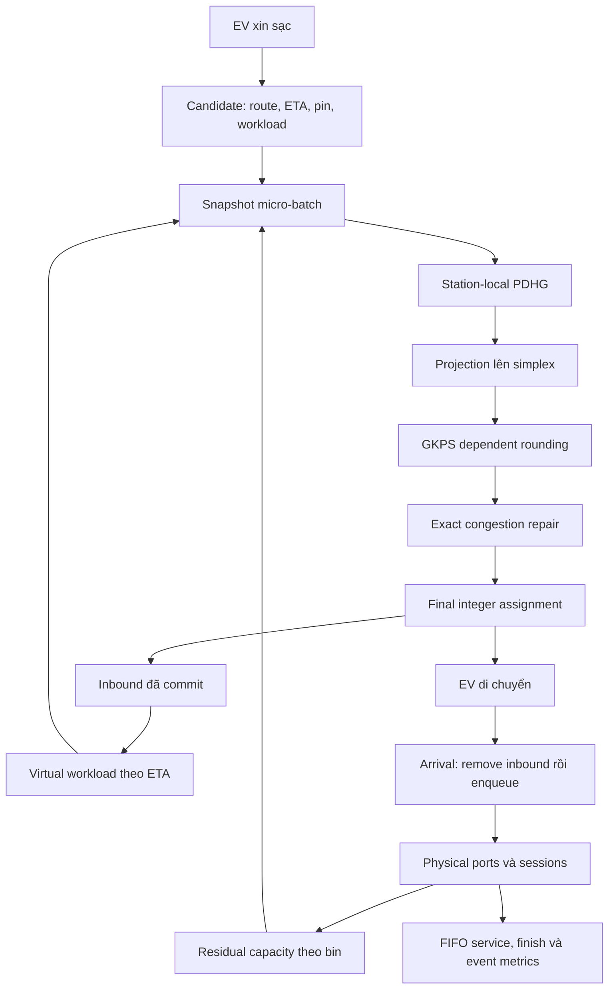

> Tài liệu lịch sử. Mô hình hiện hành: persistent-soc-activity-6 / intent-service-5; xem [hồ sơ khoa học](GAMA_RANR_SCIENTIFIC_CHANGES_VI.md).

> Tài liệu lịch sử: mô tả nguồn trước nâng cấp. Đối chiếu tại Git checkpoint `5800181`; hướng dẫn hiện hành ở [GAMA Run Guide](GAMA_RANR_RUN_GUIDE_VI.md).

**Mô tả thuật toán theo mã nguồn hiện tại — 08/10/2026**

Tài liệu này mô tả working tree hiện tại, sau lần bổ sung workload theo từng cặp EV–station. Đây là bản giải thích source, không phải tuyên bố toàn bộ nhánh mới đã được nghiệm thu. Các tài liệu IMPLEMENTATION_PLAN, NUMERICS và các báo cáo benchmark cũ còn có chỗ dùng workload cố định d_n; các kết quả ấy không tự trở thành kết quả của phiên bản d_nm/chi phí điện.

Đã đọc 30 file GAML, các Python package/scripts/tests, README, chín tài liệu cũ và cấu hình project; kiểm tra danh mục/schema/extents dữ liệu GIS, schema output và các báo cáo kiểm chứng. Không coi mã dependency trong .venv, chỉ mục GIS hoặc từng dòng CSV lịch sử là thuật toán do project định nghĩa.

Kiểm tra mới trong lượt mô tả: main compile PASS; 23 Python tests hiện có OK; Run me smoke fixed_port/proposed/step=1 chạy tới 120 giây và GIS_SMOKE_PASS. Logs: outputs/description_current_compile.log, description_current_python.log và description_current_smoke.log. Chưa có bộ nghiệm thu riêng đầy đủ cho d_nm, đối chiếu chi phí điện hay sạc tới 80% sau hành trình dài.

**1. Bài toán và quyết định cần đưa ra**

Đầu vào là một mạng đường, các trạm sạc cố định, trạng thái phục vụ tại từng trạm và các EV đang cần sạc. Với mỗi yêu cầu sạc, hệ thống phải chọn đúng một trạm tương thích mà EV đủ pin để tới, hoặc deferred nếu chưa có lựa chọn khả thi.

Mục đích của proposed là phối hợp các lựa chọn trong cùng batch để giảm tổng chi phí travel và congestion surrogate. Một trạm xa có thể được chọn nếu đường thoáng và khả năng phục vụ tương lai tốt hơn. Thuật toán không có ràng buộc bắt mọi trạm nhận số xe bằng nhau. Trạm ít khách không tự là lỗi.

Năng lượng có ba vai trò: lọc trạm có thể tới với reserve; tính workload cần sạc tại từng trạm để đạt SOC mục tiêu; và, khi bật time_energy, quy đổi chi phí điện phát sinh do đi đường thành phút tương đương.

Phạm vi hiện tại là EV→Station. Phục vụ thực do FIFO fixed-port đảm nhiệm. Chưa có robot, robot SOC, recharge/failure, robot routing hoặc Robot→EV scheduling. Tên robot-aware là hướng tích hợp tiếp theo, chưa phải thuộc tính đã có bằng chứng thực nghiệm của backend hiện tại.

**2. Các file thực hiện từng phần**

| Thành phần | Nội dung |
|---|---|
| models/main.gaml | Nạp GIS, tạo mạng đường/trạm/xe, dân số và giờ cao điểm, GUI, thống kê theo ngày |
| models/Mobility.gaml | Road/intersection/building, native driving, hệ số congestion, lịch trình xe |
| models/ChargingService.gaml | EV SOC, charging session, physical queue/ports, sạc thực, forecast fixed-port và mock |
| models/Traffic.gaml | Import entry point rất nhỏ cho service/mobility |
| models/Coordination.gaml | Candidate, ETA/energy/workload, inbound, batch, gọi solver và final commit |
| models/ConvexAssignment.gaml | Epigraph PDHG tại station, certificate, projection, GKPS, exact repair |
| models/PhaseA.gaml, PairedCapacity.gaml | Các snapshot capacity/workload kiểm chứng toán |
| models/CoordinationBenchmark.gaml, GISCoordinationBenchmark.gaml | Đối chứng nearest/proposed với demand được kiểm soát |
| models/tests | 20 file regression GAML |
| verification/model.py | Mô hình độc lập, PDHG, Clarabel convex reference, HiGHS MILP, enumeration |
| verification/recovery.py, io.py, events.py, run.py | Rounding/repair độc lập, đọc snapshot, event metrics và kiểm tra certificates |
| scripts | Launcher GAMA, compile/runtime checks, manifest và paired benchmarks |
| tests | 23 Python test methods hiện có và fixture proxy_miss |

Chuỗi import là main→Coordination→Traffic→ChargingService→Mobility, cùng với Coordination→ConvexAssignment. GAMA không gọi Python trong runtime.



**3. Bản đồ và trạm được giữ cố định như thế nào**

Các input thực sự được main sử dụng:

| Input | Số feature nguồn | Vai trò |
|---|---:|---|
| includes/line.shp | 5.491 | Đường và world envelope |
| includes/Middle.shp | 1.330 | Building |
| includes/final.shp | 615 | Building |
| includes/Part1.shp | 604 | Building |
| includes/Part2.shp | 469 | Building |
| includes/temporary_cs.shp | 11 | Vị trí, tên và số cổng trạm |

Tổng building là 3.018. Các file roads, cleaned_road, test_*, new_temporary_cs, official_vorenoi, population_based_ports_stations... có trong includes nhưng không tự được main chọn thay cho input trên. Có dataset khác CRS/schema, nên không thể coi tất cả là các lớp của một lần chạy.

Trước khi tạo graph, main chia polyline tại vertex xuất hiện trong nhiều source roads. Crossing không có vertex chung không được tự nối. Sau đó thêm đường ngược chiều: hiện đang giả định hai chiều, chưa thực thi quy tắc one-way từ một dataset giao thông được hiệu chỉnh.

Building và trạm dùng điểm tiếp cận trên connected component lớn nhất. Trạm giữ nguyên geometry/tọa độ nhưng access node có thể lệch tới 300 m. Hành trình kết thúc ở node tiếp cận, chưa mô phỏng đoạn vào bãi giữa node và trạm.

Số cổng được đọc từ dữ liệu, không do optimizer quyết định:

| Trạm | 250 kW | 180 kW | 150 kW | 60 kW | 30 kW | 11 kW |
|---|---:|---:|---:|---:|---:|---:|
| cs_1 | 0 | 0 | 0 | 2 | 1 | 0 |
| cs_2 | 0 | 0 | 0 | 4 | 0 | 2 |
| cs_3 | 0 | 0 | 0 | 4 | 2 | 2 |
| cs_4 | 0 | 0 | 0 | 4 | 2 | 2 |
| cs_5 | 0 | 0 | 0 | 17 | 0 | 4 |
| cs_6 | 0 | 0 | 0 | 0 | 3 | 1 |
| cs_7 | 0 | 0 | 4 | 0 | 0 | 0 |
| cs_8 | 1 | 0 | 0 | 20 | 4 | 4 |
| cs_9 | 0 | 0 | 0 | 12 | 0 | 0 |
| cs_10 | 0 | 0 | 0 | 14 | 0 | 0 |
| cs_11 | 0 | 2 | 0 | 14 | 0 | 0 |

ID nội bộ đi theo thứ tự nạp feature; nhãn cs_11 xuất hiện trước cs_9/cs_10 trong input. Vì vậy station có ID nội bộ nhỏ nhất không luôn là trạm có hậu tố tên nhỏ nhất.

**4. Ba đồng hồ phải phân biệt**

Engine dùng giây, mặc định step=1. Session/ETA/optimization dùng phút. Lịch sinh hoạt dùng simulation_hour=schedule_start_hour+time/3600.

Mỗi phút elapsed mới gom batch. Một bin dự báo dài năm phút. Solver chạy nhiều iteration bên trong một epoch; thời gian vật lý không tiến trong các iteration đó. Wall-clock runtime của solve được đo riêng. Hiện chưa mô phỏng xe tiếp tục chạy trong lúc chờ một solver/network thật trả lời.

Ví dụ step=1: 3.600 cycle tương ứng khoảng một giờ mô phỏng. Step=60: 60 cycle là một giờ. Đồng hồ GAMA 00:46:00 vẫn là 46 phút. Step=3.600 là chế độ rất thô và không phù hợp để kết luận waiting.

Xe thường bắt đầu hoạt động trong khoảng 05:00–07:00; nếu chạy từ nửa đêm thì nhiều biểu đồ service bằng zero trong những giờ đầu là phù hợp với demand. GUI có start hour và small smoke scenario để quan sát sớm.

**5. Mỗi lần xin sạc là một session riêng**

EV tự gọi begin_request khi idle/completed, SOC<30%, chưa needs_charging và chưa is_charging. Một lần gọi hợp lệ tạo req_ID mới, reset các timestamps/counters của session, lưu đích đang đi để có thể tiếp tục sinh hoạt sau sạc và ghi event request.

Luồng chính:

```text
requested → assigned → en_route → waiting → charging → completed
     ↘ deferred
active session → cancelled / stranded
```

Deferred được xét lại ở epoch sau. Cancelled không tự tạo request lại ngay tick kế tiếp. Một EV có tối đa một public request đang hoạt động. Home charging bị tắt khi bắt đầu public request; chỉ xe private đủ điều kiện, thực sự ở nhà, không public session mới có thể sạc ở nhà.

Xe chờ assignment vẫn có thể tiếp tục tuyến đang đi. Vì vậy vị trí/SOC/candidates được lấy mới tại epoch, không cố dùng vị trí lúc request đã cũ.

**6. ETA và năng lượng của candidate**

Với từng trạm tương thích, route_forecast trả [route_metres, travel_minutes]. Nếu EV đang ở trên đường, thêm phần còn lại của current road; nếu inbound đã commit, dùng phần còn lại của current_path thay vì tự thay bằng một route mới.

Road speed factor chung cho forecast và movement:

```text
factor(link) = max(0.1, min(1, speed_coeff(link)))
speed_coeff ≈ 1 − number_of_vehicles / road_capacity
```

Trong snapshot_speed:

```text
T_nm = Σ_link length_link / (nominal_EV_speed × factor_link) / 60
ETA_nm = epoch_min + T_nm
```

Nominal_speed thay factor bằng 1. Hệ số được giữ cố định trong một solve. Native drive còn có acceleration, giao lộ, tương tác xe và traffic thay đổi nên forecast không bằng thời gian thực một cách chính xác.

Quan trọng: path_between/compute_path đang dùng Dijkstra với policy graph hiện tại, thực tế theo road length. Code chưa tìm nhanh nhất trong tất cả các route đủ pin, chưa thực hiện energy-constrained shortest-time path. Trạm xa đường thoáng có thể thắng về ETA giữa các station, nhưng chưa thể khẳng định route tới mỗi station là route nhanh nhất khả thi về năng lượng. Candidate không giữ một route object để commit nguyên trạng; physical planner tính lại theo cùng graph policy, nên các path hòa điểm vẫn cần được kiểm chứng riêng nếu muốn bảo đảm đồng nhất tuyệt đối.

Mô hình energy hiện tuyến tính theo distance:

```text
E_current = battery_kWh × SOC / 100
E_travel_nm = consumption_kWh_km × route_metres / 1000
E_arrival_nm = E_current − E_travel_nm
```

Chưa có điện tiêu hao khi dừng chờ/điều hòa, quan hệ speed–consumption, độ dốc hoặc biên sai số forecast được calibrated. Giao thông ảnh hưởng ETA, còn energy trên cùng tuyến phụ thuộc quãng đường.

**7. Điều kiện giữ trạm và candidate modes**

Candidate cần compatible=true, có đường đi, và:

```text
E_arrival_nm ≥ reserve_SOC × battery_kWh / 100
```

Reserve mặc định 5%. Fixed_port còn yêu cầu installed_port_count>0. Port đang bận không bị xem là không có hardware; installed count tính cả các port đang charging. Capacity tương lai bằng zero không làm một trạm có phần cứng trở thành infeasible: nó làm tăng backlog.

ALL_FEASIBLE giữ mọi trạm đạt điều kiện; đây là mặc định của phiên bản điều phối 11 trạm. TOP_K giữ tối đa ba trạm ETA nhỏ nhất. Sắp tie theo thứ tự station nội bộ. Không có candidate thì deferred, không ép chọn trạm thiếu pin.

Nearest baseline chọn candidate có road distance nhỏ nhất; không chọn ETA nhỏ nhất và không xét queue/congestion. Với TOP_K thì baseline chỉ so trong subset đã giữ. Với ALL_FEASIBLE mới là so nearest trên toàn bộ trạm khả thi.

**8. Nhu cầu sạc theo SOC mục tiêu và d_nm**

Code hiện có hai semantics:

- fixed_request: chốt lượng điện lúc xin sạc; các candidate cùng workload, tương thích các fixture/benchmark cũ.
- target_soc: với mỗi candidate tính lại lượng điện để đạt target sau khi đã tiêu hao năng lượng đi đến đó. main hiện mặc định target_soc=80%; ChargingService mặc định fixed_request để các model import service cũ giữ semantics.

Trong target_soc:

```text
E_target = target_SOC × battery_kWh / 100
E_req_nm = max(0, E_target − E_arrival_nm)
d_nm = 60 × E_req_nm / (reference_efficiency × reference_power_kW)
```

Ví dụ EV 60 kWh, SOC30%=18 kWh, target80%=48 kWh, reserve=3 kWh:

| Đại lượng | A | B |
|---|---:|---:|
| Travel energy | 1 kWh | 3 kWh |
| Arrival energy | 17 kWh | 15 kWh |
| Arrival SOC | 28,33% | 25% |
| Request tới 80% | 31 kWh | 33 kWh |
| Workload ở reference 60 kW, efficiency .9 | 34,44 service-min | 36,67 service-min |

Cả A/B đều còn hơn reserve. B tạo job lớn hơn dù đi nhanh hơn. Các hệ số d_nm được cố định trong snapshot; A(x) vẫn affine nên tính convex được giữ.

Commit dùng E_req/d_nm của cạnh đã chọn. Khi arrival, remove inbound trước rồi tính lại E_req từ SOC thực và chuyển thành physical workload. Batch snapshot đã xuất giữ nguyên, không sửa ngược coefficient của solve trước. Do đó forecast error có thể tạo chênh giữa committed workload và workload thực; không được che nó bằng cách chỉnh lại snapshot cũ.

**9. Tiền điện và mục tiêu thực sự đang bật**

Cost mode hiện mặc định time_only:

```text
c_nm = T_nm
```

Năng lượng vẫn ảnh hưởng tính khả thi và d_nm. Nhưng time_only chưa trực tiếp phạt tiền điện, nên không được nói mặc định đã đánh đổi tiền với thời gian.

Nhánh mới time_energy tính:

```text
c_nm = T_nm + (electricity_price_VND_kWh / value_of_time_VND_min) × E_travel_nm
```

3.000 đ/kWh và 500 đ/phút là các giá trị synthetic đang có trong tham số, chưa phải dữ liệu tariff hoặc valuation đã hiệu chỉnh. Quy đổi cho ví dụ A travel20 phút, energy.6 kWh; B travel10 phút, energy1.8 kWh:

```text
A: direct cost = 20 + 1.800/500 = 23,6 phút tương đương
B: direct cost = 10 + 5.400/500 = 20,8 phút tương đương
```

Đó mới là direct cost; quyết định batch còn cộng congestion, không thay F bằng waiting được tự giả định. Với các waiting minh họa 10 và 3 phút, tiết kiệm17 phút/chi phí tăng3.600 đ có ngưỡng khoảng211,76 đ/phút. Đây là phép minh họa trade-off, không phải output waiting do solver hiện tại dự báo.

Giá hiện đồng nhất, theo battery-delivered kWh. Với cùng current energy và cùng target, phần năng lượng cần nạp cơ sở là hằng số giữa candidates; phần khác nhau do đường đi là E_travel. Vì vậy có thể dùng incremental travel electricity một lần để so lựa chọn. Không cộng E_req rồi lại cộng E_travel và vô tình tính khoản bù điện đường đi hai lần. Nếu muốn charging tariff khác nhau theo trạm, grid-input billing, phí giao dịch hoặc TOU thì cần mở rộng công thức riêng. Năng lượng trạm hiện vẫn là nguồn lưới; không có pin trạm, PV hoặc ngân sách năng lượng tổng.

**10. Micro-batch và frozen snapshot**

Mỗi epoch lấy các session requested/deferred, xây candidates, bỏ xe không có candidate khỏi solve và tạo batch_n. Chọn horizon:

```text
H = ceil((largest absolute ETA − epoch_min + 120 minutes) / 5 minutes)
```

Largest ETA gồm candidates của batch và unresolved inbound. Chỉ tạo assignment_station block cho các trạm xuất hiện trong candidates. Congestion tại trạm không có cạnh mới là hằng số đối với batch và không được cộng vào báo cáo objective của snapshot đó.

Mỗi cạnh assignment_edge biểu diễn một khả năng n→m, giữ EV/request, bin ETA, demand d_nm, direct cost c_nm, travel distance, raw x, projected xp, equality dual ν và integer z. Station block giữ C, inbound, Q, local inequality duals và backlog/price profiles.

Candidate, capacity, ETA, workload, cost và theta không đổi trong solve. Theta=.05×max(1, median edge cost). Khi time_only thì median là travel; time_energy thì gồm energy quy đổi. Source hiện chưa chia toàn bộ objective cho một scale s trước PDHG; việc chọn theta theo scale không đồng nghĩa objective đã được normalize như một phiên bản kế hoạch trước đó.

**11. Virtual inbound và chống quên demand giữa các batch**

Một EV đã assign nhưng còn di chuyển chưa có trong physical queue. Mỗi station giữ ledger local theo request_id: inbound_work, inbound_eta, inbound_ev và inbound_data.

Aggregate về ETA bins tạo:

```text
H_vir[m,h] = Σ valid committed requests tới m trong bin h d_chosen
Am,h (`5800181:docs/x`) = H_vir[m,h] + Σ_current_batch δ[n,m,h] d[n,m] x[n,m]
```

Fractional x và preliminary rounding không ghi ledger. Chỉ final repaired z commit. Refresh cập nhật ETA từ remaining committed route; workload vẫn là lượng đã chốt lúc commit cho tới arrival. Cancellation/stranded/removal được remove. Reliability=1 khi request còn hiệu lực; không decay tùy ý. Hiện không có calibrated uncertainty, TTL/late eviction hoặc mô hình xác suất arrival.

Arrival phải remove ledger trước/đồng thời physical enqueue. Physical forecast không đọc inbound. Như vậy một request chưa đến ảnh hưởng A, còn request đã đến ảnh hưởng residual C thông qua physical commitments; không đếm hai lần.

**12. Oracle tạo residual capacity C_mh**

Mock chỉ trả fixture: constant; drop ở một đoạn horizon; recovery sau đoạn đầu; heterogeneous theo station. Mock không chạy robot và không điều khiển physical service.

Fixed_port forecast đọc free ports, active sessions, remaining delivered energy, battery headroom, completion_pending và FIFO waiting queue. Nó tạo bản sao local gồm port rates và free_at; không thay đổi SOC, queue, ports, RNG hay events.

Port r có công suất P_r, một active job còn e_r kWh thì thời gian bận dự kiến:

```text
t_busy = 60 e_r / (physical_efficiency × P_r)
```

Release được làm tròn lên physical dispatch tick; completion_pending dùng finish đã ghi và tick release. Sau đó gán lần lượt physical waiting jobs cho port r sẵn sàng sớm nhất; tie chọn P_r lớn nhất, tương ứng policy nhanh nhất trong các port đang rảnh của physical service.

Sau khi đã giữ chỗ cho các physical jobs, port r có free_at=f_r tính từ epoch. Với bin [l_h,u_h]:

```text
idle_minutes[r,h] = max(0, u_h − max(l_h,f_r))
C[m,h] = Σ_r idle_minutes[r,h] × physical_efficiency × P_r
         / (reference_efficiency × reference_power)
```

C có đơn vị equivalent reference-service minutes. Ở reference60kW/.9, một port60kW/.9 rảnh năm phút cho C=5; port30kW cho2,5. Khi physical efficiency thay đổi, đơn vị workload không đổi vì reference efficiency được giữ riêng.

Đây là residual interval capacity sau các physical commitments, không là tổng port nameplate power. Source trả C trực tiếp; chưa tạo shadow robot rollout hay S_res từ robot. Có thể lấy cumulative sum C để biểu diễn S, nhưng không được dùng cumulative capacity như capacity của từng bin.

Acceptance fixture đã có: cùng một waiting job cần một service-minute, active job còn1min cho C=[3,5]; active còn6min cho C=[0,3]. Forecast phải khác dù queue length giống nhau. Inbound1000 thêm vào ledger không được làm C đổi.

**13. Causal backlog loại phantom capacity**

Chọn convention arrival ở cuối bin. Với q_before_first=0:

```text
q[m,h] = A[m,h] + max(0, q[m,h−1] − C[m,h])
```

C_h chỉ xử lý backlog đã có trước arrival cuối bin. Dịch vụ không dùng trong bin hết hiệu lực; không tích trữ. Ví dụ C=[50,10], A=[20,0] thì q=[20,10]. Nếu dùng max(0,prev+A−C) thì20 workload bị xóa bằng50 service xuất hiện trước arrival, gây phantom capacity.

q là lượng công việc tồn, không phải số xe. Physical queue đã được oracle trừ vào residual service, nên q0=0 không có nghĩa physical queue trống. Không dùng hard assigned_demand≤capacity; overload dẫn tới backlog và chi phí lớn, không làm primal vô nghiệm.

**14. F và marginal congestion price**

```text
F_m(A_m) = Σ_h Delta_h q[m,h] / d_ref
```

Delta mặc định5min; d_ref30service-min. F có đơn vị phút nhưng là fluid workload-holding congestion surrogate, không là waiting của một EV. Ngay workload vào cuối bin vẫn có holding charge của bin đó; có F>0 không chứng minh EV đã chờ tương ứng từng ấy phút.

Mỗi q_h là affine arrival cộng max của0 và một convex function. Induction cho q_h convex, F convex. Capacity được cố định và không phụ thuộc x trong snapshot.

Subgradient dùng forward q rồi backward:

```text
b[h] = 1 nếu q[h−1] > C[h], ngược lại 0
pi[H] = Delta_H / d_ref
pi[h] = Delta_h / d_ref + b[h+1] pi[h+1]
gamma[n,m] = d[n,m] pi[m,ETA_bin(n,m)]
```

Tại equality chọn inactive branch0 nhất quán. π có đơn vị phút/service-minute; gamma có đơn vị phút. Downstream persistence đã có trong π, không cộng lại prices tất cả future bins vào gamma.

PDHG giải epigraph trực tiếp bằng dual variables; code không lấy pi rồi chạy một softmax heuristic mỗi vòng. price_profile phục vụ diễn giải/proxy repair và xuất metrics.

**15. Primal convex thống nhất**

```text
min J_theta(x) = Σ_n Σ_m c[n,m] x[n,m]
               + Σ_m F_m(A_m(x))
               + theta Σ_n Σ_m x[n,m] ln x[n,m]

subject to x[n,m] ≥ 0, Σ_m∈M_n x[n,m] = 1
```

Quy ước0ln0=0. d_nm, c_nm và ETA cố định nên A affine. F convex, entropy convex. Với theta>0, assignment x có unique optimizer trên nonempty candidate simplices; không khẳng định auxiliary epigraph/raw iterates unique. Theta=0 có thể nhiều optimizer.

Ở optimum, với một subgradient phù hợp KKT, generalized marginal cost là c_nm+d_nm*pi_mh; entropy cho cấu trúc Gibbs/softmax. Điều đó không biến mỗi intermediate PDHG x hay price_profile chọn nhánh cố định tại kink thành một nghiệm KKT đã đạt.

Integer objective bỏ entropy:

```text
J_int(z) = Σ c_nm z_nm + Σ F_m(H_vir + integer arrivals)
```

Time_only dùng travel+F; time_energy dùng travel+incremental electricity quy đổi+F. Cả hai không trực tiếp tối ưu exact discrete Waiting hay station grid supply scheduling.

**16. Candidate-overlap graph và local ownership**

Hai station nối nhau trong optimization graph nếu cùng là candidate của một EV. Mỗi EV tạo clique các station ứng viên. Graph có thể có nhiều component. Minimum internal station ID làm representative của component.

Mỗi station giữ local x edges/Q/λ và capacity/inbound. Equality Σ_m x_nm=1 là coupling. Mỗi station candidate giữ một ν copy của EV đó; đồng bộ iteration giúp các copies nhận cùng residual, cùng khởi tạo0 nên phải giống nhau.

Logical solver payload là shared EV index và extrapolated xbar. Chi tiết queue, capacity profile hoặc raw service state không cần nằm trong payload solver. Tuy vậy một GAMA world chung vẫn có quyền truy cập agents; đây là decomposition/message-boundary, không phải cryptographic privacy hoặc một hệ thống vận hành trên nhiều máy.

Driver toàn cục tạo snapshot, tìm component, thiết lập step và barrier, tổng hợp stopping metrics. Station tính local primal/dual updates. Không nên gọi toàn bộ simulator là một network deployment không có điều phối nào.

**17. Epigraph mà PDHG thực sự giải**

Ký hiệu Q_mh=q_mh/d_ref là biến phụ dimensionless, khác physical queue. Với a_nm=d_nm/d_ref và H=H_vir:

```text
Σ_edges bin h a_nm x_nm − Q_mh                       ≤ −H_mh/d_ref
Σ_edges bin h a_nm x_nm + Q_m,h−1 − Q_mh             ≤ (C_mh−H_mh)/d_ref
Σ_m x_nm                                              = 1
0 ≤ Q_mh ≤ U
```

Q_before_first=0. Objective là Σ c x +thetaΣxlnx+Σ Delta Q. U=(tổng inbound trên active stations+tổng d trên mọi candidate edge)/d_ref, một upper bound toàn batch an toàn nhưng có thể lỏng.

Đặt p=(x,Q), gom các rows thành Kp≤b và equality rows. GAML không lưu K dense, thực hiện các tích bằng cấu trúc station/edge. Python build_operator dựng matrix để tái tạo cùng equations.

Initialization thực tế: x uniform theo candidate count; xbar=x; Q=Qbar=0; λ1=λ2=ν=0. Không khởi tạo Q bằng forward backlog recursion như một bản plan cũ.

Code dùng một step toàn batch:

```text
||K||F² = M_active(3H−1) + Σ_edges [1+2(d_nm/d_ref)²]
tau = sigma = .99 / ||K||F
```

Đây chưa là step riêng từng component. Frobenius norm ≥spectral norm nên tau*sigma*||K||²<1. Không suy ra linear convergence hoặc convergence khi communication bất đồng bộ/delay tùy ý.

**18. Một iteration PDHG chi tiết**

Trước iteration, các cạnh nhận tổng xbar của cùng EV. Station chỉ broadcast giữa shared candidates.

Tại station m, tính Lbar_h=H_h+Σ d_nm*xbar_nm. Cập nhật duals:

```text
lambda1_h ← max(0, lambda1_h + sigma(Lbar_h/d_ref − Qbar_h))
lambda2_h ← max(0, lambda2_h + sigma(Lbar_h/d_ref + Qbar_(h−1)
                                   − Qbar_h − C_h/d_ref))
nu_n(copy) ← nu_n(copy) + sigma(Σ_candidates xbar_nm − 1)
```

Sau đó assignment update:

```text
v_nm = x_nm − tau[c_nm + nu_n + (d_nm/d_ref)(lambda1_h+lambda2_h)]
x_new_nm = prox_(tau theta x ln x + x≥0)(v_nm)
xbar_nm = 2x_new_nm − x_nm
```

Với theta>0, giải scalar equation trong log coordinate ell:

```text
exp(ell) + tau theta(1+ell) = v_nm
x_new = exp(ell)
```

Source dùng52 bisections, ell từ−745 tới ln(max(1,v)). Theta=0 dùngmax(0,v). Raw x có thể>1 khi equality chưa feasible; xbar còn có thể ngoài nonnegative domain. Không dùng raw values làm physical assignment.

Epigraph update:

```text
Q_new_h = clip(Q_h − tau[Delta_h − lambda1_h − lambda2_h
                         + lambda2_(h+1)], 0, U)
Qbar_h = 2Q_new_h − Q_h
```

Lambda2 sau cuối horizon bằng0. Mọi dual update hoàn thành trước primal update; các station dùng cùng snapshot và synchronization barrier. Không thay theta giữa iterations.

**19. Projection, stopping và timeout**

Cứ20 iterations hoặc cuối budget:

1. Chiếu từng raw assignment row lên simplex bằng sorted threshold: xp_i=max(0,x_i−threshold), tổng xp=1.
2. Tính raw equality/epigraph maximum residual; tính disagreement giữa ν copies.
3. Từ xp recompute A→causal q→F để có feasible objective, thay vì tin Q raw đang có thể infeasible.
4. Tính certified LB và relative gap.

Dừng chỉ khi raw residual≤1e−6, ν-copy disagreement≤1e−6 và relative gap≤1e−7. Mặc định20.000 iterations. Điều kiện so với Clarabel trong verification là relative reference objective error≤1e−5, không phải cùng một đại lượng với certified primal–dual gap.

Nếu hết budget, status=timeout. Vẫn dùng projected xp để rounding/repair tạo quyết định khả thi, nhưng không gọi relaxed iterate là optimum. Projected feasibility không đồng nghĩa optimizer đã hội tụ.

**20. Lower bound, entropy bias và upper bound**

Với B=Σ_n ln|M_n|:

```text
J0* − theta B ≤ Jtheta* ≤ J0*
```

Không lấy approximate relaxed primal objective làm LB. Code tính infimum Lagrangian với λ≥0, equalityν unrestricted, trên x∈[0,1],Q∈[0,U]. Box chứa toàn bộ feasible primal nên vẫn cho lower bound hợp lệ dù prox numerical chỉ ép x≥0.

Đặt g_x=c+K_x^T y, g_Q=Delta+K_Q^T y:

```text
x_min = min(1, exp(−1−g_x/theta))  nếu theta>0
min_x contribution = min(0,g_x)     nếu theta=0
min_Q contribution = U min(0,g_Q)
LB_theta = −b^T y + tổng các minima scalar
```

Equality constant−ν chỉ tính một lần mỗi EV. Entropy dual LB đã≤integer objective không entropy, vì entropy bằng0 tại binary z. Không cần trừ entropy bias thêm lần nữa.

UB là J_int của final feasible z trên cùng snapshot. Báo UB−LB hoặc normalized gap nếu thích hợp. Gap là của surrogate snapshot, không phải certificate cho exact actual Waiting. LB có thể âm; tránh normalized gap gây hiểu sai khi denominator nhỏ hoặc không dương.

**21. GKPS: từ phân số tới một trạm thật**

Không argmax độc lập từng EV. Với100 EV đều .51/.49, argmax đẩy100 xe tới một trạm; dependent rounding cho51/49 trong fixture có station fractional degree nguyên.

Representative xét bipartite graph EV–station của component, chỉ giữ fractional edges. DFS tìm even cycle; nếu không có cycle, lấy maximal path trong forest. Chia trail edges luân phiên plus/minus.

```text
alpha = min(1−z trên plus, z trên minus)
beta  = min(z trên plus, 1−z trên minus)

với xác suất beta/(alpha+beta): plus +=alpha, minus -=alpha
còn lại:                      plus -=beta,  minus +=beta
```

Mỗi step giữ kỳ vọng của từng cạnh và làm ít nhất một fractional edge thành0/1. Bảo vệ active ancestor, parent chain, cycle chẵn, path không lặp, step>0 và số fractional edges giảm. Giá trị trong1e−10 ở hai đầu được snap về0/1.

Mỗi EV cuối cùng degree1. Station counts có floor/ceil behavior trước repair; không bảo đảm tổng heterogeneous service workload chính xác bằng expectation. RNG rounding dùng LCG riêng và lưu state; không dùng chung RNG sinh mobility.

**22. Exact congestion repair sau rounding**

Recompute integer backlog/prices. Với EV đang tại m, thử chuyển sang candidate j:

```text
proxy = c_nj−c_nm + d_nj*pi_j,h(n,j) − d_nm*pi_m,h(n,m)
```

Với d phụ thuộc station phải dùng hai workload khác nhau. Dạng d_n(pi_j−pi_m) chỉ đúng khi d_nj=d_nm.

Sort mọi relocation theo proxy. Code kiểm exact lần lượt: năm move đầu trước, rồi phần còn lại nếu chưa accept. Move đầu tiên có:

```text
Delta_exact = (c_nj−c_nm)
             + [F_m sau remove − F_m hiện tại]
             + [F_j sau add − F_j hiện tại] < −1e−6
```

được nhận, rồi recompute hai stations và bắt đầu vòng mới. Đây là first-improvement, chưa phải kiểm đủ top5 rồi chọn best exact trong top5 như một phiên bản plan.

Local delta chỉ tính lại suffix từ ETA bin liên quan, giữ backlog prefix. Proxy không bao giờ tự quyết định accept. Nếu không move nào cải thiện sau full scan thì dừng. Finite assignments và strict decrease cho finite termination tới1-exchange local optimum trong tolerance. Không có guarantee global optimum hoặc constant-factor approximation.

Rounding marginal-preservation chỉ áp dụng trước repair; repair có chủ ý đổi marginals để giảm objective.

**23. Final commit, đến trạm và sạc thực**

Chỉ sau recovery, commit mỗi z_nm=1: gán station, commit_time, assigned ETA/forecast energy, chosen energy request/workload; ghi assigned; thêm inbound; native compute_path; ghi en_route. V1 giữ trạm sau commit, không tự đổi station do congestion biến động.

EV di chuyển theo native driving. Quãng đường mỗi bước lấy chênh lệch remaining route length, gồm curved/multiple segments, không lấy khoảng cách thẳng giữa hai positions. SOC giảm theo consumption×metres. Arrival chờ đến cuối interval đã di chuyển, tránh station phục vụ trước khi xe thực sự đến. Nếu xe ở sẵn access node thì có thể arrival ngay lúc commit.

Station enqueue idempotent: live EV, đúng assigned station, active state và chưa arrival. Remove inbound, reconcile target energy nếu target_soc, ghi arrival và đưa vào FIFO waiting_queue. Chỉ service backend chọn port và chuyển waiting→charging.

Port được chọn theo thứ tự công suất250,180,150,60,30,11 kW trong các port rảnh. EV đầu queue được phục vụ trước. Không đồng thời ở waiting và charging. Waiting=start−arrival, xe được cấp port ngay có waiting0.

Mỗi step:

```text
energy_delivered = min(request_remaining, battery_headroom,
                       physical_efficiency × port_power × seconds/3600)
grid_energy += energy_delivered/physical_efficiency
SOC += 100 energy_delivered/battery_kWh
```

Finish ghi theo thời lượng thực của bước cuối bị clip. Port vẫn occupied ở completion_pending tới khi simulation clock đạt finish, rồi mới release và ghi completed đúng một lần. Requests đang sạc không bị reset khi qua ngày.

Cancellation/death cleanup loại inbound/waiting/physical record và release port một lần. Metadata local còn tồn tại khi EV đã bị xóa giúp ghi terminal event mà không đọc thuộc tính dead agent.

**24. Đo chất lượng, logs và vị trí output**

Ba đại lượng đánh giá chính lấy từ events:

```text
Actual Travel  = arrival − commit
Actual Waiting = service_start − arrival
Actual Total   = service_start − commit
```

Service duration/finish, completed throughput, mean/P95 Waiting, zero waits, deferred/cancelled/stranded/unfinished và unstarted được báo riêng. ETA bias/MAE là forecast diagnostics, không phải Waiting.

New event columns có SOC, forecast/actual travel kWh và incremental money; candidate CSV có arrival energy/E_req/d_nm/direct cost. Có một điểm cần kiểm chứng trước dùng money làm kết luận: total_distance hiện tích lũy từ request khi needs_charging=true, còn Actual Travel time bắt đầu từ commit. Nếu xe di chuyển trong lúc chờ batch, energy/distance event cohort đang gồm đoạn trước commit; cần thống nhất denominator/cohort hoặc tách distance từ commit.

Một số tên cột legacy `edges.travel_min` và `metrics.travel_cost_min` hiện chứa c_nm. Trong time_energy chúng là direct cost phút tương đương gồm điện, không còn pure travel minutes. Dùng candidates.travel_min cho ETA travel và candidates.direct_cost_min cho chi phí kết hợp; cần đổi nhãn legacy trước khi xuất biểu đồ nghiên cứu về money.

Main/controlled runs tạo thư mục riêng với prefix in trong RUN_OUTPUT_PREFIX và monitor Results directory. Có output lịch sử cả ở outputs/ và models/outputs/ do cách resolve relative paths giữa root/import/GUI; không đoán file mới nhất chỉ từ tên run_*. Lấy absolute prefix thực của run. includes/accumulate_properties.csv là file cũ hiện chỉ có header, không còn đích ghi của code mới.

Mỗi run: config, events, station snapshot, status, IO và daily_statistics cho main. Mỗi batch: config, edges (xp/raw_x/z), bins (C/inbound/q/pi), station_map, candidates và metrics (LB/UB/gap/residual/iterations/rounding/repair/messages/runtime).

Event file append phần mới qua cursor; flush không có event không rewrite. History vẫn ở RAM; status còn quét history và các snapshot nhỏ vẫn rewrite. daily_statistics là cumulative mean/sums, không phải độc lập từng ngày. Manifest checksum tạo offline; nếu file manifest tồn tại thì main copy vào run, không tự gọi Python tính checksum tại runtime.

**25. Communication và chi phí tính toán thực tế**

Solver broadcast có Σ_n K_n(K_n−1) logical messages mỗi iteration, mỗi payload tính16 byte cho request index và xbar. Các phase rounding/repair cộng counters theo số remote edges/stations/exact checks với kích thước giả định32/64 byte hoặc profile scalar.

Source không serialize UTF-8 JSON và không tính hop-by-hop routing tới representative. Recovery representative truy cập agents của component trong GAMA trực tiếp, kể cả station không phải neighbor trực tiếp. Vì vậy phần plan chuyển recovery messages qua overlap edges và đo actual JSON bytes chưa được triển khai. Chỉ solver candidate exchange có cấu trúc clique overlap đúng như mô tả.

Arithmetic kernel PDHG có O(E+M_active H), nhưng GAML filters/candidate scans/projection/stopping còn overhead. Global U/norm có thể làm step rất nhỏ. GKPS dựng lại graph qua nhiều step; repair sort O(R logR) và exact suffix recomputations, trong đó R=Σ(K_n−1). Không được từ kernel complexity suy ra runtime city-scale đã đạt.

Python build_operator hiện tạo dense matrix trước khi chuyển CSR, nên memory còn tốn O((2MH+N)(E+MH)); package offline không phải solver sparse large-scale hoàn chỉnh chỉ vì kết quả cuối là CSR.

**26. Kiểm chứng đang có và những điều chưa được chứng minh**

Reference độc lập: CVXPY/Clarabel giải convex epigraph, SciPy/HiGHS giải integer/MILP, tiny enumeration duyệt hết assignments. Python PDHG replay theo đúng exported budget/tolerances và từng edge workload; `edge_demand` là dữ liệu chuẩn cho d_nm, trường d EV-only còn để tương thích fixture cũ.

Các regression hiện có kiểm phantom capacity, subgradient, entropy prox scalar, theta0/dương, overloaded/zero capacity, one-candidate/disconnected components,51/49/marginals/long chains, full repair neighborhood, LB≤integer optimum≤UB, physical idempotence/resource release, clock/GIS/map/access và append events.

Bằng chứng của phiên bản trước nhánh d_nm/money:30 roots compile,26 GAMA runtime checks,23 Python tests,11 mock snapshot comparisons và8 paired physical runs PASS. Trên synthetic fixtures, mean Travel+Waiting trước/sau lần lượt near_busy30→1,97min; burst75→30,98; light.95→.95; GIS controlled cs1 busy30→2,53. Đây không phải số liệu đô thị đã calibrated, không phải bằng chứng mới của time_energy.

Timeout được giữ: hai PhaseA N30 cases timeout20.000; controlled burst/GIS cũng timeout default. Extended cùng equations: burst hội tụ94.340; GIS vẫn timeout200.000 dù GAML/Python khớp. Không nói solver mọi batch đều hội tụ trong budget.

Trong lượt đọc này chỉ chạy lại compile main,23 tests và smoke120s hiện tại; chưa rerun toàn bộ benchmark sau target_soc/money changes. Chưa có case acceptance riêng cho1kWh/3kWh→31/33kWh, target80% thực sau forecast error, tariff trade-off và proxy d_nj≠d_nm. Đây là hạng mục cần kiểm chứng trước khi gọi nhánh mới hoàn tất.

Các phần chưa có: real robot scheduler/oracle, network transport/latency/loss, fastest energy-feasible route search, calibrated congestion/consumption/ETA uncertainty, individual exact waiting predictor, full48h experiment với24h warm-up và scalability toàn thành phố. B1 nearest và proposed có runtime policy; B10/B11 có offline references. Danh sách toàn bộ B1–B11 trong tài liệu nghiên cứu không có nghĩa tất cả đã là selectable runtime baselines.

**27. Pseudocode toàn pipeline theo source**

```text
Khởi tạo GIS/graph/stations/vehicles, physical clock và output prefix

Mỗi physical tick:
    Reconcile request/session của xe chết hoặc bị xóa
    Materialize các arrival đã tới cuối interval
    Station finalize completion đủ giờ, dispatch FIFO và tích phân charging energy
    Xe cập nhật lịch/drive/SOC và tạo charging requests khi cần
    (GAMA thực hiện theo thứ tự reflex của model; đây là nhóm trách nhiệm, không API callback song song)

Mỗi coordination epoch:
    Refresh inbound ETA, cleanup invalid requests
    Lấy requested/deferred EVs
    Với mỗi EV/station:
        Forecast distance và ETA trên cùng route policy
        Tính travel energy, arrival reserve, compatibility
        Giữ ALL_FEASIBLE hoặc TOP_K
        Tính E_req_nm/d_nm và c_nm theo modes hiện tại
    Nếu batch không có candidates: giữ deferred, kết thúc epoch
    Freeze snapshot và theta; tạo H/horizon và active station blocks
    Station forecast C chỉ từ physical state; aggregate ledger thành H_vir
    Nếu nearest: chọn candidate có distance nhỏ nhất
    Nếu proposed:
        PDHG synchronous local updates tới convergence hoặc timeout
        Project raw x thành feasible xp
        Mỗi component representative chạy GKPS
        Recompute integer backlog/prices
        Proxy-sort, exact first-improvement repair tới full-scan local optimum
    Export frozen optimization snapshot
    Chỉ final z mới commit station/E_req/demand/ETA vào inbound và route EV

Khi actual arrival:
    Remove inbound một lần
    target_soc mode reconcile energy từ SOC thực
    Add physical FIFO job, ghi arrival
    Backend cấp port → start event; charging → finish event → release

Xuất event metrics Travel/Waiting/Total độc lập với F và certificates
```

Thuật toán nghiên cứu hiện có thể mô tả chính xác là: **điều phối EV→Station theo micro-batch, với ETA snapshot, energy-feasible candidates, station-dependent charging workload, virtual inbound, causal residual capacity, convex workload congestion, synchronous PDHG và GKPS kèm exact local repair**. Money là mode tùy chọn mới; Robot-aware là giai đoạn chờ tích hợp thật.
