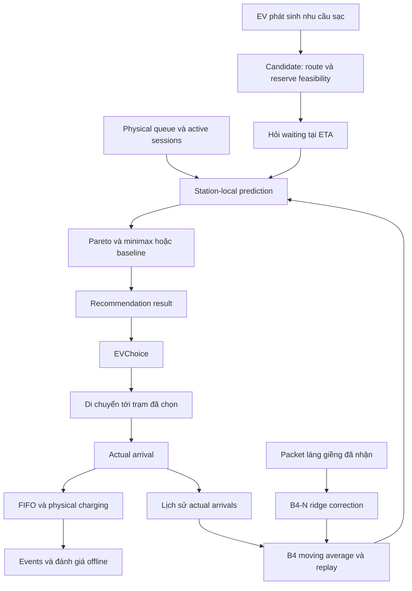
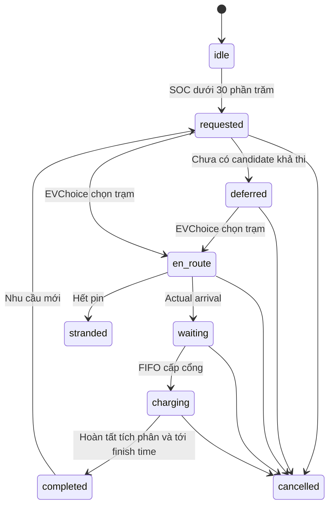

# Mô tả toàn bộ hệ thống và thuật toán khuyến nghị trạm sạc EV

> **Phạm vi:** tài liệu này mô tả hệ thống GAMA B3/B4/B4-N lịch sử. Pipeline chính hiện là RANR GAMA: xem [hướng dẫn chạy](GAMA_RANR_RUN_GUIDE_VI.md) và [thay đổi khoa học](GAMA_RANR_SCIENTIFIC_CHANGES_VI.md). Pipeline Python tại [RANR_METHODS_VI.md](RANR_METHODS_VI.md) đã được lưu làm reference lịch sử.

**Ngày đối chiếu mã:** 09/10/2026, múi giờ Asia/Bangkok.  
**Phạm vi:** mã GAML, dữ liệu GIS được `main.gaml` sử dụng, Python reference, scripts kiểm chứng và các kết quả đã lưu trong project.  
**Tên kiến trúc:** Distributed Observation-Driven Charging Recommendation.  
**Runtime được sử dụng trong kiểm chứng đã lưu:** GAMA 1.9.3 / Java 17.

Tài liệu mô tả **hệ thống thực sự được cài đặt tại thời điểm đối chiếu**, phân biệt với mục tiêu nghiên cứu và các phần chưa hoàn thành. Việc một chức năng có trong mã không đồng nghĩa đã chứng minh nó cải thiện waiting trên GIS Nha Trang. Đây là tài liệu nguồn; không thay thế log nghiệm thu hoặc dữ liệu thí nghiệm.

**Sơ đồ trực quan:** [10 flowchart chi tiết theo mã hiện tại](SYSTEM_FLOWCHART_VI.md), kèm ảnh SVG/PNG, Mermaid và [PDF toàn bộ sơ đồ](flowcharts/SYSTEM_FLOWCHART_VI.pdf).

## Mục lục

1. [Bài toán, mục tiêu và phạm vi](#1-bài-toán-mục-tiêu-và-phạm-vi)
2. [Kiến trúc, module và nơi ra quyết định](#2-kiến-trúc-module-và-nơi-ra-quyết-định)
3. [GIS, mạng đường và phần cứng 11 trạm](#3-gis-mạng-đường-và-phần-cứng-11-trạm)
4. [Đồng hồ, cycle, epoch và bin](#4-đồng-hồ-cycle-epoch-và-bin)
5. [Dân số xe, lịch hoạt động và rush](#5-dân-số-xe-lịch-hoạt-động-và-rush)
6. [Trạng thái EV và vòng đời session](#6-trạng-thái-ev-và-vòng-đời-session)
7. [Candidate, route, ETA, năng lượng và workload](#7-candidate-route-eta-năng-lượng-và-workload)
8. [Recommendation, EVChoice và intention](#8-recommendation-evchoice-và-intention)
9. [Pareto, normalized regret và minimax](#9-pareto-normalized-regret-và-minimax)
10. [Các quy tắc đối chứng](#10-các-quy-tắc-đối-chứng)
11. [B3: dự báo từ trạng thái vật lý](#11-b3-dự-báo-từ-trạng-thái-vật-lý)
12. [B4: thống kê local và historical replay](#12-b4-thống-kê-local-và-historical-replay)
13. [B4-N: giao tiếp và ridge online](#13-b4-n-giao-tiếp-và-ridge-online)
14. [LIVE, LIMITED, cache và độ cũ thông tin](#14-live-limited-cache-và-độ-cũ-thông-tin)
15. [Nhiều yêu cầu, feedback và herding](#15-nhiều-yêu-cầu-feedback-và-herding)
16. [Physical FIFO, công suất và tích phân năng lượng](#16-physical-fifo-công-suất-và-tích-phân-năng-lượng)
17. [Benchmark ideal assignment: PDHG, GKPS, repair](#17-benchmark-ideal-assignment-pdhg-gkps-repair)
18. [Toàn bộ cấu hình và cách so sánh phương pháp](#18-toàn-bộ-cấu-hình-và-cách-so-sánh-phương-pháp)
19. [Output, schema và lưu dữ liệu khi Pause](#19-output-schema-và-lưu-dữ-liệu-khi-pause)
20. [Metrics và cách đánh giá đúng](#20-metrics-và-cách-đánh-giá-đúng)
21. [Thiết kế thí nghiệm và kết quả có bằng chứng](#21-thiết-kế-thí-nghiệm-và-kết-quả-có-bằng-chứng)
22. [Kiểm thử, bất biến và cách chạy kiểm chứng](#22-kiểm-thử-bất-biến-và-cách-chạy-kiểm-chứng)
23. [Chi phí tính toán và giới hạn triển khai](#23-chi-phí-tính-toán-và-giới-hạn-triển-khai)
24. [Các giới hạn nghiên cứu và phần chưa cài đặt](#24-các-giới-hạn-nghiên-cứu-và-phần-chưa-cài-đặt)
25. [Ví dụ xuyên suốt một yêu cầu sạc](#25-ví-dụ-xuyên-suốt-một-yêu-cầu-sạc)
26. [Tra cứu action, thuật ngữ và nguồn](#26-tra-cứu-action-thuật-ngữ-và-nguồn)
27. [Dấu vân tay mã nguồn tại thời điểm mô tả](#27-dấu-vân-tay-mã-nguồn-tại-thời-điểm-mô-tả)

## 1. Bài toán, mục tiêu và phạm vi

### 1.1. Đầu vào và quyết định

Một EV đang di chuyển trên mạng đường Nha Trang có SOC, lịch hoạt động và nhu cầu sạc. Hệ thống cần khuyến nghị một trạm:

- Có route tới điểm tiếp cận trạm.
- Có dịch vụ tương thích và cổng sạc được lắp.
- EV đủ năng lượng để tới, vẫn giữ SOC dự trữ.
- Có thông tin dự báo hợp lệ để xếp hạng.

Các tiêu chí chính là thời gian di chuyển, quãng đường, năng lượng di chuyển và waiting dự báo **tại ETA**, không chỉ queue hiện tại. Nếu chưa có lựa chọn hợp lệ, hệ thống trả unavailable/deferred theo trường hợp; EV có thể trì hoãn.

### 1.2. Recommendation khác assignment

| Khái niệm | Ý nghĩa | Đổi destination? | Thêm physical workload? |
|---|---|---|---|
| Recommendation | Engine đề xuất một trạm | Không | Không |
| Choice | EV chọn một hành động/trạm | Có, qua EVChoice | Chưa |
| Intention | EV chủ động thông báo ý định | Không tự đổi | Không |
| Actual arrival | Xe thực sự đến điểm tiếp cận trạm | Kết thúc hành trình tới trạm | Có, qua enqueue |
| Ideal assignment | Quyết định bắt buộc trong benchmark riêng | Có, qua hard commit | Ghi inbound; physical queue vẫn đợi arrival |

V1 chủ ý không coi recommendation là đặt chỗ. Xe chưa đến không được thêm vào queue thật. Việc gửi intention cũng không bảo đảm xe sẽ thực hiện.

### 1.3. Ý nghĩa của mục tiêu minimax

Minimax là quy tắc cân bằng mức bất lợi tương đối giữa các tiêu chí của **một EV tại một thời điểm**. Nó không tối thiểu trực tiếp tổng waiting toàn thành phố, không tối thiểu hóa tiền điện khi thiếu hệ số, và không tối ưu đồng thời các lựa chọn của mọi EV trong recommendation runtime.

Trong kế hoạch nghiên cứu, **B4 là phương pháp chính**, B3 là baseline vật lý, B4-N là đóng góp cần kiểm chứng. Không được xem việc có neighbor learning là bằng chứng mặc định về cải thiện.

### 1.4. Những gì hệ thống không quyết định

Vị trí trạm, số cổng, bản đồ và công suất danh định được lấy từ dữ liệu cố định. Thuật toán không mở/đóng trạm, không tối ưu xây dựng hạ tầng, không thay scheduler FIFO, không có Robot→EV và không kiểm soát tỷ lệ tuân thủ ngoài thực tế.

## 2. Kiến trúc, module và nơi ra quyết định

### 2.1. Chuỗi import thực tế

```text
main.gaml
└── Recommendation.gaml
    └── Coordination.gaml
        ├── Traffic.gaml
        │   └── ChargingService.gaml
        │       └── StationForecast.gaml
        │           └── Mobility.gaml
        └── ConvexAssignment.gaml
```

`Traffic.gaml` là entry point import ngắn, không phải một optimizer riêng. GAML chạy mô phỏng, forecast và lựa chọn; Python chỉ kiểm chứng/reference, chạy experiments và đánh giá offline.

### 2.2. Trách nhiệm module

| File | Trách nhiệm |
|---|---|
| [main.gaml](../models/main.gaml) | Nạp GIS, tạo road graph/building/trạm/xe, dân số, rush, GUI, tổng hợp ngày |
| [Mobility.gaml](../models/Mobility.gaml) | Đồng hồ, lịch xe, native driving, road speed factor, đo remaining route |
| [ChargingService.gaml](../models/ChargingService.gaml) | Lifecycle EV, physical FIFO/cổng, tích phân năng lượng, station-local history, replay, neighbor learning |
| [StationForecast.gaml](../models/StationForecast.gaml) | Tham số forecast, hàm ranking thuần, discrete shadow và giải hệ ridge |
| [Recommendation.gaml](../models/Recommendation.gaml) | Barrier forecast/recommendation/choice, query/response, intention tùy chọn, export recommendation |
| [Coordination.gaml](../models/Coordination.gaml) | Candidate/route dùng chung; ideal batch/inbound/commit; event và station export |
| [ConvexAssignment.gaml](../models/ConvexAssignment.gaml) | PDHG, primal/dual metrics, simplex projection, GKPS, exact repair của ideal benchmark |
| [RecommendationBenchmark.gaml](../models/RecommendationBenchmark.gaml) | Mạng synthetic, demand có RNG riêng, burst/shift/light, kết thúc theo run_hours |
| [verification/recommendation.py](../verification/recommendation.py) | Reference độc lập cho ranking, shadow, moving average, ridge |
| [scripts/recommendation_experiments.py](../scripts/recommendation_experiments.py) | Development calibration, launcher và event evaluator |

### 2.3. Phân tán về dữ liệu và tính toán

Mỗi `charging_station` sở hữu queue, phiên vật lý, lịch sử arrivals và sufficient statistics của correction. Trạm tự trả lời `predict_waiting`. Neighbor messages chỉ trao đổi tổng hợp.

Trong cài đặt GAMA, world vẫn điều khiển vòng lặp đồng bộ và gọi `generate_recommendation(ev)` cho từng EV; hàm ranking được đặt ở global và gọi qua EV. Vì vậy đây là kiến trúc **station-local forecast với orchestration trong một mô phỏng GAMA**, chưa phải triển khai nhiều máy, nhiều tiến trình hoặc network API thật. Recommendation runtime không có world-level optimizer cho tập choices và không có central training server.

### 2.4. Luồng tổng thể



## 3. GIS, mạng đường và phần cứng 11 trạm

### 3.1. Các input thực sự được main sử dụng

Số bản ghi được đối chiếu trực tiếp từ DBF đi kèm shapefile ngày 09/10/2026:

| Input | Số feature nguồn | Vai trò |
|---|---:|---|
| `includes/line.shp` | 5.491 | Đường; xác định world envelope |
| `includes/Middle.shp` | 1.330 | Building |
| `includes/final.shp` | 615 | Building |
| `includes/Part1.shp` | 604 | Building |
| `includes/Part2.shp` | 469 | Building |
| `includes/temporary_cs.shp` | 11 | Tên, vị trí và cấu hình cổng trạm |

Tổng building là 3.018. Những shapefile khác tồn tại trong `includes/` không tự trở thành input của lần chạy này. Input manifest ghi SHA256 và kích thước các thành phần `.shp/.shx/.dbf/.prj/.cpg` có mặt.

### 3.2. Tạo graph và điểm tiếp cận

`node_shared_road_vertices()` chia polyline tại vertex xuất hiện trong nhiều đường nguồn. Crossing hình học không có vertex nguồn chung không được tự nối. Việc chia kiểm tra bảo toàn tổng độ dài.

Main tạo thêm đường ngược chiều: đây là giả định bidirectional hiện tại, chưa phải mô hình one-way được hiệu chỉnh. `as_driving_graph` dùng Dijkstra theo graph hiện có.

Building và trạm được gắn vào node gần nhất trong connected component lớn nhất. Trạm giữ geometry/vị trí nguồn; điểm kết thúc hành trình là `closest_intersection`. Khoảng lệch station-access phải không quá 300 m. Chưa mô phỏng riêng đoạn vào bãi từ access node tới tọa độ trạm.

### 3.3. Hardware cố định

Các số sau là **cổng được lắp ban đầu**, không phải số cổng rảnh trong lúc chạy:

| Trạm | 250 kW | 180 kW | 150 kW | 60 kW | 30 kW | 11 kW | Tổng cổng |
|---|---:|---:|---:|---:|---:|---:|---:|
| cs_1 | 0 | 0 | 0 | 2 | 1 | 0 | 3 |
| cs_2 | 0 | 0 | 0 | 4 | 0 | 2 | 6 |
| cs_3 | 0 | 0 | 0 | 4 | 2 | 2 | 8 |
| cs_4 | 0 | 0 | 0 | 4 | 2 | 2 | 8 |
| cs_5 | 0 | 0 | 0 | 17 | 0 | 4 | 21 |
| cs_6 | 0 | 0 | 0 | 0 | 3 | 1 | 4 |
| cs_7 | 0 | 0 | 4 | 0 | 0 | 0 | 4 |
| cs_8 | 1 | 0 | 0 | 20 | 4 | 4 | 29 |
| cs_11 | 0 | 2 | 0 | 14 | 0 | 0 | 16 |
| cs_9 | 0 | 0 | 0 | 12 | 0 | 0 | 12 |
| cs_10 | 0 | 0 | 0 | 14 | 0 | 0 | 14 |

Tổng 125 cổng, tổng công suất danh định 7.195 kW; không có giả định tất cả cổng luôn phục vụ đồng thời. `port_*` là số cổng còn rảnh; khi xe sạc, giảm biến tương ứng, khi giải phóng thì tăng lại. `installed_port_count` cộng cả các xe đang giữ cổng để không nhầm trạm bận với trạm không có hardware.

Thứ tự nguồn đặt `cs_11` trước `cs_9/cs_10`. Tie-break sử dụng **station.index nội bộ**, không phải thứ tự từ điển hoặc hậu tố số của tên.

## 4. Đồng hồ, cycle, epoch và bin

### 4.1. Bốn loại thời gian

| Đại lượng | Đơn vị | Ý nghĩa |
|---|---|---|
| `time`, `step` | Giây | Thời gian vật lý elapsed và bước mô phỏng |
| `time/60`, request/choice/arrival/service/ETA | Phút elapsed | Timeline session, query và output events |
| `simulation_hour` | Giờ có offset | `schedule_start_hour + time/3600`, dùng lịch hoạt động |
| `machine_time`, runtime_ms | Đồng hồ máy | Chi phí tính toán; không phải giờ mô phỏng |

`initial_hour` được chốt thành `schedule_start_hour` khi init. Nó đổi giờ sinh hoạt, không cộng thêm vào elapsed timestamps.

### 4.2. Cấu hình bước và chu kỳ

- `Run me` mặc định `step=60`: một cycle bằng một phút mô phỏng.
- Mobility module khai báo nền `step=1`; experiment/import có thể override. Luôn đọc config của experiment đang chạy.
- Recommendation batch mặc định 60 giây.
- Bin arrivals mặc định 5 phút.
- Forecast station được phát theo chu kỳ bin; cập nhật nhãn chỉ sau khi bin target đã đóng.
- `step=3600` có trong GUI nhưng quá thô để đánh giá waiting chất lượng cao.

Với step 60: 24 giờ elapsed tương ứng 1.440 khoảng bước, 48 giờ là 2.880, 7 ngày là 10.080. Số cycle/headless finalStep còn phụ thuộc cách launcher tính bước khởi tạo; mốc `time_min` trong CSV là bằng chứng tốt hơn chỉ nhìn số cycle.

### 4.3. Day 1 không luôn bằng 24 giờ elapsed

`export_daily_statistics` chạy khi `simulation_hour >= day_counter*24`. Nếu bắt đầu 06:00, bản `Day=1` được xuất sau 18 giờ elapsed, tại nửa đêm. Các giá trị là **cumulative**, không phải số liệu riêng từng ngày.

Muốn đánh giá đúng 24 giờ elapsed, lọc event timestamps tới 1.440 phút và ghi snapshot tương ứng; không lấy `Day 1` làm mặc định.

### 4.4. Giới hạn chạy và hiển thị

`Run me` không có điều kiện dừng tổng thời lượng trong mã. `maximum_cycle_duration=0.2` không phải giới hạn 0,2 giây cho toàn experiment. `Headless Runme` có `until: time >= 48 #h`; XML headless dùng `finalStep` là một cơ chế giới hạn khác.

Monitor `Elapsed simulation (hours:minutes)` hiển thị tổng giờ, phút 00–59: `05:36`, `24:00`, `100:00`, `168:00`. Mã hiện tại không ghi đè native status/clock của GAMA bằng reflex `status`, nhằm giữ ô native như người dùng yêu cầu.

## 5. Dân số xe, lịch hoạt động và rush

### 5.1. Dân số nền của main

| Loại | Species | Số nền mặc định |
|---|---|---:|
| Xe thường | `car` | 3.000 |
| Taxi EV | `taxi_ev` | 1.138 |
| EV cá nhân | `private_ev` | 594 |
| Tổng EV | `elecars` | 1.732 |

`refresh_population_targets` chặn taxi trong [0, elecars], sau đó `privates=elecars-taxis`. Xe xuất hiện trong các lịch sinh hoạt synthetic; đây không phải dữ liệu hành vi lái xe được thu thập.

### 5.2. Hoạt động và congestion

Xe có home, work_place và lịch khởi hành cá nhân. Khoảng morning departure nền 05:00–07:00, evening 20:00–24:00; lịch được lấy lại khi sang ngày mới. Xe thường và private EV có nhánh work/entertainment, lunch/return. Taxi và xe rush có hành vi chọn chuyến riêng.

EV nền khởi tạo SOC ngẫu nhiên trong 40–100%; rush EV khai báo 35–40%. Default tốc độ global được lấy ngẫu nhiên trong 50–60 km/h cho xe thường và 40–50 km/h cho EV, có thể chỉnh GUI. Các phân bố này là giả định của simulator; seed và giá trị thực tế cần được giữ khi đối chiếu.

Road congestion dùng số agent đăng ký trên road so với `capacity`. Hàm chung:

\[
g_e=\max(0.1,\min(1,\text{speed\_coeff}_e)).
\]

Road thường có capacity từ số làn và chiều dài; `chargeroad` được xử lý capacity lớn trong main. Đây là xấp xỉ congestion, chưa phải traffic model thực nghiệm cho từng tuyến.

### 5.3. Rush hiện tại có hai tác động

Khi `have_rush=true`, giờ cao điểm **vừa kích hoạt xe nền đủ điều kiện, vừa thêm xe theo tỷ lệ từng loại**. Morning window cấu hình 05:30–07:30; evening 17:00–20:00. Các điều kiện reflex sử dụng clock có offset và cờ reset theo ngày.

Số bổ sung:

\[
N^{extra}_s=\left\lfloor N^{base}_s\,p_{rush}/100\right\rfloor.
\]

Với 30%: 900 xe thường, 341 taxi EV, 178 private EV; tổng 1.419 xe bổ sung, trong đó 519 EV. Mức tối đa theo cohort: 3.900 xe thường, 2.251 EV, tổng 6.151 xe.

Chỉ bổ sung phần thiếu một lần mỗi rush window. Xe bổ sung còn sống từ window trước được trừ khỏi cap; không cộng lại toàn bộ 30% rồi tích lũy không giới hạn.

Xe nền được kích hoạt khi đang nghỉ, không có request sạc, không đang sạc và chưa được kích hoạt trong window đó. Mã tái sử dụng lịch cá nhân để đặt departure; không thêm một xác suất tuân thủ recommendation. EV đang có request/trip sạc không bị đổi destination bởi rush.

Hết rush, xe bổ sung không có nhu cầu sạc được thu hồi trong một tick. EV bổ sung còn request/sạc được giữ để hoàn thành hoặc hủy rồi mới thu hồi. `rush_extra_percent=0` cho phép kiểm tra chỉ tác động hoạt động xe nền.

**Hệ quả khi so sánh:** đổi rush, tỷ lệ thêm xe hoặc lịch hoạt động có thể đổi mạnh demand sạc; không được quy mọi chênh lệch waiting cho policy.

### 5.4. Home charging

Private EV nền thực sự ở gần home access, không có public request, trong thời gian về nhà và đủ điều kiện có thể bật home charging. SOC dưới 50% được ưu tiên theo rule hiện tại; các trường hợp khác sử dụng `proba_charge_home=0.3`. Công suất mặc định 7 kW, tích phân theo step và efficiency, dừng ở 100% hoặc thời gian đi làm.

Điện home không cộng vào `charging_station.power_consumed`. Khi bắt đầu public request, home charging bị tắt. Xác suất home charging là giả định sinh hoạt, **không phải xác suất nghe theo recommendation**.

## 6. Trạng thái EV và vòng đời session

### 6.1. State machine



`assigned` là trạng thái trung gian riêng của ideal benchmark trước `en_route`. Nếu recommendation unavailable do thiếu thông tin nhưng còn feasible candidates, session có thể vẫn `requested`; không đồng nhất mọi unavailable với state `deferred`.

### 6.2. Bắt đầu request

`request_charge` chỉ tự kích hoạt với state `idle/completed`, SOC dưới 30%, chưa `needs_charging` và chưa đang sạc. `begin_request`:

1. Tạo `req_<session_sequence>` mới; một EV có thể có nhiều session theo thời gian.
2. Đặt `needs_charging=true`, state `requested`, tắt home charging.
3. Ghi request time; reset choice/arrival/start/finish timestamps và energy counters.
4. Tính initial requested energy tới target SOC; nhu cầu theo từng trạm sẽ được tính lại ở candidate.
5. Reset recommendation version/options; lưu đích sinh hoạt cũ và event `request`.

Xe chưa chọn trạm có thể tiếp tục chuyến đang đi. Candidate được xây lại từ vị trí và SOC tại recommendation epoch, không cố dùng vị trí request đã cũ.

### 6.3. Arrival đúng trạm và một lần

`enqueue_arrival(ev)` kiểm tra EV còn sống, `current_station` đúng trạm, state hợp lệ, chưa có arrival, cách access node dưới 2 m và movement interval đã kết thúc. Sau đó xóa inbound/intention tương ứng, tính lại nhu cầu theo SOC thực tế, ghi observation local, thêm physical queue và event arrival.

Arrival lặp không tạo thêm workload. Xe ở trạm khác không được âm thầm enqueue vào trạm khuyến nghị. Geometry trạm và access node cần được phân biệt khi đọc điều kiện 2 m.

### 6.4. Cleanup và agent bị xóa

`pending_session_data` giữ metadata audit cho request chưa station-owned và cho recommendation EV đang đi. `physical_sessions` giữ dữ liệu tại trạm; ideal có inbound ledger riêng. Các snapshot cho phép ghi cancellation và giải phóng cổng nếu EV đã bị xóa, không dereference agent chết.

`terminal_session_ids` chặn event terminal trùng. `cancel_request` dọn queue/cổng/inbound, route và flags. Cancelled không tự tạo request mới ngay tick sau vì reflex request chỉ xét `idle/completed`. EV hết pin khi không sạc ghi stranded nếu có request, được unregister và xóa; không tạo session rỗng cho xe không có request.

## 7. Candidate, route, ETA, năng lượng và workload

### 7.1. Candidate set

`build_candidates` xét station theo index, loại station không compatible, không có hardware với fixed_port, không có route hoặc không đủ reserve. Sau đó sắp theo ETA.

- `ALL_FEASIBLE`: giữ mọi trạm vượt các điều kiện trên.
- `TOP_K`: giữ tối đa `max_candidates=3` theo ETA, **không phải top K theo distance hay waiting**.
- Neighbor graph không giới hạn candidate set.
- Tập có thông tin waiting hợp lệ có thể nhỏ hơn tập feasible, đặc biệt trong LIMITED.

### 7.2. Route và ETA trên cùng tuyến

`route_forecast(ev,station)` trả `[metres, minutes]`. Nếu EV đang trên một road, tính connector là phần còn lại tới current target, rồi path từ node đó tới access node trạm. Nếu ideal inbound đã có route, dùng remaining current_path thay vì tự chọn một tuyến mới cho forecast.

Trên tuyến đang được đánh giá:

\[
D_{nm}=D^{connector}_{nm}+\sum_{e\in r_{nm}}\ell_e,
\qquad
T_{nm}=\frac{D^{connector}_{nm}}{60v_ng_{connector}}+
\sum_{e\in r_{nm}}\frac{\ell_e}{60v_ng_e}.
\]

Ở đây distance là m, speed là m/s, T là phút. `nominal_speed` dùng factor 1; `snapshot_speed` dùng congestion snapshot của route. `ETA_nm = epoch_min + T_nm`.

Graph/policy hiện tại dùng shortest road length. ETA đánh giá congestion trên tuyến đó; **không được gọi đây là fastest path đã được kiểm chứng**. Khi EVChoice thực thi, native driving tính path bằng cùng graph/policy; path object của candidate chưa được giữ như một route reference bất biến. Tie và congestion tương lai có thể làm predicted/actual travel khác nhau.

### 7.3. Reserve feasibility

\[
E^{current}_n=B_n\,SOC_n/100,
\qquad E^{travel}_{nm}=c_nD_{nm}^{km},
\]

\[
E^{current}_n-E^{travel}_{nm}\ge B_n\,SOC^{reserve}/100.
\]

Default: battery 60 kWh, consumption 0,18 kWh/km, reserve SOC 5%. Consumption hiện độc lập với tốc độ, độ dốc, nhiệt độ hoặc tải điều hòa. Reserve được kiểm trên predicted route distance; không bảo đảm bất khả hết pin nếu actual route/hoạt động sai khác dự báo.

### 7.4. Nhu cầu phụ thuộc trạm

Với target SOC:

\[
E^{arrival}_{nm}=E^{current}_n-E^{travel}_{nm},
\qquad E^{req}_{nm}=\max(0,B_nSOC^{target}/100-E^{arrival}_{nm}),
\]

\[
d_{nm}=\frac{60E^{req}_{nm}}{\eta_{ref}P_{ref}}.
\]

Default target 80%, `P_ref=60 kW`, `eta_ref=0.9`. Với `fixed_request`, candidate giữ requested energy của session thay vì tăng theo hành trình. Tại actual arrival, `target_soc` tính lại E_req từ SOC thực tế.

### 7.5. Bảng đơn vị bắt buộc

| Đại lượng | Đơn vị |
|---|---|
| D trong route/event `travel_m` | m |
| D trong ranking/export candidate `distance_km` | km |
| T, W, ETA, request/arrival/start/finish | Phút elapsed |
| SOC | % |
| Requested/delivered/travel/grid energy | kWh, nhưng grid khác battery-delivered |
| P của cổng | kW |
| d, benchmark capacity/inbound/backlog | Equivalent reference service-minutes |
| Regret/minimax score | Không đơn vị |
| Ideal epigraph Q=q/d_ref | Không đơn vị |

`d_nm` không phải kWh và không phải thời gian service thật ở mọi trạm. Ví dụ 30 kWh là 33,333 reference-min với 60 kW/0,9, nhưng ở cổng 30 kW có physical charging duration khoảng 66,667 phút trước các quy ước tick.

## 8. Recommendation, EVChoice và intention

### 8.1. Barrier của mỗi recommendation epoch

Pseudo-code tương ứng `recommendation_batch`:

```text
epoch = time / 60
deliver các packet đã tới
station tới hạn: đóng nhãn cũ, cập nhật history/model, phát forecast
pending = EV có state requested hoặc deferred
for EV in pending:
    build candidates
    query station-local waiting tại ETA
    rank các options hợp lệ
    lưu recommendation và candidate records
for EV in pending:
    xử lý EVChoice
export recommendation/forecast/communication diagnostics
```

Không có choice của EV đầu được chèn vào forecast cho EV sau cùng đợt. Vòng lặp đồng bộ này giữ cùng trạng thái trước choice, không phải solver matching nhiều EV.

### 8.2. Recommendation result

Trong bộ nhớ, result chứa station reference, station ID, criteria T/D/E/W, ETA, energy-to-receive, workload, snapshot/received time, forecast status, replay error/count/spread, Pareto flag, regrets, score, score_method, alternative rank, request/version và thời điểm phát hành.

Output CSV lưu metadata tương ứng nhưng không serialize path object đầy đủ. `feasible_count` và `available_count` giúp nhận diện việc thiếu thông tin. Nếu không có route candidate hoặc không còn waiting hợp lệ, result có status/reason unavailable và xuất `_recommendation_unavailable.csv`.

### 8.3. EVChoice

| Chế độ | Cách quyết định | Điều kiện diễn giải |
|---|---|---|
| `FOLLOW_RECOMMENDATION` | Chọn recommended station | Giả định tuân thủ hoàn toàn trong thí nghiệm |
| `SELF_INTERESTED_CHOICE` | Rank lại options bằng personal rule/weights | Mặc định personal minimax; không tự sinh sở thích khác |
| `EXOGENOUS_CHOICE_TRACE` | Dùng record hợp lệ mới nhất tại epoch | Phải có dữ liệu; không tạo trace giả |
| `DEFER_CHOICE` | Không áp destination | Đối chứng trì hoãn/không chọn |

Trace file có header `request_id,time_min,station`. Station rỗng thể hiện không chọn ở record đó. Chưa tới thời điểm record thì tiếp tục chờ; station ngoài options hợp lệ không bị ép chọn. Thiếu trace/record khi cần có thông báo và assertion theo hợp đồng runtime.

`apply_station_choice` mới đặt `current_station`, `actual_chosen_station`, choice time/ETA, reset distance đoạn tới trạm, tắt home charging và gọi mobility. Event `choice` và `en_route` được ghi riêng. EV ở đúng access node có thể arrival ngay, nhưng chỉ sau choice.

### 8.4. Intention chỉ để audit

`publish_intention=false` mặc định. Khi bật, station lưu request ID, ETA, workload, issued_at. Intention không đi vào B3/B4/B4-N; không giữ cổng và không tạo reservation. Cleanup xóa intention khi arrival/cancel/removal.

Lý do V1 tách intention: arrivals forecast đã học từ xe thực sự đến; cộng thêm intention không hiệu chỉnh có thể đếm đôi. Chưa có mô hình xác suất realized intention hoặc compliance để hợp nhất hai nguồn.

### 8.5. EV đã đi không tự được đổi trạm

Đợt recommendation chỉ xét `requested/deferred`, không xét lại `en_route`. Mã hiện chưa có policy tự động re-recommend khi queue tăng, chưa có ngưỡng đổi trạm hoặc chi phí chuyển hướng. Không được coi việc forecast được cập nhật là việc xe đang đi tự nhận và thực hiện khuyến nghị mới.

## 9. Pareto, normalized regret và minimax

### 9.1. Vector tiêu chí

Với EV n và station m:

\[
f_{nm}=(T_{nm},D_{nm}^{km},E^{travel}_{nm},W^{pred}_{nm}).
\]

Tất cả được tối thiểu hóa. E_req và công suất trạm ảnh hưởng service/forecast, nhưng không được thêm làm tiêu chí thứ năm trong vector ranking hiện tại.

### 9.2. Pareto filtering

A dominates B khi A không tệ hơn B trên mọi tiêu chí và tốt hơn ít nhất một tiêu chí. Trong mã, tolerance của T/D/W là 1e−9 theo đơn vị tiêu chí; Energy 1e−10 kWh. Tolerance xử lý sai số số học, không phải mức đánh đổi sở thích.

Mã vẫn lưu feasible options và đánh dấu Pareto để giải thích. Minimax/weighted/time_wait chọn trên Pareto set; nearest và eta chọn trên mọi options hợp lệ.

### 9.3. Chuẩn hóa

Với normalization `feasible`, l_j/u_j lấy trên **toàn bộ options có thông tin hợp lệ trước Pareto filtering**:

\[
l_{nj}=\min_m f_{nmj},\quad u_{nj}=\max_m f_{nmj},
\]

\[
r_{nmj}=\begin{cases}
0,&u_{nj}-l_{nj}\le\epsilon_j,\\
(f_{nmj}-l_{nj})/(u_{nj}-l_{nj}),&\text{ngược lại}.
\end{cases}
\]

Nếu LIMITED không có dữ liệu cho một station, station đó không tham gia thang chuẩn hóa; `ALL_FEASIBLE` không có nghĩa mọi trạm luôn được rank.

Với normalization `pareto`, lấy min/max trên Pareto set. Đây là ablation cấu hình, không âm thầm thay quy tắc mặc định.

### 9.4. Score và tie-break

\[
R_{nm}=\max_j r_{nmj},\qquad m^*\in\arg\min_{m\in Pareto_n}R_{nm}.
\]

Tie-break: score thấp nhất, sau đó T+W thấp nhất, sau đó station.index thấp nhất. Tolerance score là 1e−10, tolerance T+W 1e−9. Không cộng các regret để phá hòa. Alternative ranks được tạo deterministic, winner theo tolerance được đưa lên trước.

### 9.5. Ví dụ A/B/C

| Trạm | T phút | D km | E kWh | W phút | r_T | r_D | r_E | r_W | R |
|---|---:|---:|---:|---:|---:|---:|---:|---:|---:|
| A | 20 | 3 | 0,6 | 10 | 1 | 0 | 0 | 1 | 1 |
| B | 10 | 9 | 1,8 | 3 | 0 | 1 | 1 | 0 | 1 |
| C | 14 | 6 | 1,2 | 6 | 0,4 | 0,5 | 0,5 | 3/7 | **0,5** |

Chọn C. Tuy nhiên B có T+W=13 phút, C=20, A=30; minh họa rằng minimax không đồng nghĩa minimum T+W. Energy ở đây là năng lượng hành trình, không phải toàn bộ điện sạc hoặc giá tiền.

### 9.6. Không có trọng số được học

Minimax không dùng alpha_T/alpha_D/alpha_E/alpha_W. Hệ số `1/(u-l)` là scale chuẩn hóa theo tập options, không phải preference learned từ dữ liệu. Thang này thay đổi theo candidate/snapshot, nhưng không phải training.

Với E=cD cùng c cho một EV, regret E trùng regret D. Maximum không tăng ảnh hưởng chỉ vì lặp tiêu chí; weighted sum có thể cộng lặp nếu không thiết kế weights cẩn thận.

### 9.7. Sensitivity với dominated outlier

Feasible normalization có thể đổi quyết định vì một station dominated vẫn làm thay đổi u_j. Regression cụ thể:

```text
A=(12,5,1,19), B=(18,2,0.4,4), C=(4,4,0.8,12)
Chưa thêm outlier: feasible minimax chọn C.
Thêm X=(1000,20,4,20), X bị dominated: feasible minimax chọn B.
Pareto normalization trong fixture này vẫn chọn C.
```

Phải ghi nhận sensitivity thay vì xem candidate set là chi tiết vô hại. Fixture không chứng minh Pareto normalization bất biến với mọi thay đổi options.

## 10. Các quy tắc đối chứng

| `recommendation_method` | Score | Miền chọn | Trong dropdown Run me? |
|---|---|---|---|
| `nearest` | D_km | Mọi options hợp lệ | Có |
| `eta` | T_min | Mọi options hợp lệ | Có |
| `minimax` | max normalized regrets | Pareto | Có |
| `time_wait` | T+W_pred | Pareto | Không |
| `weighted_sum` | Tổng alpha_j r_j | Pareto | Không |
| `monetary` | Tổng alpha_j f_j | Pareto | Không |

Nearest không tối thiểu khoảng cách Euclidean; dùng road distance đã tính trong candidate. Eta tối thiểu travel duration, không cộng waiting. Nearest/eta vẫn đi qua query/options runtime, nên thiếu thông tin có thể làm candidate không được rank, dù score không sử dụng W.

`weighted_sum` và `monetary` cần bốn weights nonnegative, tổng dương; default list rỗng, thiếu weights thì assertion. Mã không tự gán 0,25 hoặc tự học weights. Khi gọi `monetary`, caller phải cung cấp hệ số với đơn vị phù hợp để score thực sự có nghĩa tiền tệ; tên phương pháp không tự hiệu chỉnh giá trị thời gian/chi phí/km.

Đối chứng `time_wait` là cách kiểm tra trực tiếp mục tiêu thời gian dự báo tới service start. Nó vẫn phụ thuộc waiting forecast và vẫn quyết định từng EV; không phải minimum global actual T+W.

## 11. B3: dự báo từ trạng thái vật lý

### 11.1. Dữ liệu sử dụng và loại trừ

B3 đọc tại station: cổng rảnh theo công suất, phiên đang sạc, remaining requested energy, SOC, completion pending và FIFO queue thật. **Không đọc inbound làm tải dự báo, không cộng intention, không cộng số recommendation hoặc xe vừa chọn trạm.**

### 11.2. Shadow port state

`shadow_port_state(issued)` tạo list `rates` và `free_at` theo phút offset từ snapshot:

1. Cổng rảnh có free_at=0.
2. Cổng đang sạc có release theo remaining energy hoặc completion pending.
3. Queue hiện có được xếp FIFO vào shadow ports; chọn earliest release, hòa chọn rate cao hơn.

Physical queue/jobs được account một lần trong state này. Sau đó B4 không thêm lại cùng các phiên như future arrivals tại thời điểm hiện tại.

### 11.3. Discrete shadow với probe

`discrete_shadow_wait(rates,free_at,arrivals,eta)` dùng tick_min=step/60. Với scenario arrival trước hoặc bằng ETA:

- Làm tròn arrival offset lên boundary tick.
- Chọn port có `max(free_at,arrival_tick)` nhỏ nhất; hòa chọn công suất lớn nhất.
- Service duration làm tròn lên ít nhất một tick theo energy/(efficiency×power).
- Cập nhật free_at của port, không mutate physical station/EV.

Probe là một xe giả chỉ để hỏi khi nào bắt đầu service; không phải physical agent, không cần cấp năng lượng của probe để xác định waiting của chính nó:

\[
W^{pred}_{nm}=\max(0,\min_i free\_at_i-ETA^{offset}_{nm}).
\]

Các scenario arrivals cùng ETA được xử lý trước probe. Với một port free_at=10 phút, ETA offset=3 thì W=7 phút; nếu port đã rảnh trước ETA thì W=0. Không có port thì trả −1 và option unavailable.

### 11.4. Ý nghĩa chính xác

B3 trả waiting nếu chỉ các jobs vật lý đã biết tiếp tục được phục vụ và không có future arrivals mới ngoài probe. Trạm hiện vắng và chưa có jobs có thể trả W=0 cho nhiều xe cùng lúc; đây không phải lời bảo đảm không phải xếp hàng khi chúng đến.

Shadow không tiêu thụ RNG của mobility/physical service; regression kiểm tra không đổi SOC, queue và trạng thái thật. Forecast phù hợp fixture xác định trong độ phân giải tick, không phải prediction hoàn hảo ngoài mẫu.

## 12. B4: thống kê local và historical replay

### 12.1. B4 có training không?

B4 hiện tại **không train neural model hoặc học trọng số cost**. Nó cập nhật moving average và chọn các cửa sổ lịch sử đại diện. Hiệu chỉnh window/threshold trên development là model selection, khác với training weights online của B4-N.

### 12.2. Observation và bin workload

Mỗi actual arrival lưu `(at, energy)` ngay tại arrival, sau khi tính lại target demand. Không dùng future completion để suy ra energy tại quá khứ.

\[
Y_{mb}=\sum_{arrival\in[b\Delta,(b+1)\Delta)}
\frac{60E^{req,arrival}}{\eta_{ref}P_{ref}},\qquad\Delta=5\text{ phút}.
\]

Thiếu key trong `observed_bin_work` tương đương Y=0, không bỏ qua bin vắng. Forecast tại issued time chỉ đọc closed bins.

### 12.3. Moving average hiện tại

Với b=floor(issued/Delta), L=12 và L_t=min(L,b):

\[
\widehat Y^{local}_{m,b+h}=\frac1{L_t}\sum_{i=1}^{L_t}Y_{m,b-i}.
\]

Nếu chưa có bin đóng thì local value=0. Cùng local mean được dùng cho từng horizon trong V1, chưa có seasonality theo giờ/ngày hoặc mô hình burst chuyên biệt. History observation được cắt còn khoảng 576 bin, tương đương 48 giờ. History này phục vụ replay, không có nghĩa moving-average window cũng dài 48 giờ.

### 12.4. Điều kiện cold start

Replay chỉ được xét khi có ít nhất 24 closed bins, ít nhất 20 observed arrivals trong phần lịch sử còn lưu và đủ lịch sử cho horizon cần hỏi. Đây là điều kiện tối thiểu, không bảo đảm mọi demand shape được đại diện.

Nếu chưa đạt thì giữ physical waiting với status `cold_start` hoặc `insufficient_horizon`. Physical forecast vẫn chạy được khi thiếu history.

### 12.5. Từ workload thành các arrival scenarios

Horizon truy vấn H=max(1,ceil(ETA_offset/5)). Với mỗi cửa sổ lịch sử đã hoàn tất độ dài H bins, tạo vector workloads L_s và so với forecast:

\[
e_s=\sqrt{\frac1H\sum_{h=0}^{H-1}
\left(\frac{Y_{m,s+h}-\widehat Y_{m,b+h}}{\max(1,\widehat Y^{local}_m)}\right)^2}.
\]

Scale trong mã là `max(1,local_value)`, không phải vector standard deviations học từ quá khứ. Đây là một khác biệt cài đặt cụ thể so với các đề xuất chuẩn hóa feature tổng quát.

Chỉ các cửa sổ kết thúc trước boundary bin đã đóng của query được dùng. Xếp theo mismatch, giữ tối đa `replay_scenarios=20` cửa sổ đạt threshold. Với mỗi cửa sổ, copy arrival offsets và requested energy từng session rồi dịch về query time; không co giãn energy và không sinh số xe để ép tổng workload bằng forecast.

Chạy shadow B3 cộng scenario arrivals trên từng cửa sổ, lấy:

\[
\widehat W=\frac1S\sum_{s=1}^SW_s,
\qquad spread=\max_sW_s-\min_sW_s.
\]

`scenario_spread` là **range giữa scenarios**, không phải standard deviation hoặc calibrated confidence interval.

### 12.6. Ngưỡng đại diện và fallback

| Status | Điều kiện | Waiting trả về với fallback mặc định |
|---|---|---|
| `physical_only` | B3 | Shadow vật lý |
| `cold_start` | Thiếu bins/arrivals | Shadow vật lý |
| `insufficient_horizon` | History chưa đủ horizon | Shadow vật lý |
| `ood_threshold_not_calibrated` | Threshold <0 | Shadow vật lý |
| `out_of_distribution` | Không có window đạt threshold | Shadow vật lý |
| `replay` | Có scenarios đạt threshold | Mean waiting scenarios |

Default threshold −1 nghĩa chưa hiệu chỉnh. Đổi GUI sang B4 không tự tạo một forecast replay hữu ích nếu gate này chưa qua. Threshold 0,5 được dùng trong một benchmark synthetic đã hiệu chỉnh; không tự áp dụng cho Nha Trang.

Fallback có thể cho W=0 nếu trạng thái vật lý thực sự rảnh. Đây là zero có điều kiện theo physical-only, khác với việc gán unknown waiting=0. Khi báo kết quả phải giữ status và fallback fraction, không chỉ tên B4.

### 12.7. Giới hạn đại diện

Nếu forecast tăng từ 100 lên 180 reference-min nhưng history chỉ có windows 80–110, hai predictor có thể vẫn chọn các windows giống nhau hoặc cùng fallback. Khi đó workload prediction thay đổi không nhất thiết tạo waiting prediction khác biệt. Replay không tạo được burst shape chưa có trong history.

EWMA được nêu trong kế hoạch như đối chứng, nhưng không có implementation EWMA trong forecast runtime hiện tại. Không ghi moving average là EWMA hoặc một mô hình AI đã train.

### 12.8. Fluid comparator

`waiting_estimator_mode=fluid` dùng local workload theo bin, residual capacity và causal backlog để ước lượng clearing delay. Mã lấy max với physical waiting; horizon không đủ trả −1, status `fluid_horizon_exhausted`.

`ood_fallback_mode=fluid` chỉ đổi sang fluid khi status đúng `out_of_distribution`; không tự bật cho mọi cold-start/unconfigured threshold. Các lần dùng fluid phải giữ nhãn `fluid_approximation` hoặc `ood_fluid_fallback`.

Fluid hiện dùng local baseline; không được coi mặc nhiên là cùng một phiên bản corrected replay B4-N. Đây là computational/model comparator, không phải discrete FIFO ground truth.

## 13. B4-N: giao tiếp và ridge online

### 13.1. Graph thông tin cố định

Khi initialize recommendation, mỗi trạm tìm tối đa `communication_degree=3` trạm reachable gần nhất theo reference road travel time giữa access nodes. Reference time dùng road length và nominal EV speed, chưa phải congestion động tại mỗi query. Hòa theo station.index; các cạnh sau đó được đối xứng hóa.

Degree thực tế có thể lớn hơn 3 sau đối xứng. Không ép nối các component không reachable. Graph cố định trong run và khác graph shared-candidate của ideal solver. EV vẫn có thể chọn mọi feasible station ngoài nhóm neighbor.

### 13.2. Payload và nhận packet

Mỗi bin, station ở chế độ B4-N phát packet chứa sender, sequence, issued_at, deliver_at, bin_minutes, local workload vector, residual capacity vector, workload unit và số closed bins lịch sử. Không gửi raw FIFO queue, EV identity list hoặc robot state.

`received_forecasts` giữ packet mới nhất đã giao từ mỗi sender. Receiver không đọc state mới trực tiếp của neighbor để sửa packet cũ. Communication log ghi actual `received_at`, latency và logical bytes.

`neighbor_delay_minutes=0` là nominal logical delay, không phải network thật. Do delivery barrier chạy **trước** issuance, packet mới phát tại epoch t chỉ được nhận ở một recommendation epoch sau đó. Với batch 60 giây, zero-delay packet vẫn có thể được log nhận sau một phút; feature ở lần forecast tiếp theo sử dụng snapshot trước đó. Khi phân tích phải đọc `received_at−issued_at`, không mặc định nominal delay bằng observed latency.

### 13.3. Feature vector thực tế

Mỗi horizon h có feature p=6:

\[
\phi_{mh}=\left[1,\ \overline Y^{neighbor}_h/s,
(\overline Y^{neighbor}_h-\widehat Y^{local}_m)/s,
\overline{age}_{bins},\ missing\_fraction,\ h/H_{forecast}\right].
\]

Trong đó `s=forecast_feature_scale=30` reference-min, `H_forecast=24` bins. Neighbor values phải còn phủ horizon sau khi trừ tuổi packet. Không còn coverage thì xem như thiếu dữ liệu.

Đây là **scale cố định**, không phải mean/std scaler học online từ past features. Residual capacity có trong packet nhưng **không đi vào sáu feature hiện tại**; không được tuyên bố capacity vector đã cải thiện arrival forecast.

### 13.4. Mô hình học và target

Mỗi trạm, mỗi horizon h lưu A_h, b_h và sample count. Khởi tạo:

\[
A_h=\lambda I_p,\qquad b_h=0.
\]

Tại lúc phát forecast, lưu feature snapshot, baseline và corrected prediction của target bin. Sau khi target bin đã đóng:

\[
y_h=(Y^{actual}_{target}-\widehat Y^{local}_{issued})/s,
\]

\[
A_h\leftarrow A_h+\phi_h\phi_h^T,
\qquad b_h\leftarrow b_h+\phi_hy_h,
\qquad w_h=A_h^{-1}b_h.
\]

Mã giải linear system bằng Gaussian elimination trong `ridge_solution`, không gọi Python/sklearn lúc mô phỏng. Penalty nằm sẵn trong A; không cộng lambda lần thứ hai khi giải. Intercept cũng chịu ridge như các cột khác trong cài đặt này.

Dự báo:

\[
\widehat Y^N_{m,b+h}=\max(0,\widehat Y^{local}_{m,b+h}+s\,w_{mh}^T\phi_{mbh}).
\]

`ridge_min_samples=50`, gate thực tế `count>=max(50,5p)`; p=6 nên ít nhất 50 nhãn cho từng horizon. Correction bằng 0 khi chưa đủ nhãn, correction disabled hoặc không đúng B4-N. Cập nhật chỉ dùng features đã lưu khi issue, không tính lại features bằng thông tin tương lai lúc label trưởng thành.

### 13.5. Prequential và model selection

Thứ tự của một forecast: issue và lưu snapshot → quan sát target bin → score dự báo đã phát → cập nhật sufficient statistics cho tương lai. Tại một forecast epoch mới, mã có thể trưởng thành nhãn cũ trước khi issue mới; điều này vẫn causal.

Penalty, replay threshold và các cấu hình lựa chọn phải chọn bằng development rồi khóa trước test. Workload MAE giảm chưa đủ: correction phải được đánh giá thêm waiting error, recommendation và closed-loop outcome.

Kết quả synthetic đã lưu không có ridge penalty vượt development gate; primary B4-N vì vậy tắt correction và quyết định bằng B4, vẫn đo communication overhead. Supplementary có bật correction để thăm dò. Không được gọi hai run B4/B4-N giống nhau là bằng chứng neighbor learning đã cải thiện.

### 13.6. Training nào đang có?

| Thành phần | Có cập nhật dữ liệu? | Có học hệ số? | Có học preference EV? |
|---|---|---|---|
| B3 shadow | Có, đọc state hiện tại | Không | Không |
| B4 moving average/replay | Có | Không có regression weights | Không |
| B4-N ridge | Có | Có, workload correction theo horizon | Không |
| Minimax | Tính lại theo options | Không | Không |
| Weighted comparators | Đọc weights cung cấp trước | Chưa tự học weights | Chưa |

## 14. LIVE, LIMITED, cache và độ cũ thông tin

### 14.1. LIVE

`LIVE_STATION_INFORMATION` hỏi `station.predict_waiting(epoch_min,ETA_offset)` tại epoch hiện tại. Physical state mới tại trạm có thể được nhìn thấy ngay ở query sau; arrivals forecast vẫn dựa trên closed bins và forecast cadence.

LIVE không có nghĩa biết tương lai thật, không đọc xe vừa nhận recommendation làm phantom workload và không làm xe đang en_route tự đổi trạm.

### 14.2. LIMITED

Station phát aggregate waiting curve theo các offset một phút, mặc định phủ 24×5=120 phút. EV chỉ dùng packet đang có, không đọc queue mới để làm mới curve cũ.

Với age=epoch−issued_at và offset=ETA−epoch:

\[
slot=\lceil age+offset-10^{-10}\rceil,
\quad W_{limited}=curve[slot]+slot-age-offset.
\]

Phần cộng là bù làm tròn trên curve snapshot, không phải correction demand thực tế. Slot không tồn tại hoặc waiting âm thì option unavailable. Status giữ tiền tố `stale_`, snapshot timestamp và query received time được xuất.

Không dùng W=0 thay cho packet không phủ ETA. Tập rank có thể co lại, làm đổi cả Pareto và normalization range. Curve một phút là một xấp xỉ cần báo khi so với LIVE/step 1 giây.

### 14.3. Cache

- Waiting cache key gồm issued time, ETA offset, forecast mode, estimator và fallback.
- Replay cache key theo closed bin, horizon, forecast mode và threshold.
- Issuing forecast mới xóa hai cache.
- Arrival, service tick và cancellation làm waiting cache mất hiệu lực.

Cache tái sử dụng tính toán, không được hiểu là một reservation. `shadow_calls` và `waiting_cache_hits` được log để đo chi phí. Các counters/runtime là lượng tích lũy, không phải percentile runtime theo query.

## 15. Nhiều yêu cầu, feedback và herding

### 15.1. Cùng thời điểm

Ví dụ A đang rảnh, nhiều EV có cùng origin/ETA/preferences. Tất cả được rank trên cùng pre-choice state nên có thể cùng chọn A. Không có sequential soft booking, capacity quota hoặc matching nhiều EV trong recommendation batch.

Barrier hiện tại bảo đảm lựa chọn của EV trước không tạo thông tin giả cho EV sau. **Barrier không phải một cơ chế ngăn herding.** Station ID tie-break deterministic giúp tái lập nhưng cũng có thể làm các EV giống nhau cùng chọn một trạm.

### 15.2. Khác thời điểm

| Thời điểm hỏi của EV sau | B3 nhìn thấy gì? | Rủi ro |
|---|---|---|
| EV trước mới nhận recommendation | Chưa có physical workload mới | Có thể khuyên cùng trạm |
| EV trước đã chọn và đang đi | Vẫn loại inbound/intention khỏi prediction | Tiếp tục đánh giá trạm đang vắng |
| EV trước đã arrival | Queue/session vật lý mới | Query LIVE sau có thể điều chỉnh |
| Packet LIMITED còn cũ | Waiting curve snapshot cũ | Phản ứng chậm hơn LIVE |

B4 có thể dự báo statistical arrivals trước khi chúng đến nếu lịch sử đủ đại diện. Nó chưa biết chắc các xe vừa nhận khuyến nghị sẽ đến; thay policy có thể làm lịch sử trở nên không đại diện.

### 15.3. Vòng phản hồi

```text
Recommendation → EVChoice → Actual arrivals → Local history
→ Forecast update → Recommendation tiếp theo
```

Tải arrivals không độc lập với policy. B4 thấy A vắng có thể khuyên nhiều xe tới A; khi arrivals tăng, nó khuyên sang B; sau đó B có thể đông. Không có bằng chứng hiện tại local/neighbor forecast tự ngăn dao động này.

### 15.4. Các cơ chế chưa có

Chưa có conditional realized-choice demand model, soft-pressure predictor được hiệu chỉnh, causal policy feature, reservation, tự động đổi trạm khi đang đi hoặc randomized tie-break cho load balancing. Recommendation pressure hiện là metric quan sát, không được tự nhân một hệ số để chèn vào arrivals.

Nếu bổ sung sau này, phải giữ recommendation khác commitment, tránh đếm đôi local forecast và intention, và kiểm chứng độc lập. Đây là hướng tiếp theo, không phải tính năng đã chạy.

## 16. Physical FIFO, công suất và tích phân năng lượng

### 16.1. Queue và chọn cổng

Actual arrival được thêm cuối `waiting_queue`. `process_queue` lấy đầu FIFO và cấp cổng rảnh có công suất lớn nhất theo `[250,180,150,60,30,11]`. FIFO ưu tiên thứ tự arrival vật lý; không sắp queue theo regret, target SOC, khoảng cách hoặc mức trả tiền.

Simultaneous arrivals được xử lý theo thứ tự event/agent của simulator; probe convention trong shadow đặt arrivals trước probe cùng timestamp. Không được xem tie-break ranking station ID là tie-break ưu tiên service giữa các EV.

### 16.2. Tích phân

Với remaining demand và phần trống battery:

\[
E_{remain}=\min(E_{requested}-E_{delivered},B_n(100-SOC_n)/100),
\]

\[
\Delta E^{battery}=\min(\max(0,E_{remain}),\eta_{charge}P\,step/3600),
\]

\[
\Delta SOC=100\Delta E^{battery}/B_n,
\quad\Delta E^{grid}=\Delta E^{battery}/\eta_{charge},
\quad\Delta t_{charging}=60\Delta E^{battery}/(\eta_{charge}P).
\]

Charge efficiency 0,9 là default vật lý; reference efficiency 0,9 là định nghĩa workload riêng. Chúng trùng mặc định nhưng không được trộn khi cấu hình khác nhau. `power_consumed` dù tên là power thực chất là **grid energy kWh tích lũy**.

Chưa có charge taper theo SOC hoặc đường cong nhận công suất theo model xe. Physical service dùng công suất cổng và efficiency cố định với energy cap.

### 16.3. Completion pending và causality

Nếu cuối một integration interval hoàn tất demand, EV được đánh dấu `completion_pending`, ghi `service_finish=time_min+charge_seconds/60`. Cổng chưa được tái cấp ngay trong cùng tick trước thời điểm finish.

Ở service tick tiếp theo khi clock đã đạt finish, `stop_charging` ghi completion một lần, tăng served_customer, giải phóng cổng và flags. Queue được dispatch khi scheduler xử lý tick hợp lệ. Do sampling, port có thể thực tế rảnh muộn hơn exact fractional finish tới một bước.

Event service duration `finish−start` và station accumulated `charging_time` có thể khác nếu có boundary/dispatch gaps ở coarse step. Khi so sánh cần nêu chính xác metric đang dùng.

### 16.4. Movement energy và arrival interval

EV dùng giảm `remaining_trip_metres` trước/sau native drive để tính travelled distance, tránh lấy straight displacement khi một tick băng qua nhiều đoạn cong. SOC giảm theo 0,18 kWh/km trên travelled route.

Khi xe đến cuối path trong movement interval, `station_arrival_due=(time+step)/60`; global reflex materialize arrivals ở boundary sau trước physical service tick. Tránh enqueue/service ở đầu interval khi xe chỉ tới ở cuối interval.

### 16.5. Station counters

| Counter/getter | Ý nghĩa/mẫu số |
|---|---|
| `arrived_customer` | Số session đã actual arrival |
| `vehicle_charged` | Số session đã bắt đầu service |
| `served_customer` | Số session hoàn tất |
| `vehicle_waited` | Arrival còn waiting sau thử dispatch |
| `get_average_waiting_time()` | Tổng waiting tại start / số started |
| `get_average_charging_time()` | Tổng charging_time hoàn tất / số completed |
| `get_total_distance()` | Tổng travel_m ở arrival / số arrived |
| `peak_physical_queue` | Peak queue ghi sau arrival/dispatch |

Getter trả 0 nếu chưa có mẫu, tiện hiển thị GUI. Trong evaluator, thiếu observation được giữ missing; không diễn giải station zero chưa có khách là bằng chứng waiting tốt.

## 17. Benchmark ideal assignment: PDHG, GKPS, repair

### 17.1. Mục đích và phạm vi certificate

`IDEAL_COORDINATED_ASSIGNMENT` là đường chạy riêng, có `coordinate_batch()` và `commit_assignment()` với assert runtime mode. Nó phối hợp các EV trong batch, khác recommendation từng EV.

Pipeline: snapshot candidate/capacity/inbound → PDHG relaxation → simplex projection → GKPS dependent rounding → exact repair → hard commit. `assignment_policy=nearest` là baseline hard assignment riêng; không nhầm với `recommendation_method=nearest`.

LB/UB chỉ áp dụng objective surrogate của **snapshot đóng băng**, không là bound cho actual FIFO waiting, không chứng nhận recommendation tối ưu và không là global city optimum.

### 17.2. Snapshot và capacity

Với mỗi station m, residual interval capacity C_mh được tính từ physical shadow đã account queue/session. Với port i, khoảng idle trong bin h chuyển thành reference workload:

\[
C_{mh}=\sum_i idleMinutes_{ih}\frac{\eta_{charge}P_i}{\eta_{ref}P_{ref}}.
\]

Inbound hard-committed chưa arrival được đặt riêng vào H_mh theo ETA cập nhật của remaining committed route. Physical shadow loại inbound để không đếm đôi. Horizon gồm max candidate/inbound ETA cộng tail mặc định 120 phút.

ETA bin dùng ceil và clamp về [0,H−1]; bins 5 phút. Một request có edge cho mỗi feasible station với demand d_nm phụ thuộc station, travel cost và ETA bin riêng.

### 17.3. Causal backlog và objective

Với decision x_nm và workload arrivals:

\[
A_{mh}=H_{mh}+\sum_{n:h_{nm}=h}d_{nm}x_{nm},
\quad q_{m,-1}=0,
\]

\[
q_{mh}=A_{mh}+\max(0,q_{m,h-1}-C_{mh}).
\]

Capacity bin h chỉ phục vụ backlog có trước end-of-bin arrivals; không tích lũy công suất rảnh cho các arrivals sau. Ví dụ A=20, C=50, backlog trước=0 vẫn cho q=20.

Congestion surrogate:

\[
F_m=\frac{\Delta}{d_{ref}}\sum_hq_{mh},\qquad d_{ref}=30\text{ reference-min}.
\]

Relaxed objective:

\[
J_\theta(x)=\sum_{nm}c_{nm}x_{nm}+\sum_mF_m(x)
+\theta\sum_{nm}x_{nm}\ln x_{nm},
\]

với x>=0 và tổng candidate x của mỗi EV bằng 1. `0 ln 0=0`. Trong ideal batch main, theta=0,05×max(1,median(edge costs)). Integer objective J_0 dùng z binary và không entropy.

`time_only`: c_nm=T_nm. `time_energy`: c_nm=T_nm+electricity_price×E_travel/value_of_time, đơn vị phút tương đương. Giá 3.000 VND/kWh và 500 VND/phút hiện là synthetic defaults của ideal, không tự là real tariffs hoặc recommendation weights.

### 17.4. Epigraph và PDHG

Đặt Q=q/d_ref, a_nm=d_nm/d_ref. Epigraph constraints cho mỗi station/bin:

\[
\sum_{n:h_{nm}=h}a_{nm}x_{nm}-Q_{mh}\le-H_{mh}/d_{ref},
\]

\[
\sum_{n:h_{nm}=h}a_{nm}x_{nm}+Q_{m,h-1}-Q_{mh}
\le(C_{mh}-H_{mh})/d_{ref}.
\]

Domains: raw x>=0, 0<=Q<=U; U từ tổng inbound và tổng candidate demand/d_ref. Equality dual nu được replicate ở các candidate station cho cùng EV. Mỗi synchronized iteration trao đổi xbar, cập nhật nonnegative inequality duals, equality duals, entropy prox x và clamped Q rồi extrapolate `bar=2*new−old`.

Step tau=sigma=0,99/ước lượng Frobenius norm của operator. Entropy prox giải trong log coordinates bằng 52 bisection steps; theta=0 dùng max(0,v). Raw x có thể vượt 1 trong quá trình giải equality; chỉ projected xp dùng cho feasible objective và recovery.

Check mỗi 20 iteration: primal residual<=1e−6, consensus-copy disagreement<=1e−6, relative gap<=1e−7. Default budget 20.000 iterations; không đạt thì status `timeout`, không tự xem timeout là converged.

### 17.5. Projection, lower bound và upper bound

Row simplex projection tạo xp>=0, xp<=1 và sum xp=1 cho mỗi request. Recompute causal backlog từ xp thay vì dùng raw Q chưa feasible.

Lower bound được tính bằng infimum Lagrangian trên box chứa feasible domain; equality constant được trừ đúng một lần mỗi EV. Integer feasible z tạo UB theo frozen snapshot. Điều kiện LB<=UB được audit. Entropy bias và miền proximal được giải thích đầy đủ ở [NUMERICS.md](NUMERICS.md).

### 17.6. GKPS rounding

Fractional EV–station graph được chia connected components theo shared candidates. Station index nhỏ nhất trong mỗi component điều phối recovery; không phải random chọn một trạm global.

GKPS đi trên even cycle hoặc maximal forest path, cập nhật dấu luân phiên ±. Nếu bước alpha về một hướng và beta hướng kia, xác suất chọn +alpha là beta/(alpha+beta), bảo toàn marginal kỳ vọng trước repair. Rounding RNG riêng, trạng thái đầu/cuối được export; không dùng mobility RNG.

Mỗi bước phải làm giảm số fractional edges; traversal kiểm tra ancestry/path/cycle, parity và step dương. Cuối cùng mỗi EV chọn đúng một station. Count-degree bảo toàn của rounding không đồng nghĩa workload cân bằng khi d_nm heterogeneous, và repair có thể đổi các đặc tính marginal ban đầu.

### 17.7. Exact repair

Tạo tất cả one-EV relocation trong candidate set, xếp theo proxy cost + marginal congestion. Kiểm top five trước rồi vẫn kiểm các move còn lại; top five không phải giới hạn làm bỏ sót neighborhood.

Với move accepted, tính exact congestion delta ở hai station trên ETA suffix, yêu cầu delta <−1e−6 phút, cập nhật profiles và lặp lại. UB không tăng; điểm dừng là one-exchange local optimum trong tolerance của snapshot objective, **không phải global integer optimum**.

### 17.8. Hard commit

Chỉ z cuối sau repair tạo inbound ledger và destination. Fractional x/xp hoặc z trước repair không tạo physical workload. Actual arrival atomically xóa inbound trước enqueue; cancellation/stranded/removal giải phóng ledger.

Component representative có gather fractions/repair coordination trong ideal implementation; không mô tả bước recovery này là fully decentralized, không cần đồng bộ. Chi tiết có tại [ALGORITHM_IDEAL_ASSIGNMENT.md](ALGORITHM_IDEAL_ASSIGNMENT.md).

## 18. Toàn bộ cấu hình và cách so sánh phương pháp

### 18.1. Default main/Run me hiện tại

| Tham số | Giá trị | Nơi chính |
|---|---|---|
| runtime_mode | `RECOMMENDATION_RUNTIME` | main |
| waiting_forecast_mode | `B4` | main override StationForecast |
| recommendation_method | `minimax` | Recommendation |
| normalization_mode | `feasible` | Recommendation |
| information_mode | `LIVE_STATION_INFORMATION` | StationForecast |
| ev_choice_mode | `FOLLOW_RECOMMENDATION` | Recommendation |
| oracle_backend / service_backend | `fixed_port` / `fixed_port` | main / ChargingService |
| candidate_mode / max_candidates | `ALL_FEASIBLE` / 3 | Coordination |
| eta_model | `snapshot_speed` | Coordination |
| charging_goal / target_soc | `target_soc` / 80% | main / ChargingService |
| battery_capacity_kwh | 60 | ChargingService |
| consumption_kwh_km | 0,18 | ChargingService |
| charge_efficiency / reference_efficiency | 0,9 / 0,9 | StationForecast / ChargingService |
| reference_power_kw / home_power_kw | 60 / 7 | ChargingService |
| reserve_soc | 5% | Coordination |
| step trong Run me | 60 giây | Experiment main |
| initial_hour | 0 giờ | Mobility; có thể đặt 6 |
| seed trong Run me | 42 | Experiment main |
| batch_seconds | 60 | Coordination |
| observation_bin_minutes | 5 | StationForecast |
| observation_window | 12 | StationForecast |
| observation_min_bins / min_sessions | 24 / 20 | StationForecast |
| observation_history_bins | 576 | StationForecast |
| forecast_horizon_bins | 24 | StationForecast |
| replay_scenarios | 20 | StationForecast |
| replay_similarity_threshold | −1, chưa hiệu chỉnh | StationForecast |
| waiting_estimator_mode / ood_fallback_mode | `replay` / `physical_only` | StationForecast |
| neighbor_correction_enabled | false | StationForecast |
| ridge_penalty / ridge_min_samples | 1 / 50 | StationForecast |
| forecast_feature_scale | 30 reference-min | StationForecast |
| communication_degree / neighbor_delay_minutes | 3 / 0 | StationForecast |
| publish_intention | false | Recommendation |
| recommendation_weights | Rỗng, cần cung cấp khi weighted | Recommendation |
| cars / taxis / privates | 3.000 / 1.138 / 594 | main |
| have_rush / rush_extra_percent | true / 30% | main |

Module nền có defaults phục vụ legacy fixtures (`runtime_mode=IDEAL`, `charging_goal=fixed_request`, forecast B3, step 1); main override như bảng. Không suy default GUI từ một file được import đơn lẻ. Lượt chạy B3 7 ngày trước đó explicit override forecast B3 và initial_hour=6; không phải default B4 của GUI.

### 18.2. Các lựa chọn trong GUI

`models/main.gaml → Run me → Parameters`:

| Nhóm/label | Lựa chọn |
|---|---|
| Recommendation / Runtime mode | Recommendation hoặc ideal; restart |
| Recommendation / Recommendation policy | minimax, nearest, eta |
| Recommendation / Waiting forecast | B3, B4, B4-N |
| Recommendation / Information | LIVE, LIMITED |
| Recommendation / EV choice | FOLLOW, SELF_INTERESTED, TRACE, DEFER |
| Recommendation / Normalization | feasible, pareto |
| Recommendation / Waiting estimator, OOD fallback | replay/fluid; physical_only/fluid |
| Recommendation / Replay similarity threshold | Nhập ngưỡng; −1 chưa hiệu chỉnh |
| Recommendation / Experimental neighbor correction, ridge | Bật/tắt, lambda |
| Coordination / Candidate stations, ETA forecast | ALL_FEASIBLE/TOP_K; snapshot/nominal |
| Coordination / Ideal assignment policy | nearest/proposed, chỉ có ý nghĩa ở ideal |
| Energy | Target SOC, consumption, efficiency; synthetic economic assumptions cho ideal |
| Time | Start hour, seconds per cycle |
| Param / Bool / Speed / Display | Dân số, home charge, rush, tỷ lệ bổ sung, tốc độ, icon size |

Window/count/degree/delay có biến trong mã và launcher/benchmark parameters nhưng không phải mọi biến đều có ô trong Run me. weighted/time_wait có hàm ranking nhưng chưa có dropdown Run me.

### 18.3. Bộ so sánh policy chính

| Method | Policy | Forecast | Correction |
|---|---|---|---|
| B1 | nearest | B3 | false |
| B2 | eta | B3 | false |
| B3 | minimax | B3 | false |
| B4 | minimax | B4 | false |
| B4-N thực sự học | minimax | B4-N | true và đủ sample gate |
| B4-N disabled control | minimax | B4-N | false; theo logic prediction bằng B4, có communication overhead |

Giữ runtime recommendation, fixed_port, ALL_FEASIBLE, LIVE và FOLLOW cho đối chiếu algorithm cơ bản. Chỉ đổi policy hoặc forecast theo câu hỏi đang kiểm tra; không đổi đồng thời rush, charging goal hoặc hardware.

### 18.4. Các ablation có thể cấu hình

- Feasible/Pareto normalization: độ nhạy candidate outlier.
- LIVE/LIMITED: tác động snapshot age và option coverage.
- ALL_FEASIBLE/TOP_K: candidate restriction.
- Replay count 5/10/20/50, window 6/12/24: sensitivity forecast; phải có scenarios thực sự được dùng.
- B4-N enabled/disabled, degree, nominal delay 0/5/15 phút: value/overhead của neighbors.
- Rush off/on, extra 0%/30%, light/burst/shift: demand stress; các policy trong cùng scenario phải giữ demand assumptions.
- Fixed personal preferences hoặc trace: behavior assumptions; không sinh compliance rate tùy ý.
- Replay/fluid: model approximation và computational comparator, phải giữ nhãn.

Một ablation không có tác động lên cấu trúc không đủ để kết luận: TOP_K=3 trên mạng hai trạm không loại candidate, degree 1/3 có thể tạo cùng graph, replay count khác nhau nhưng zero accepted scenarios vẫn cùng fallback.

### 18.5. Quy trình đối chiếu nearest hiện tại

1. Bắt đầu lượt mới với cùng seed, initial states, population, rush, start hour và step.
2. Chọn nearest/minimax/eta trước khi chạy; không đổi policy giữa run rồi coi toàn bộ run thuộc một method.
3. Giữ target_soc/efficiency/ports/traffic/home charging như nhau.
4. Lưu đúng elapsed horizon, output directory và configs từng run.
5. Đánh giá actual metrics và unfinished cùng nhau.
6. Lặp nhiều paired seeds nếu muốn kết luận nghiên cứu; một seed chỉ là kiểm tra ban đầu.

Trên GIS, cùng seed chưa tự chứng minh demand/initial states identical nếu các policy làm số lần gọi RNG và lifecycle diverge. Demand RNG tách riêng đã có ở synthetic benchmark; GIS sinh nhu cầu endogenous từ SOC/trips/home charge, cần audit khả năng ghép cặp thay vì ép actual arrivals giống nhau.

## 19. Output, schema và lưu dữ liệu khi Pause

### 19.1. Thư mục riêng mỗi lượt

Main bật `isolate_run_outputs=true`, tạo folder dạng `outputs/run_<machine_time>_<seed>/`, prefix trong folder là `run`. Monitor **Results directory** chỉ đường dẫn này; console ghi `RUN_OUTPUT_PREFIX`.

Không lấy thư mục mới nhất theo thời gian làm mặc định nếu vừa chạy fixture/headless khác: phải kiểm tra prefix và `run_recommendation_config.csv` để xác nhận đúng GUI run đang quan tâm.

### 19.2. File tự xuất của recommendation GIS

| File | Nội dung | Cách ghi |
|---|---|---|
| `run_recommendation_config.csv` | Runtime, forecast/choice/score/normalization, seed, step, energy, replay và correction settings | Khi initialize |
| `run_neighbor_graph.csv` | Sender/receiver graph thông tin | Khi initialize |
| `run_inputs.json` | Manifest GIS nếu precomputed manifest có sẵn | Copy khi init |
| `run_events.csv` | Request/choice/en_route/arrival/start/completed/cancelled/stranded/deferred | Append event delta |
| `run_io.csv` | Time, số event đã xuất, số write calls, append mode | Ghi đè snapshot |
| `run_stations.csv` | Queue/charging/inbound, counts, mean wait, grid kWh, hardware/access | Ghi đè snapshot |
| `run_status.csv` | Time, deferred/stranded/cancelled, unfinished/unstarted hiện tại | Ghi đè snapshot |
| `run_population.csv` | Dân số nền/thực tế, moving, rush activity và extras mỗi loại | Append theo phút |
| `run_recommendations.csv` | Recommendation result một hàng mỗi phiên bản phát hành | Append |
| `run_recommendation_candidates.csv` | Criteria, Pareto, regrets, score/rank, prediction status mỗi option | Append |
| `run_recommendation_unavailable.csv` | Request/time/reason thiếu recommendation | Append |
| `run_forecasts.csv` | Local/corrected workload đã issue theo station/horizon | Append |
| `run_forecast_errors.csv` | Outcome của nhãn đã trưởng thành | Append |
| `run_communication.csv` | Sender/receiver, issued/received, latency, logical bytes | Append |
| `run_recommendation_metrics.csv` | Tổng query/response/messages/bytes, runtime, shadow/cache | Ghi đè snapshot |
| `daily_statistics.csv` | Cumulative station statistics tại mốc nửa đêm | Append |

Không phải file nào cũng có dữ liệu dòng ngoài header ở mọi mode: B3 không phát B4-N packets; forecast labels chưa trưởng thành chưa có outcome. Intention hiện có ledger trong bộ nhớ, chưa có một `run_intentions.csv` riêng trong exporter.

### 19.3. File riêng benchmark/offline

Synthetic recommendation benchmark thêm `_demand.csv` và `_physical_summary.csv`; physical summary gồm arrived/started/completed/peak_queue/grid_kwh ở cuối run. GUI GIS không tự xuất file physical summary này bằng cùng reflex.

Evaluator thêm `_session_evaluation.csv` và `_evaluation.json` khi được chạy offline; đây không phải file GAML tự tạo ngay sau Pause. Ideal có `_config.csv`, `_batch_<n>_*` cho config/edges/bins/station map/candidates/metrics của từng snapshot. Không mặc định recommendation GUI cũng có ideal `_config.csv`.

### 19.4. Các trường quan trọng

Event CSV có `request_id,ev_id,event,time_min,station,requested_kwh,delivered_kwh,waiting_min,travel_m,state,commit_min,eta_min,soc_pct,travel_kwh,forecast_travel_kwh,extra_electricity_vnd,choice_wait_min,chosen_forecast_status`.

Recommendation CSV có schema_version, request/version/issued_at, recommended_station, score, snapshot_time, forecast_status, replay_error/scenario_count, predicted_eta, travel_min/distance_km/energy_kwh/predicted_wait_min, feasible/available counts, score_method, monetary_cost_vnd, received_at và scenario_spread.

Candidate CSV ghi riêng `regret_T/D/E/W`, `pareto`, `recommended`, `alternative_rank`. Score là dimensionless với minimax; `monetary_cost_vnd` chỉ điền ở monetary. Legacy `extra_electricity_vnd` để trống ở recommendation exporter cuối, không dùng để xếp hạng.

Schema metadata hiện ghi version 2. Một số artifacts schema 2 cũ thiếu các cột bổ sung về explanation; reader phải đọc header thực tế, không suy mọi schema-2 CSV có cùng số cột hoặc cùng exporter revision.

### 19.5. Tần suất xuất và Pause

`export_events` gọi `export_run` mỗi 60 giây mô phỏng khi coordination enabled; recommendation batch gọi exporter recommendation theo epoch. Daily export chỉ tại boundary ngày. Pause không tự gọi action flush/export mới.

Cách giữ kết quả:

1. Pause experiment.
2. Đọc **Results directory** và mở đúng folder.
3. Kiểm tra `time_min` của `run_status.csv`/`run_stations.csv`, cùng event timestamps mới nhất.
4. Copy cả folder sang một bản lưu có tên method/seed/elapsed horizon.
5. Giữ configs, population và input manifest cùng events; không chỉ giữ ảnh chart.

Tùy thứ tự global/agent trong tick, event cuối có thể chưa được flush, chậm khoảng một export interval/bước. Step quá lớn có thể khiến chênh lệch lớn hơn một phút; phải đọc timestamps. GUI hiện chưa có nút **Save now** hoặc checkpoint đầy đủ để phục hồi trạng thái agent sau khi đóng GAMA. CSV là kết quả/nhật ký, không phải snapshot có thể resume toàn simulator.

### 19.6. Snapshot và log tích lũy

`run_stations.csv` và `run_status.csv` chỉ giữ snapshot mới nhất vì rewrite; chúng không chứa lịch sử queue từng phút. Muốn dựng lại queue trajectory/peak phải dùng events, hoặc physical_summary nếu benchmark có xuất.

`daily_statistics.csv` có header `Day,Station_Name,Cumulative_Mean_Service_Min,Cumulative_Mean_Wait_Min,Cumulative_Travel_M,Cumulative_Grid_KWh`. Travel trong file này là **tổng m**, khác chart Mean travel (m) dùng mean getter. Mean wait/service là cumulative tới boundary, không phải daily increment.

Config recommendation được xuất khi init, không tự ghi đầy đủ mọi thay đổi GUI sau đó. Nó cũng chưa bao gồm mọi biến của simulator như start hour, toàn bộ traffic speeds, home-charge settings hoặc max_candidates. Population log bổ sung dân số/rush, và requested config/source manifest của một launcher riêng có thể bổ sung phần thiếu. Muốn reproducibility phải lưu cấu hình đầy đủ, không coi một CSV init là toàn bộ experiment specification.

## 20. Metrics và cách đánh giá đúng

### 20.1. Ghép theo request, không chỉ EV ID

Một EV có nhiều session nên key chính là request_id. Ghép request, recommendation version phù hợp choice, choice/assigned, actual arrival, service_started, service_completed và terminal reasons. Audit duplicate events trước khi lấy một record mỗi event; map overwrite trong evaluator không tự chứng minh không có duplicate.

### 20.2. Metrics vật lý

Với timestamps elapsed minutes:

\[
T^{actual}=t_{arrival}-t_{choice},\quad
W^{actual}=t_{start}-t_{arrival},\quad
S^{actual}=t_{finish}-t_{start},
\]

\[
(T+W)^{actual}=t_{start}-t_{choice}.
\]

Trong ideal, choice được thay bằng assigned/commit. Request-to-choice delay cần tách khỏi travel; tổng từ request tới start có thêm delay này. Service duration không tự là waiting, và travel+waiting chưa bao gồm thời gian sạc.

Actual distance lấy `arrival.travel_m/1000`, actual travel energy từ event theo cùng đoạn sau choice/commit. Movement trước choice không được cộng vào metric travel-to-station, dù nó vẫn làm giảm SOC.

Grid energy toàn trạm gồm cả phần sạc đang diễn ra; cộng delivered kWh của completed sessions rồi chia efficiency không nhất thiết bằng total grid snapshot nếu còn partial charging hoặc cancelled sessions.

### 20.3. Mẫu số và censoring

| Metric | Mẫu hợp lệ |
|---|---|
| Mean/P95 travel, distance, travel energy | Có choice và actual arrival |
| Mean/P95 waiting | Có arrival và service start, kể cả zero wait |
| Mean/P95 T+W | Có choice, arrival và start |
| Mean service duration | Có start và finish |
| Completed-cohort T+W | Chỉ completed có T+W, vẫn cần báo unfinished |
| Throughput/completion rate | Completed / requests theo định nghĩa cohort |

Xe chưa start có waiting **chưa quan sát đầy đủ**, không gán 0. Xe completed là một subset có thể thiên lệch về jobs dễ phục vụ; mean completed thấp không tự chứng minh hệ thống tốt nếu nhiều xe khác còn chờ.

Mỗi báo cáo phải có requests, arrived, started, completed, deferred/no-choice, cancelled, stranded và active unfinished. Một EV đang sạc chưa completed không giống EV chưa arrival.

`scripts/recommendation_experiments.py` hiện dùng `unresolved = not finish`, nên có thể bao gồm cancelled/stranded; `run_status.unfinished_sessions` đếm EV còn `needs_charging`, là active unfinished. Không so hai cột này như cùng định nghĩa nếu có terminal failure.

### 20.4. Không cộng mean của các cohort khác nhau

Mean travel có thể lấy tất cả arrived, mean waiting chỉ lấy started. Nếu mẫu khác nhau, `mean(T)+mean(W)` không phải mean T+W đúng. Tính T+W theo session rồi mới average trên các session có cả hai.

Không average đều các station means để có fleet mean. Fleet waiting mean phải dùng số started của từng station làm weights hoặc lấy trực tiếp events. Station không có khách không được thêm zero như một mẫu khách.

### 20.5. Prediction errors

\[
e_W=W^{pred,chosen}-W^{actual},\qquad
e_{ETA}=t_{arrival}-ETA^{pred,chosen}.
\]

Dùng dự báo tại **station EV thực sự chọn**, không dùng recommended station nếu EV từ chối. Metrics: MAE, RMSE, P95 absolute error, bias nếu tự tính thêm; ghi số session có label và forecast/fallback status.

Workload MAE/RMSE dùng forecast đã issue so với actual target bin sau khi đóng; không dùng forecast mới nhất để thay cho bản đã phát trong quá khứ.

### 20.6. Herding, concentration và stability

Với share arrivals/recommendations p_m trong một bin/đợt:

\[
HHI=\sum_mp_m^2.
\]

HHI gần 1 biểu thị tập trung vào một trạm. Không tự coi equal station shares là optimum: các trạm khác công suất, vị trí và nhu cầu.

Evaluator còn tính L1 thay đổi shares giữa các bins có arrivals, dominant-station switch rate và std arrival counts. `arrival_total_variation` hiện là tổng trị tuyệt đối thay đổi shares, chưa nhân hệ số 1/2 của định nghĩa total variation probability thông thường. Các phép diff bỏ bins không có arrivals theo mask; phải ghi convention khi diễn giải dao động theo thời gian.

Queue peak, waiting P95, completed/unfinished và physical T+W phải đọc cùng concentration. B4-N giảm workload MAE nhưng không giảm waiting/peak hoặc tăng unfinished chưa đủ để xem là cải tiến hệ thống.

### 20.7. Nhiều seeds

So sánh paired delta cùng seed/scenario; báo mean, distribution và uncertainty của delta. Báo rõ P95 là pooled sessions hay mean của P95 từng seed. Khoảng t 95% trên seed deltas không phải confidence interval của replay scenarios.

Regret score không phải physical cost có thể tùy ý cộng giữa các request với normalization ranges khác nhau. Output score hỗ trợ giải thích, không thay metrics phút/km/kWh.

## 21. Thiết kế thí nghiệm và kết quả có bằng chứng

### 21.1. Hai tầng đánh giá

**Offline/prequential:** cùng trace arrivals quá khứ, cùng physical snapshots/probe ETAs để đối chiếu predictor B3/B4/B4-N; khóa parameter selection trước test.

**Closed-loop:** cùng demand generation/initial conditions và assumptions; actual arrivals được phép đổi theo recommendation và choice. Đây là nơi đo feedback, queue, waiting và throughput. Không ép arrivals của các policy giống nhau vì đó là outcome.

### 21.2. Controlled synthetic benchmark đã lưu

[RECOMMENDATION_VALIDATION.md](RECOMMENDATION_VALIDATION.md) ghi development seeds 101/102, mỗi trace 24 giờ; test seeds 1–10, mỗi run 48 giờ. Main fixture có hai trạm, mỗi trạm **một** cổng 60 kW, battery 60 kWh, efficiency 0,9, consumption 0,18, target 80%, physical step 60 giây và FOLLOW.

`RecommendationBenchmark.gaml` tạo demand mỗi 15 phút: light một request; bình thường hai; burst/feedback_shift sáu trong khung giờ 6–8 của chu kỳ 12 giờ. Feedback shift đổi origin sau 24 giờ. Initial SOC controlled 55–70%, request được tạo explicit thay vì chờ SOC<30. Demand LCG có state riêng, không phụ thuộc mobility RNG; audit SHA256 demand theo paired seeds.

Danh mục đã lưu gồm 30 primary, 49 supplementary và một ideal-architecture run; `artifact_audit.json` ghi PASS cho 80 runs. Đây là bằng chứng các artifacts đã được audit trước đó, **không phải tuyên bố đã chạy lại 80 experiments khi viết tài liệu này**.

### 21.3. Kết quả synthetic, không suy thành kết quả GIS

Các số sau là mean của 10 seed results, mỗi run 512 requests; P95 là mean P95 từng run:

| Method | Mean W phút | Mean P95 W phút | Mean T phút | Mean T+W phút | Completed/run | Unfinished/run |
|---|---:|---:|---:|---:|---:|---:|
| B1 nearest | 638,69 | 1.488,67 | 3,00 | 641,69 | 348,7 | 163,3 |
| B2 eta | 638,69 | 1.488,67 | 3,00 | 641,69 | 348,7 | 163,3 |
| B3 physical-only/minimax | 174,32 | 306,63 | 3,99 | 178,31 | 453,2 | 58,8 |
| B4 local/replay/minimax | 174,15 | 305,63 | 3,99 | 178,15 | 453,3 | 58,7 |
| B4-N primary, correction disabled | 174,15 | 305,63 | 3,99 | 178,15 | 453,3 | 58,7 |

B1/B2 trùng vì fixture tạo cùng ordering distance và travel time, không phải nearest và eta luôn là một thuật toán. B3 tốt hơn nearest về waiting/throughput **trong fixture overload này**, đồng thời đi xa/lâu hơn. Không có matched full-GIS nearest run được xác nhận để chuyển kết luận đó sang Nha Trang.

Paired B4−B3 mean waiting = −0,163 phút, khoảng t 95% [−0,744; +0,417]. Chưa có bằng chứng về cải thiện tăng thêm của B4 trên fixture này. HHI recommendation=1 ở các đợt của fixture; herding không biến mất.

### 21.4. Forecast validity và neighbor gate

Development threshold grid 0,25/0,5/1/2/4 chọn 0,5 bằng waiting MAE trong các cấu hình coverage>=5%. Coverage selected 5,37% trên 1.285 physical probe cases. Physical-only MAE=8,836 phút; selected replay MAE=9,211 phút: chọn được threshold khả dụng **chưa chứng minh replay chính xác hơn B3**.

Primary B4 replay ở 15,74% recommendation; phần còn lại có fallback. Neighbor development gate yêu cầu workload MAE không tăng và waiting MAE giảm; ridge 0,1/1/10 không đạt nên primary correction tắt. Không tune penalty lại bằng primary test outcomes.

### 21.5. Ideal finite-budget benchmark

Một run 48 giờ seed 1, 2.000 iterations/batch: 460 completed, 52 unfinished, mean waiting 162,74 phút, P95 401,90. Tất cả 192 batches timeout, mean relative gap 0,653. Đây là một finite-budget policy run, không phải nghiệm relaxation tối ưu. Lượt 20.000/batch bị dừng chưa tính là completed result.

### 21.6. Lượt B3 GIS 7 ngày gần nhất

Đã đọc lại [status.json](../outputs/b3_gis_7days_rush30_seed42_20261008_201436/status.json) ngày 09/10/2026. Requested setup: B3, step 60, seed 42, start hour 6, cars 3.000, EV 1.732, rush tăng hoạt động và thêm 30%, target_soc 80%, LIVE/FOLLOW/minimax/feasible.

File status ghi `time_min=10080`, return code launcher 0, nhưng state **`failed_or_incomplete`** và failure marker **`Runtime error`**. [launcher.log](../outputs/b3_gis_7days_rush30_seed42_20261008_201436/launcher.log) có thông báo **Memory is low (0 megabytes)**. Snapshot cuối ghi 207 unfinished và 207 unstarted.

Vì vậy chỉ có thể nói dữ liệu đã ghi tới mốc 168 giờ; **không được gọi đây là run 7 ngày PASS sạch**. Pipeline phân tích được đặt sau driver thành công nên chưa có REPORT được nghiệm thu ở thư mục này tại lúc đối chiếu. Không âm thầm dùng return code 0 để bỏ qua console errors hoặc dùng lượt này chứng minh city-level improvement.

Source archive của run được chốt trước lần bỏ UI status override; mã hiện tại đã bỏ override đó. Khi đọc history cần dùng source manifest/snapshot đúng run, không mặc định current source giống mọi archived source.

### 21.7. Các ảnh nearest cũ không đủ để kết luận thuật toán

CSV/ảnh cũ có service mean khoảng 1–5 đơn vị, khác mức service hiện tại; graph và CSV waiting không đồng nhất, units/timestamp/mode chưa được xác nhận đầy đủ. Không có đủ started counts để tính fleet waiting mean từ các station means trong ảnh.

Cần cùng target energy, hardware/backend, step, population/rush, seed, initial states và horizon mới quy chênh lệch cho method. Giữ kết quả cũ làm record, nhưng không dùng như matched baseline nếu cấu hình/đơn vị chưa được xác định.

## 22. Kiểm thử, bất biến và cách chạy kiểm chứng

### 22.1. Những bất biến phần mềm quan trọng

- Recommendation không đổi destination/queue/inbound.
- Chỉ EVChoice yêu cầu mobility thực hiện lựa chọn trong recommendation runtime.
- Physical enqueue chỉ sau đúng actual arrival, một lần cho mỗi session.
- Terminal callbacks/cleanup không tạo cancellation hoặc completion trùng.
- Queue và cổng không âm; installed hardware bảo toàn qua occupy/release.
- History/labels/features không sử dụng dữ liệu tương lai.
- Shadow không mutate agents và không dùng physical RNG.
- d/capacity/backlog cùng reference units; energy kWh không trộn vào d.
- Waiting missing không bị đổi thành zero trong evaluation.
- Ideal commit không chạy trong recommendation, và không ghi fractional inbound.

### 22.2. Các nhóm fixtures

| Nhóm | File tiêu biểu | Điều kiểm tra |
|---|---|---|
| Ranking | `tests/test_recommendation.py`, `RecommendationTests.gaml` | A/B/C, zero range, dominance, duplicate E/D, outlier, nearest khác eta |
| Forecast/replay | `ObservationForecastTests.gaml`, `RecommendationTests.gaml` | Closed bins, zero arrivals, cold start, OOD, giữ energy/offset, no future |
| Waiting | `WaitingPredictionTests.gaml`, `FixedPortForecastTests.gaml` | Queue/session heterogeneity, discrete reference, physical state read-only |
| Information | `RecommendationInformationTests.gaml` | LIMITED stale/missing, neighbor timestamp/labels, correction cold start |
| Lifecycle | `RecommendationLifecycleTests.gaml`, `DeadLifecycleTests.gaml` | Wrong station, duplicated arrival, external deletion, cancellation/stranded |
| Physics | `PhysicalTests.gaml`, `PortCausalityTests.gaml` | FIFO/ports, charging integration, release/arrival boundary causality |
| GIS | `RoadNodingTests.gaml`, `StationAccessTests.gaml`, `MapRegression.gaml` | Shared vertices, length, access coverage, 11 trạm/building |
| Time/dashboard | `ClockOffsetRegression.gaml`, `ElapsedClockRegression.gaml`, coarse/hourly fixtures | Start offset, elapsed H:M, bước lớn, display metadata |
| Rush | `RushActivityRegression.gaml`, `RushCohortRegression.gaml` | Existing activity, 0%/30%, caps/cleanup/EV còn request |
| Smoke toggle | `LateSmokeRegression.gaml` | Bật small scenario muộn không kích hoạt sai smoke assertion |
| Ideal math | `MathRegression.gaml`, `SolverSafetyRegression.gaml`, Python model/recovery tests | Prox/domain, PDHG/LB/UB, GKPS tiến triển, repair đầy đủ |

Các test runtime có thể ghi outputs; chạy chúng không phải tác vụ chỉ đọc. Test PASS trên fixture không chứng minh forecast luôn tốt hơn baseline ngoài mẫu.

### 22.3. Lệnh kiểm chứng

Chạy từ root project, dùng Python có dependencies phù hợp:

```bash
# Reference recommendation: không khởi động experiments GIS.
.venv/bin/python -m unittest tests.test_recommendation -v

# Toàn bộ Python regression.
.venv/bin/python -m unittest discover -s tests -v

# Compile main; launcher đặt Eclipse state trong thư mục temp.
.venv/bin/python scripts/gama.py -check models/main.gaml

# Standalone roots, runtime regressions và GIS smoke.
.venv/bin/python scripts/check_gama.py --suite --gis

# Numerical snapshot fixtures và GIS riêng.
.venv/bin/python scripts/check_gama.py --phase-a --gis
```

Runner không chỉ đọc exit code: kiểm console markers `Runtime error`, `Assert failed`, `Error in`, `Exception`, `NOT_IMPLEMENTED`, thiếu parameter và PASS marker. Lượt dài low-memory ở mục 21.6 minh họa lý do exit code 0 chưa đủ.

Các log đã lưu `rush_smoke_full_gama_suite.log` và `rush_smoke_python_suite.log` thuộc kiểm chứng trước lượt dài 08/10, log Python ghi 32 tests OK. Không coi log cũ là fresh verification cho một lần thay mã sau này.

Trong lượt tạo tài liệu ngày 09/10/2026, đã chạy lại `tests.test_recommendation`: **9 tests OK**. Đã kiểm tra các liên kết nội bộ/mục lục, tổng hardware từ DBF và SHA256 bảy module cốt lõi không thay đổi. Không chạy lại full GAMA suite hoặc các experiments dài trong lượt viết tài liệu.

### 22.4. Reference độc lập và phạm vi tham số

Python ranking dùng cùng criteria/tolerances và shadow dùng heap event logic độc lập. Phải truyền tick/efficiency đúng setup nếu muốn so với GAML coarse step. Default `shadow_wait` của reference là tick 1/60 phút, khác default Run me một phút.

`LocalForecast` Python hiện quy đổi workload bằng 0,9×60 kW, phù hợp reference defaults. Nếu thay reference_power/efficiency ở GAML, phải đối chiếu/điều chỉnh reference phù hợp trước khi kết luận cross-language mismatch. Không mặc định một reference hardcoded defaults kiểm chứng mọi cấu hình GUI.

### 22.5. Gate triển khai theo kế hoạch

Audit/baseline → Python formulation → recommendation/choice separation → B3 physical waiting → B4 causal replay → B4-N communication/learning → GUI/headless GIS → experiments/documentation.

Các gate phần mềm có fixtures và logs đã lưu. Gate lợi ích ngoài mẫu của B4/B4-N và city-level matched comparison chưa tự được thông qua bởi compile/runtime PASS. Các kế hoạch EWMA, feature scaling bằng thống kê past hoặc route object bất biến phải ghi là chưa cài đặt nếu chưa có code/test tương ứng.

## 23. Chi phí tính toán và giới hạn triển khai

### 23.1. Candidate và ranking

Với N requests, M stations và K_n options mỗi EV, có tới sum K_n route/query pairs. Pareto implementation so mọi option với mọi competitor, khoảng O(K_n²×4); minimax sau đó linear theo options/criteria. Với 11 trạm chi phí ranking thường nhỏ hơn routing/shadow, nhưng không suy ra scalability khi M rất lớn.

### 23.2. Replay và shadow

Replay scan các cửa sổ history cho từng horizon; với B bins retained, H horizon và S scenarios, mismatch khoảng O(BH), sau đó shadow từng scenario. GAML shadow xét ports cho từng arrival; không phải heap implementation như Python reference. Cache horizon/window và ETA giảm gọi lại nhưng không bỏ chi phí history search hoàn toàn.

LIMITED build waiting curve cho từng phút offset, mặc định 121 points mỗi station mỗi issuance, có thể tăng shadow work dù giảm query live. Phải đo runtime/shadow/cache trên mode đang chạy.

### 23.3. Ridge và communication

Với p=6, sufficient statistics có p²+p entries mỗi horizon/model; update O(p²), solve O(p³). Đây không phải vấn đề training data lớn tập trung, nhưng history/forecast records/export buffers vẫn tốn memory.

Neighbor graph sau đối xứng có tổng cạnh O(kM); messages mỗi forecast bin theo graph. Query mỗi candidate có query/response counters riêng. Bytes trong recommendation là GAMA string length hoặc ước lượng logical fields, không bao gồm real headers/socket serialization.

### 23.4. Ideal solver

Một iteration xử lý local edges/bins và shared-candidate messages; số message clique theo sum K_n(K_n−1). Budget tới 20.000, cộng projection/metrics/rounding/repair có thể tốn thời gian lớn. GAML repeated list filtering có overhead ngoài biểu thức độ phức tạp tuyến tính lý tưởng.

Không có thời gian vật lý trôi trong các iterations synchronized của snapshot. Runtime máy chậm không tự làm EV chạy tiếp trong lúc một server thật tính; real-time latency chưa được tích hợp theo cách đó.

### 23.5. Memory và record retention

Observation window được cắt khoảng 48 giờ, nhưng `session_events`, recommendation/candidate records, issued forecasts, evaluations, communication logs và terminal IDs có thể tiếp tục tích lũy trong bộ nhớ. Append exporter giảm disk rewrites, **không đồng nghĩa mọi record đã xuất được xóa khỏi RAM**.

Portable launcher hiện đặt Java `-Xmx2048m`. Lượt GIS dài có marker low-memory; chưa có run dài clean để kết luận budget này đủ cho full population/modes. Đây là giới hạn vận hành cần xử lý riêng, không phải lý do tự đổi scientific policy hoặc xóa dữ liệu kết quả.

## 24. Các giới hạn nghiên cứu và phần chưa cài đặt

| Nội dung | Trạng thái thực tế |
|---|---|
| Recommendation tách choice/arrival | Đã cài đặt và có fixtures |
| B3 physical waiting | Đã cài đặt, reference/fixtures; không dự báo unforeseen arrivals |
| B4 moving average/replay | Đã cài đặt; lợi ích vượt B3 chưa được chứng minh |
| B4-N online ridge | Đã cài đặt; primary correction disabled do development gate |
| Dữ liệu arrival/driver thực nghiệm | Chưa có calibration thực tế |
| EV compliance học từ dữ liệu | Chưa có; FOLLOW là assumption |
| Forecast trực tiếp recommendation-induced arrivals | Chưa có |
| Soft booking/real reservation | Không có trong recommendation V1 |
| Re-recommend EV đang đi | Chưa có |
| Neural forecasting/RL học weights cost | Chưa có |
| EWMA comparator | Có trong kế hoạch, chưa cài đặt runtime |
| Route object bất biến end-to-end | Chưa có; native compute lại theo cùng policy |
| Fastest path theo congestion/energy | Chưa triển khai solver riêng |
| Speed-dependent consumption/tapering | Chưa hiệu chỉnh/cài đặt trong energy model hiện tại |
| Real network/distributed deployment | Chỉ logical simulation trong GAMA |
| Residual capacity làm neighbor feature | Có trong packet, chưa vào ridge features |
| Robot→EV scheduling | `NOT_IMPLEMENTED` |
| Global optimal actual waiting | Không có certificate |
| Full-population GIS 48h step 1s study | Chưa có bằng chứng hoàn tất trong báo cáo đã đọc |
| GIS 7 ngày step 60 sạch runtime errors | Lượt gần nhất có low-memory marker, chưa nghiệm thu PASS |
| Matched GIS nearest vs minimax | Chưa có kết quả xác nhận cùng cấu hình đầy đủ |

Một số tài liệu legacy mô tả step=1 hoặc workload d_n cố định, và một số kế hoạch yêu cầu feature normalization bằng past statistics. Source hiện tại ưu tiên Run me step=60, d_nm theo station và ridge scale cố định 30. Khi có mâu thuẫn, dùng mã/manifest của đúng run để xác định behavior; không đồng nhất đề xuất với implementation.

Các kết luận nghiên cứu phải có điều kiện: synthetic mobility/demand, fixed-port FIFO, constant energy-per-km, giả định choice và forecast/fallback coverage đã báo. Không tuyên bố cải thiện tiền điện/tối ưu nhiều EV/Q1 chỉ từ lựa chọn cân bằng hoặc một regression PASS.

## 25. Ví dụ xuyên suốt một yêu cầu sạc

Giả sử EV battery 60 kWh, SOC 25%, target 80%, reserve 5%, consumption 0,18 kWh/km. EV có 15 kWh hiện tại, reserve 3 kWh, target energy 48 kWh. Trong một snapshot, hai candidate:

| Đại lượng | A | B |
|---|---:|---:|
| Road distance | 4 km | 8 km |
| Travel snapshot | 10 phút | 15 phút |
| Travel energy | 0,72 kWh | 1,44 kWh |
| Predicted arrival energy | 14,28 kWh | 13,56 kWh |
| Predicted requested energy | 33,72 kWh | 34,44 kWh |
| Reference workload, eta_ref=0,9/P_ref=60 | 37,4667 phút | 38,2667 phút |
| Waiting forecast | 20 phút | 0 phút |

Cả hai feasible về reserve. A tốt hơn T/D/E, B tốt hơn W nên cả hai Pareto. Regrets A=(0,0,0,1), B=(1,1,1,0); minimax hòa R=1. Tie T+W: A=30, B=15 nên chọn B. Nearest và eta đều chọn A trong ví dụ này.

EVChoice có thể theo B hoặc chọn A bằng rule riêng. Recommendation không tạo queue ở B. Nếu EV theo B, energy/travel counter reset tại choice và physical route được thực thi.

Giả sử actual travel tốn 1,5 kWh thay vì 1,44; arrival energy là 13,5 kWh. Arrival tính lại E_req=34,5 kWh. Với cổng 60 kW và efficiency 0,9, charging integration cần khoảng 38,333 phút; actual waiting tùy physical queue lúc đến.

Nếu actual travel 17 phút, waiting 8 phút: T+W=25, ETA error=+2, waiting prediction error=−8. Forecast W=0 không được đổi lại thành 8 sau outcome rồi coi như đã dự báo đúng.

Actual arrival được thêm vào history station B đúng thời điểm đến với E_req=34,5; sau khi bin đóng, moving average được cập nhật và nhãn forecast cũ được score. B4-N chỉ update ridge sau khi target bin đã đóng, nếu correction enabled.

Nếu nhiều EV cùng theo B khi forecast nói B rảnh, chúng có thể làm actual waiting tăng. Ví dụ này thể hiện lợi ích của một rule trong snapshot, không chứng minh matching nhiều EV hoặc optimal city outcome.

## 26. Tra cứu action, thuật ngữ và nguồn

### 26.1. Tìm đúng nơi trong mã

| Muốn đọc | Symbol/action | File |
|---|---|---|
| Tạo charging request | `begin_request`, `request_charge` | ChargingService |
| Xây feasible stations | `build_candidates` | Coordination |
| Tính route/ETA | `route_forecast`, `road_speed_factor` | Coordination / Mobility |
| Giữ reserve, d_nm | `build_candidates` | Coordination |
| Query và recommendation | `generate_recommendation` | Recommendation |
| Barrier nhiều requests | `recommendation_batch` | Recommendation |
| EV tự chọn và mobility | `execute_ev_choice`, `apply_station_choice` | Recommendation / ChargingService |
| Minimax/nearest/eta/weighted | `rank_station_options` | StationForecast |
| B3 port state | `shadow_port_state`, `discrete_shadow_wait` | ChargingService / StationForecast |
| Arrival workload history | `observe_arrival`, `bin_work` | ChargingService |
| Moving average | `local_arrival_forecast` | ChargingService |
| Scenario selection/OOD | `replay_windows` | ChargingService |
| Waiting query/fallback/cache | `predict_waiting`, `fluid_waiting` | ChargingService |
| Packet graph | `initialize_recommendation` | Recommendation |
| Packet delivery/features | `receive_available_forecasts`, `neighbor_features` | ChargingService |
| Online learning | `mature_forecasts`, `corrected_arrival`, `ridge_solution` | ChargingService / StationForecast |
| Physical arrival/FIFO | `enqueue_arrival`, `process_queue` | ChargingService |
| Service và energy | `advance_service`, `stop_charging` | ChargingService |
| Dead agents/cleanup | `reconcile_pending_sessions`, `reconcile_sessions`, `cancel_request` | ChargingService |
| Rush cohort/activity | `rush_hour`, `rush_hour_end`, `retire_served_rush_vehicles` | main |
| GIS graph/access | `node_shared_road_vertices`, `update_road` | main |
| Elapsed H:M | `format_elapsed_hm` | Mobility |
| Export raw events/snapshot | `export_event_delta`, `export_run` | Coordination |
| Daily cumulative CSV | `export_daily_statistics` | main |
| Ideal batch/commit | `coordinate_batch`, `commit_assignment` | Coordination |
| PDHG/certificate/recovery | `solve_snapshot`, `evaluate_solver`, `recover_integer` | ConvexAssignment |
| Exact recovery | `dependent_rounding`, `exact_repair` | ConvexAssignment |

Có thể tra symbol bằng `rg -n 'symbol' models`; số dòng thay đổi sau sửa nên link file và symbol hữu ích hơn một line number cố định trong tài liệu dài.

### 26.2. Thuật ngữ ngắn

| Thuật ngữ | Nghĩa trong project |
|---|---|
| ETA | Predicted elapsed time xe tới access node |
| SOC | Mức pin phần trăm |
| Feasible | Có route/service và đủ reserve; chưa nhất thiết đủ packet waiting |
| Pareto | Không bị một option khác không tệ hơn mọi tiêu chí và tốt hơn ít nhất một |
| Regret | Khoảng cách chuẩn hóa tới giá trị tốt nhất trong tập tham chiếu |
| Minimax | Tối thiểu maximum regret của từng EV |
| Shadow | Bản mô phỏng cục bộ không thay state/RNG vật lý |
| Workload | Equivalent reference service-minutes, không phải kWh |
| Replay | Dịch nguyên arrival sessions của windows quá khứ thành scenario tương lai |
| OOD | Forecast không được history windows đại diện theo threshold |
| Prequential | Dự báo trước, nhận outcome sau, score rồi update |
| Herding | Nhiều EV dồn lựa chọn/arrival về cùng trạm |
| Inbound | Commitment ledger chỉ thuộc ideal assignment |
| Ridge | Linear correction với regularization, học từ labels đã trưởng thành |
| LB/UB | Bounds của frozen surrogate assignment objective |
| Unfinished | Cần nêu active unfinished hay unresolved không finish |

### 26.3. Tài liệu và artifacts tham chiếu

- [ALGORITHM_CURRENT.md](ALGORITHM_CURRENT.md): mô tả recommendation ngắn hơn.
- [ALGORITHM_IDEAL_ASSIGNMENT.md](ALGORITHM_IDEAL_ASSIGNMENT.md): legacy ideal formulation; cần đọc cùng source hiện tại.
- [NUMERICS.md](NUMERICS.md): PDHG/prox/domain/LB/rounding/repair.
- [SERVICE_INTERFACE.md](SERVICE_INTERFACE.md): service/oracle contract; một số đoạn step legacy khác Run me hiện tại.
- [RECOMMENDATION_VALIDATION.md](RECOMMENDATION_VALIDATION.md): các kết quả synthetic và giới hạn đã báo.
- [RUSH_AND_CLOCK_FIX.md](RUSH_AND_CLOCK_FIX.md): thay đổi rush/clock/smoke 08/10.
- [closed_loop_results.json](../outputs/recommendation_validation/closed_loop_results.json), [supplementary_results.json](../outputs/recommendation_validation/supplementary_results.json): manifests chọn đúng run.
- [artifact_audit.json](../outputs/recommendation_validation/artifact_audit.json): audit 80 artifacts đã lưu.
- [development_calibration.json](../outputs/recommendation_validation/development_calibration.json), [neighbor_development.json](../outputs/recommendation_validation/neighbor_development.json): development gates.
- [B3 GIS requested config](../outputs/b3_gis_7days_rush30_seed42_20261008_201436/requested_config.json), [B3 GIS status](../outputs/b3_gis_7days_rush30_seed42_20261008_201436/status.json): setup và trạng thái lượt dài gần nhất.

Không có nguồn bên ngoài được dùng để chứng nhận một phương pháp tốt hơn trong tài liệu này. Formulation được đối chiếu source/reference; performance claims giới hạn ở artifacts nêu cụ thể.

## 27. Dấu vân tay mã nguồn tại thời điểm mô tả

SHA256 được tính trực tiếp ngày 09/10/2026, trước khi thêm tài liệu này. Nếu source thay đổi, cần đối chiếu lại behavior thay vì xem tài liệu là tự cập nhật:

```text
models/main.gaml
476f2dc9736c3b8ef3a90ab4f327731731a27597a05c3374338c1ec62179de3b
models/Recommendation.gaml
508716cc1b339f685a96d204439cd279f8001b4b68c80348a79473ffe3d92d8f
models/StationForecast.gaml
cd040e6e7395d425408548240375fe38de793ad51d346b7c56f80046b0fbd339
models/ChargingService.gaml
f8c80cc0d2fdeb8bb652ae0996635ec930e325c975a7903153632656657b4845
models/Coordination.gaml
c444706824f2f45982811bbe6992c76acd205a76624d2676056e5e305987fd18
models/ConvexAssignment.gaml
877da248d1609e76740a1a2694c36d711757701f3ac19cb7b9a937471f306729
models/Mobility.gaml
67e2011b998c55ef906a4e0256b24d4f9fef7f0fb824aa7a8f5cd799596929f3
```

Tài liệu này chỉ thêm mô tả, không sửa model, input GIS, hardware, policy hoặc artifacts cũ. Các phiên bản trước vẫn được giữ; source snapshots `.gaml.txt` trong outputs là bản lưu để audit, không phải module GAML cần IDE compile độc lập.
