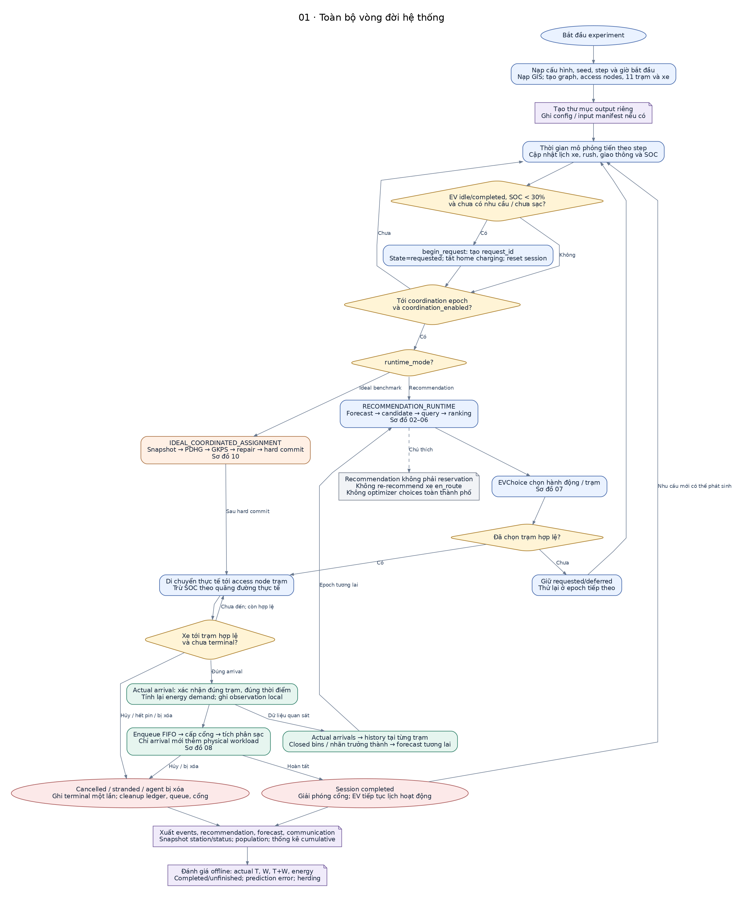
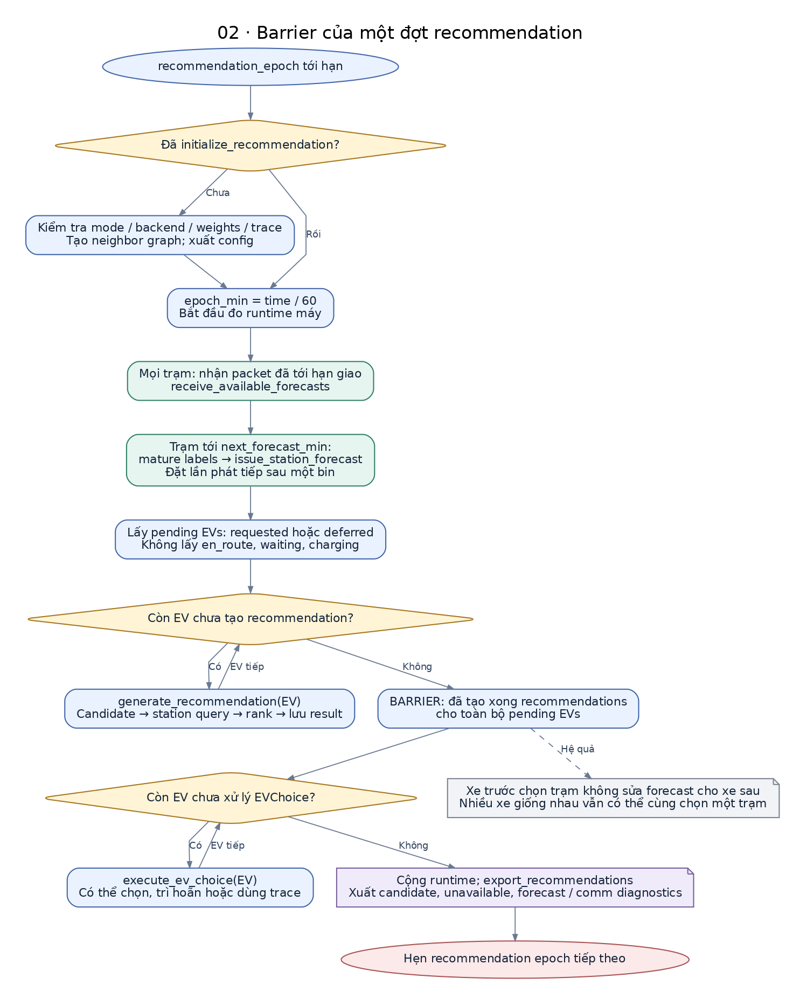
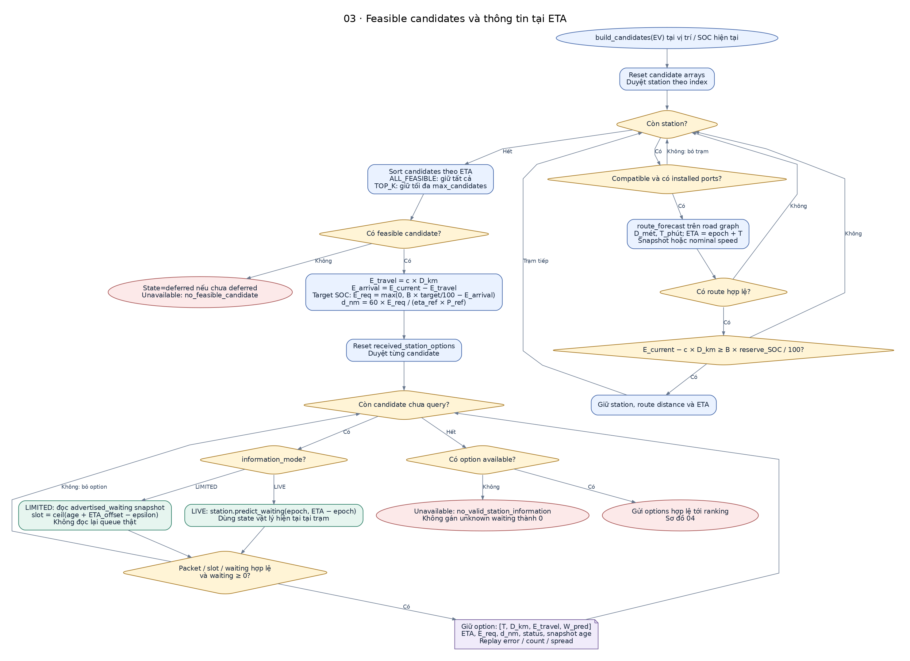
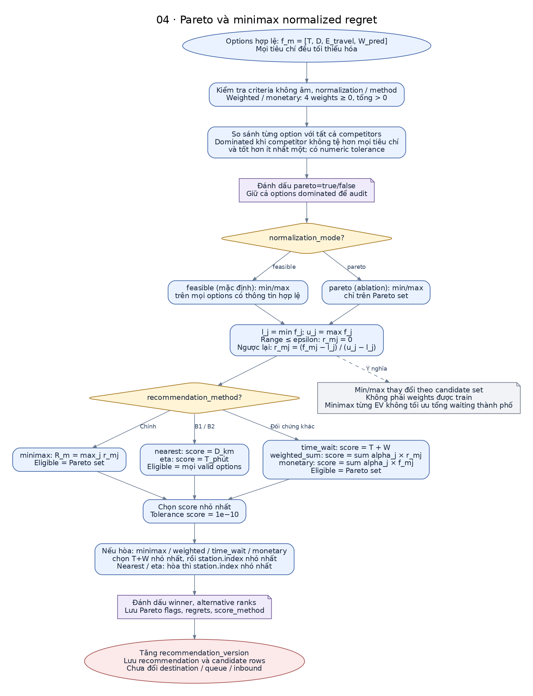
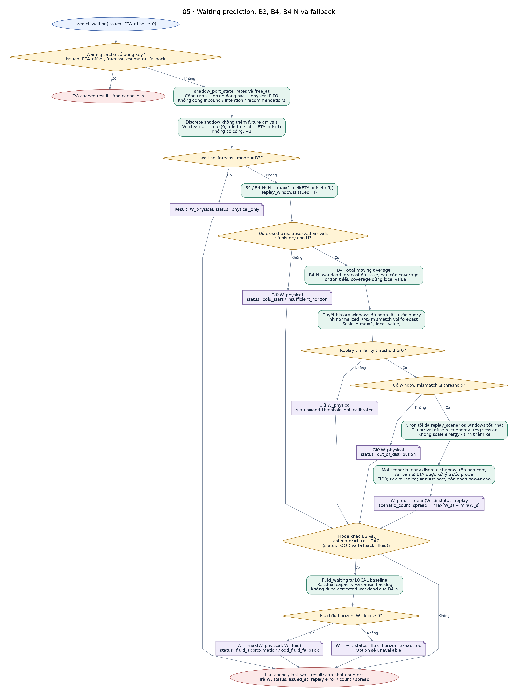
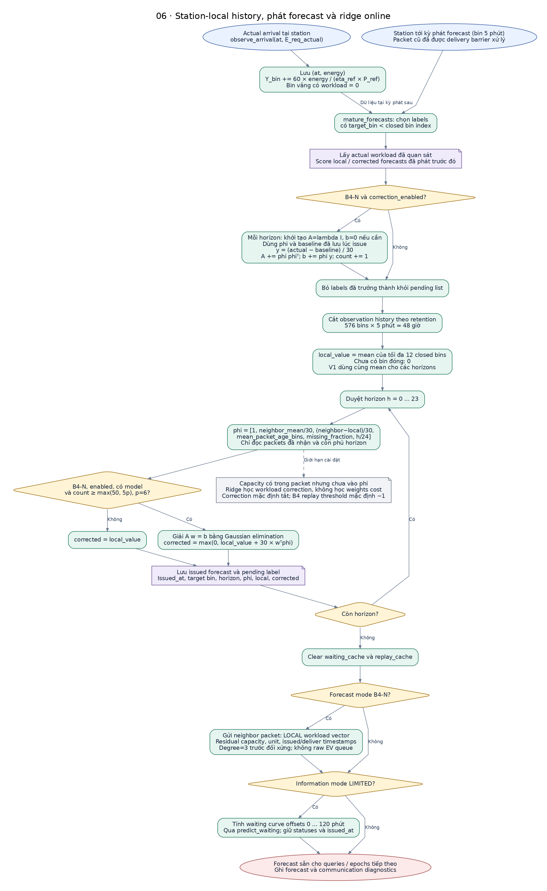
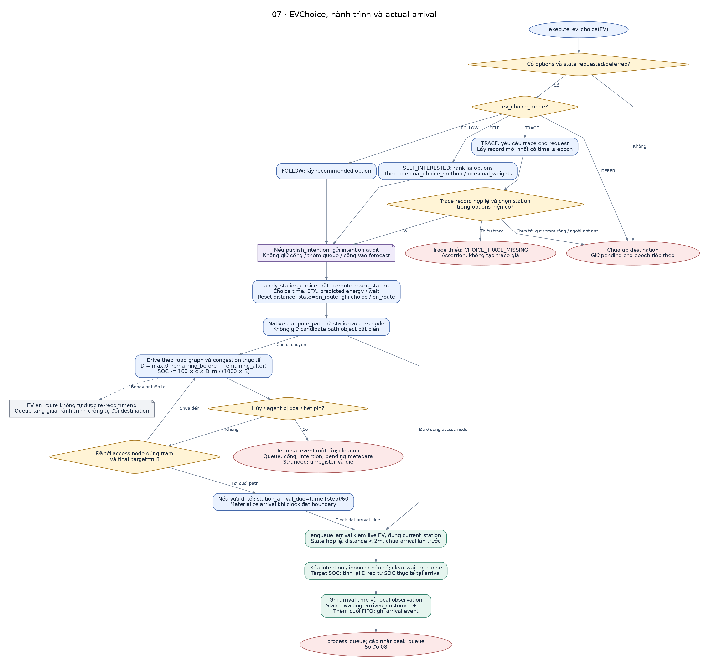
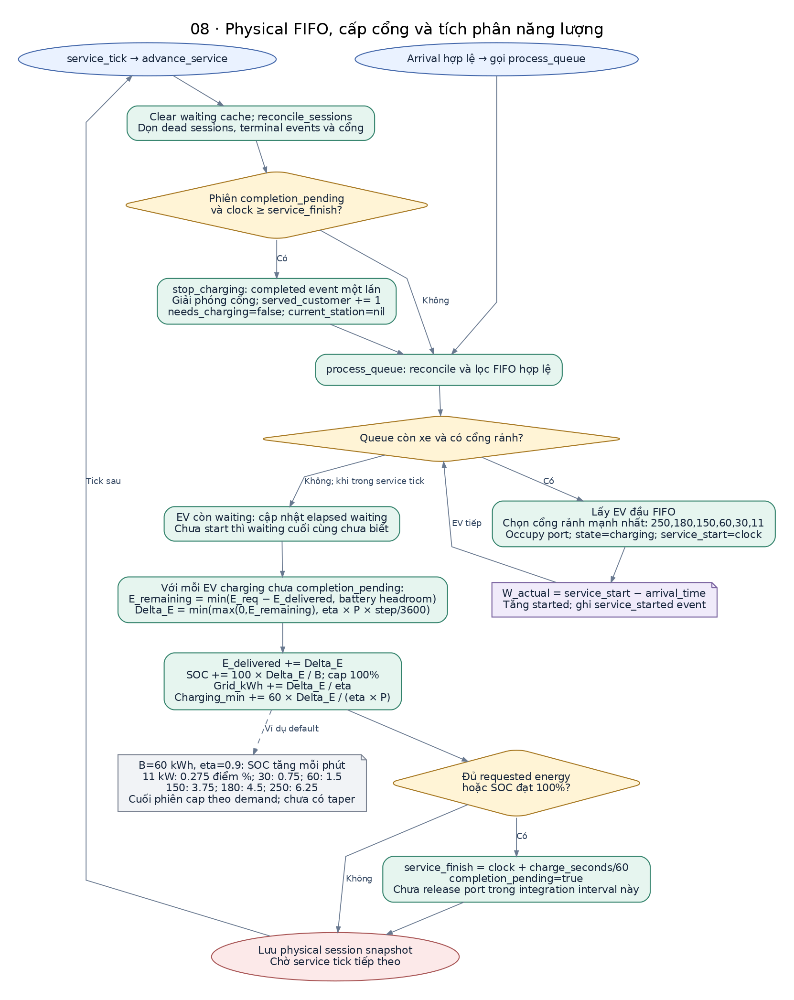
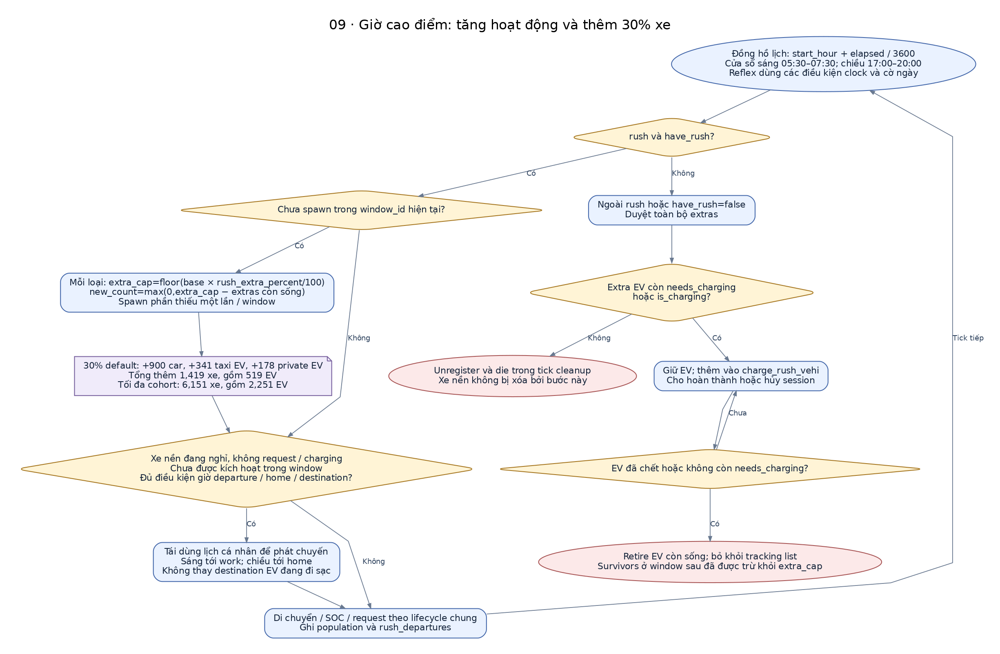
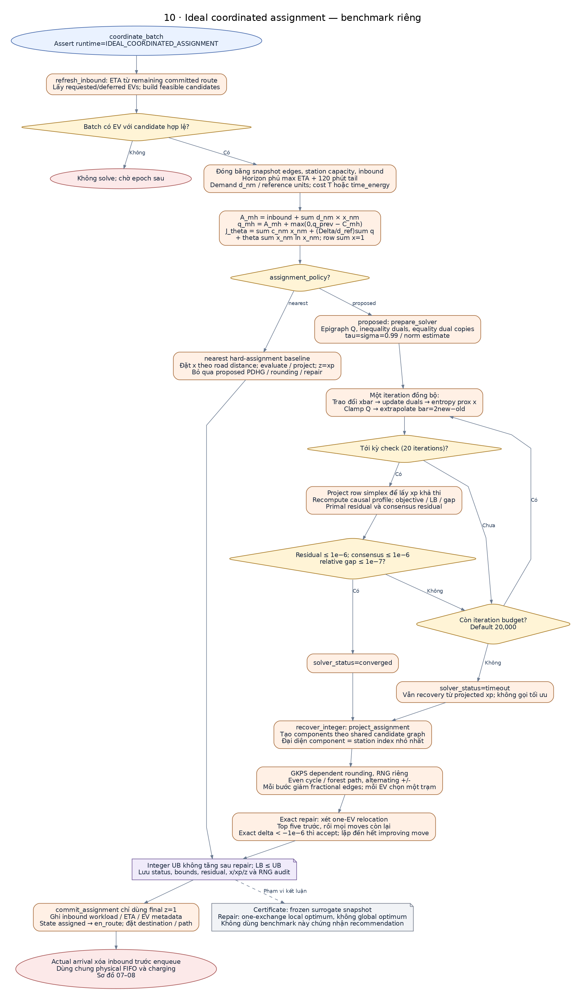

# Flowchart chi tiết hệ thống và thuật toán hiện tại

**Đối chiếu mã: 09/10/2026.** Kiến trúc Distributed Observation-Driven Charging Recommendation. Các sơ đồ diễn tả implementation hiện có, không thay đổi model hoặc đề xuất một policy mới.

[Mở PDF toàn bộ 10 sơ đồ](flowcharts/SYSTEM_FLOWCHART_VI.pdf). Mỗi phần có ảnh để xem ngay, SVG để phóng to và Mermaid/DOT để chỉnh sửa.

Luồng chính: **Request → feasible candidates → station-local waiting tại ETA → Pareto/minimax → recommendation → EVChoice → actual arrival → FIFO charging → local history.**

**Cách đọc:** hộp xanh dương là xử lý EV/orchestration; xanh lá là xử lý tại trạm; hình thoi vàng là điều kiện; tím là dữ liệu/log; cam là benchmark ideal; xám là chú thích. Nét đứt nối tới chú thích. Đường quay lại thể hiện vòng lặp logic qua iteration, tick hoặc epoch, không gọi đệ quy GAML.

## Mục lục

1. [01 · Toàn bộ vòng đời hệ thống](#01-overview)
2. [02 · Barrier của một đợt recommendation](#02-epoch)
3. [03 · Feasible candidates và thông tin tại ETA](#03-candidates)
4. [04 · Pareto và minimax normalized regret](#04-ranking)
5. [05 · Waiting prediction: B3, B4, B4-N và fallback](#05-waiting)
6. [06 · Station-local history, phát forecast và ridge online](#06-learning)
7. [07 · EVChoice, hành trình và actual arrival](#07-choice-arrival)
8. [08 · Physical FIFO, cấp cổng và tích phân năng lượng](#08-physical)
9. [09 · Giờ cao điểm: tăng hoạt động và thêm 30% xe](#09-rush)
10. [10 · Ideal coordinated assignment — benchmark riêng](#10-ideal)

## Các điểm phải giữ khi diễn giải

- Recommendation, choice và intention chưa thêm physical queue; actual arrival mới enqueue.
- Cùng đợt: tạo mọi recommendations trước mọi choices. Đây không phải matching hoặc quota capacity.
- B3 loại inbound/intention; B4 dùng history actual arrivals; B4-N correction có gate và mặc định tắt.
- B4 mặc định threshold −1: replay chưa hiệu chỉnh và giữ physical fallback với nhãn rõ ràng.
- Xe en_route chưa được tự động đổi trạm khi queue tăng; herding vẫn có thể xảy ra.
- FIFO/tích phân sạc là physical outcome. Ideal solver dùng surrogate và có pipeline riêng.

<a id="01-overview"></a>

## 01 · Toàn bộ vòng đời hệ thống

Luồng logic tổng thể. Các reflex GAMA chạy theo lịch của simulator; sơ đồ không áp đặt một thứ tự mới cho mọi reflex trong một tick.



[SVG phóng to](flowcharts/01_overview.svg) · [Mermaid](flowcharts/01_overview.mmd) · [Graphviz DOT](flowcharts/01_overview.dot)

**Nguồn:** [main.gaml](../models/main.gaml), [Mobility.gaml](../models/Mobility.gaml), [Recommendation.gaml](../models/Recommendation.gaml), [ChargingService.gaml](../models/ChargingService.gaml), [Coordination.gaml](../models/Coordination.gaml).

<details>
<summary>Mã Mermaid để chỉnh sửa</summary>

```mermaid
flowchart TD
    n_boot(["Bắt đầu experiment"])
    n_init["Nạp cấu hình, seed, step và giờ bắt đầu<br/>Nạp GIS; tạo graph, access nodes, 11 trạm và xe"]
    n_out["Tạo thư mục output riêng<br/>Ghi config / input manifest nếu có"]
    n_tick["Thời gian mô phỏng tiến theo step<br/>Cập nhật lịch xe, rush, giao thông và SOC"]
    n_need{"EV idle/completed, SOC < 30%<br/>và chưa có nhu cầu / chưa sạc?"}
    n_req["begin_request: tạo request_id<br/>State=requested; tắt home charging; reset session"]
    n_due{"Tới coordination epoch<br/>và coordination_enabled?"}
    n_mode{"runtime_mode?"}
    n_rec["RECOMMENDATION_RUNTIME<br/>Forecast → candidate → query → ranking<br/>Sơ đồ 02–06"]
    n_choice["EVChoice chọn hành động / trạm<br/>Sơ đồ 07"]
    n_picked{"Đã chọn trạm hợp lệ?"}
    n_pending["Giữ requested/deferred<br/>Thử lại ở epoch tiếp theo"]
    n_ideal["IDEAL_COORDINATED_ASSIGNMENT<br/>Snapshot → PDHG → GKPS → repair → hard commit<br/>Sơ đồ 10"]
    n_travel["Di chuyển thực tế tới access node trạm<br/>Trừ SOC theo quãng đường thực tế"]
    n_alive{"Xe tới trạm hợp lệ<br/>và chưa terminal?"}
    n_arrival["Actual arrival: xác nhận đúng trạm, đúng thời điểm<br/>Tính lại energy demand; ghi observation local"]
    n_fifo["Enqueue FIFO → cấp cổng → tích phân sạc<br/>Chỉ arrival mới thêm physical workload<br/>Sơ đồ 08"]
    n_done(["Session completed<br/>Giải phóng cổng; EV tiếp tục lịch hoạt động"])
    n_failure(["Cancelled / stranded / agent bị xóa<br/>Ghi terminal một lần; cleanup ledger, queue, cổng"])
    n_logs["Xuất events, recommendation, forecast, communication<br/>Snapshot station/status; population; thống kê cumulative"]
    n_feedback["Actual arrivals → history tại từng trạm<br/>Closed bins / nhãn trưởng thành → forecast tương lai"]
    n_limits["Recommendation không phải reservation<br/>Không re-recommend xe en_route<br/>Không optimizer choices toàn thành phố"]
    n_offline["Đánh giá offline: actual T, W, T+W, energy<br/>Completed/unfinished; prediction error; herding"]
    n_boot --> n_init
    n_init --> n_out
    n_out --> n_tick
    n_tick --> n_need
    n_need -->|"Có"| n_req
    n_need -->|"Không"| n_due
    n_req --> n_due
    n_due -->|"Chưa"| n_tick
    n_due -->|"Có"| n_mode
    n_mode -->|"Recommendation"| n_rec
    n_mode -->|"Ideal benchmark"| n_ideal
    n_rec --> n_choice
    n_choice --> n_picked
    n_picked -->|"Chưa"| n_pending
    n_pending --> n_tick
    n_picked -->|"Có"| n_travel
    n_ideal -->|"Sau hard commit"| n_travel
    n_travel --> n_alive
    n_alive -->|"Chưa đến; còn hợp lệ"| n_travel
    n_alive -->|"Hủy / hết pin / bị xóa"| n_failure
    n_alive -->|"Đúng arrival"| n_arrival
    n_arrival --> n_fifo
    n_fifo -->|"Hoàn tất"| n_done
    n_fifo -->|"Hủy / bị xóa"| n_failure
    n_arrival -->|"Dữ liệu quan sát"| n_feedback
    n_feedback -->|"Epoch tương lai"| n_rec
    n_done -->|"Nhu cầu mới có thể phát sinh"| n_tick
    n_rec -.->|"Chú thích"| n_limits
    n_done --> n_logs
    n_failure --> n_logs
    n_logs --> n_offline
    classDef process fill:#EAF2FF,stroke:#4367AA,color:#17263C;
    class n_init,n_tick,n_req,n_rec,n_choice,n_pending,n_travel process;
    classDef station fill:#E6F5EF,stroke:#31816A,color:#17263C;
    class n_arrival,n_fifo,n_feedback station;
    classDef decision fill:#FFF4D6,stroke:#A77822,color:#17263C;
    class n_need,n_due,n_mode,n_picked,n_alive decision;
    classDef data fill:#F0EBFA,stroke:#77609D,color:#17263C;
    class n_out,n_logs,n_offline data;
    classDef end fill:#FCE9E9,stroke:#A85555,color:#17263C;
    class n_done,n_failure end;
    classDef start fill:#EAF2FF,stroke:#4367AA,color:#17263C;
    class n_boot start;
    classDef note fill:#F1F3F6,stroke:#7A8291,color:#17263C;
    class n_limits note;
    classDef ideal fill:#FFF0E5,stroke:#AA7143,color:#17263C;
    class n_ideal ideal;
```

</details>

<a id="02-epoch"></a>

## 02 · Barrier của một đợt recommendation

Batch mặc định 60 giây. Tất cả recommendations được tạo trước vòng EVChoice; không phân bổ quota hoặc matching giữa các xe.



[SVG phóng to](flowcharts/02_epoch.svg) · [Mermaid](flowcharts/02_epoch.mmd) · [Graphviz DOT](flowcharts/02_epoch.dot)

**Nguồn:** [Recommendation.gaml](../models/Recommendation.gaml).

<details>
<summary>Mã Mermaid để chỉnh sửa</summary>

```mermaid
flowchart TD
    n_begin(["recommendation_epoch tới hạn"])
    n_init{"Đã initialize_recommendation?"}
    n_setup["Kiểm tra mode / backend / weights / trace<br/>Tạo neighbor graph; xuất config"]
    n_at["epoch_min = time / 60<br/>Bắt đầu đo runtime máy"]
    n_receive["Mọi trạm: nhận packet đã tới hạn giao<br/>receive_available_forecasts"]
    n_issue["Trạm tới next_forecast_min:<br/>mature labels → issue_station_forecast<br/>Đặt lần phát tiếp sau một bin"]
    n_pending["Lấy pending EVs: requested hoặc deferred<br/>Không lấy en_route, waiting, charging"]
    n_more{"Còn EV chưa tạo recommendation?"}
    n_generate["generate_recommendation(EV)<br/>Candidate → station query → rank → lưu result"]
    n_barrier["BARRIER: đã tạo xong recommendations<br/>cho toàn bộ pending EVs"]
    n_morechoice{"Còn EV chưa xử lý EVChoice?"}
    n_choice["execute_ev_choice(EV)<br/>Có thể chọn, trì hoãn hoặc dùng trace"]
    n_export["Cộng runtime; export_recommendations<br/>Xuất candidate, unavailable, forecast / comm diagnostics"]
    n_end(["Hẹn recommendation epoch tiếp theo"])
    n_warning["Xe trước chọn trạm không sửa forecast cho xe sau<br/>Nhiều xe giống nhau vẫn có thể cùng chọn một trạm"]
    n_begin --> n_init
    n_init -->|"Chưa"| n_setup
    n_init -->|"Rồi"| n_at
    n_setup --> n_at
    n_at --> n_receive
    n_receive --> n_issue
    n_issue --> n_pending
    n_pending --> n_more
    n_more -->|"Có"| n_generate
    n_generate -->|"EV tiếp"| n_more
    n_more -->|"Không"| n_barrier
    n_barrier --> n_morechoice
    n_morechoice -->|"Có"| n_choice
    n_choice -->|"EV tiếp"| n_morechoice
    n_morechoice -->|"Không"| n_export
    n_export --> n_end
    n_barrier -.->|"Hệ quả"| n_warning
    classDef process fill:#EAF2FF,stroke:#4367AA,color:#17263C;
    class n_setup,n_at,n_pending,n_generate,n_barrier,n_choice process;
    classDef station fill:#E6F5EF,stroke:#31816A,color:#17263C;
    class n_receive,n_issue station;
    classDef decision fill:#FFF4D6,stroke:#A77822,color:#17263C;
    class n_init,n_more,n_morechoice decision;
    classDef data fill:#F0EBFA,stroke:#77609D,color:#17263C;
    class n_export data;
    classDef end fill:#FCE9E9,stroke:#A85555,color:#17263C;
    class n_end end;
    classDef start fill:#EAF2FF,stroke:#4367AA,color:#17263C;
    class n_begin start;
    classDef note fill:#F1F3F6,stroke:#7A8291,color:#17263C;
    class n_warning note;
    classDef ideal fill:#FFF0E5,stroke:#AA7143,color:#17263C;
```

</details>

<a id="03-candidates"></a>

## 03 · Feasible candidates và thông tin tại ETA

Feasible về route, hardware và reserve khác với available về waiting information. TOP_K giữ K trạm theo ETA trước khi ranking.



[SVG phóng to](flowcharts/03_candidates.svg) · [Mermaid](flowcharts/03_candidates.mmd) · [Graphviz DOT](flowcharts/03_candidates.dot)

**Nguồn:** [Coordination.gaml](../models/Coordination.gaml), [Recommendation.gaml](../models/Recommendation.gaml).

<details>
<summary>Mã Mermaid để chỉnh sửa</summary>

```mermaid
flowchart TD
    n_start(["build_candidates(EV) tại vị trí / SOC hiện tại"])
    n_clear["Reset candidate arrays<br/>Duyệt station theo index"]
    n_more{"Còn station?"}
    n_hardware{"Compatible và có installed ports?"}
    n_route["route_forecast trên road graph<br/>D_mét, T_phút; ETA = epoch + T<br/>Snapshot hoặc nominal speed"]
    n_path{"Có route hợp lệ?"}
    n_reserve{"E_current − c × D_km ≥ B × reserve_SOC / 100?"}
    n_add["Giữ station, route distance và ETA"]
    n_sort["Sort candidates theo ETA<br/>ALL_FEASIBLE: giữ tất cả<br/>TOP_K: giữ tối đa max_candidates"]
    n_any{"Có feasible candidate?"}
    n_defer(["State=deferred nếu chưa deferred<br/>Unavailable: no_feasible_candidate"])
    n_energy["E_travel = c × D_km<br/>E_arrival = E_current − E_travel<br/>Target SOC: E_req = max(0, B × target/100 − E_arrival)<br/>d_nm = 60 × E_req / (eta_ref × P_ref)"]
    n_options["Reset received_station_options<br/>Duyệt từng candidate"]
    n_next{"Còn candidate chưa query?"}
    n_info{"information_mode?"}
    n_live["LIVE: station.predict_waiting(epoch, ETA − epoch)<br/>Dùng state vật lý hiện tại tại trạm"]
    n_limited["LIMITED: đọc advertised_waiting snapshot<br/>slot = ceil(age + ETA_offset − epsilon)<br/>Không đọc lại queue thật"]
    n_valid{"Packet / slot / waiting hợp lệ<br/>và waiting ≥ 0?"}
    n_keep["Giữ option: [T, D_km, E_travel, W_pred]<br/>ETA, E_req, d_nm, status, snapshot age<br/>Replay error / count / spread"]
    n_available{"Có option available?"}
    n_unknown(["Unavailable: no_valid_station_information<br/>Không gán unknown waiting thành 0"])
    n_rank(["Gửi options hợp lệ tới ranking<br/>Sơ đồ 04"])
    n_start --> n_clear
    n_clear --> n_more
    n_more -->|"Có"| n_hardware
    n_hardware -->|"Không: bỏ trạm"| n_more
    n_hardware -->|"Có"| n_route
    n_route --> n_path
    n_path -->|"Không"| n_more
    n_path -->|"Có"| n_reserve
    n_reserve -->|"Không"| n_more
    n_reserve -->|"Có"| n_add
    n_add -->|"Trạm tiếp"| n_more
    n_more -->|"Hết"| n_sort
    n_sort --> n_any
    n_any -->|"Không"| n_defer
    n_any -->|"Có"| n_energy
    n_energy --> n_options
    n_options --> n_next
    n_next -->|"Có"| n_info
    n_info -->|"LIVE"| n_live
    n_info -->|"LIMITED"| n_limited
    n_live --> n_valid
    n_limited --> n_valid
    n_valid -->|"Không: bỏ option"| n_next
    n_valid -->|"Có"| n_keep
    n_keep --> n_next
    n_next -->|"Hết"| n_available
    n_available -->|"Không"| n_unknown
    n_available -->|"Có"| n_rank
    classDef process fill:#EAF2FF,stroke:#4367AA,color:#17263C;
    class n_clear,n_route,n_add,n_sort,n_energy,n_options process;
    classDef station fill:#E6F5EF,stroke:#31816A,color:#17263C;
    class n_live,n_limited station;
    classDef decision fill:#FFF4D6,stroke:#A77822,color:#17263C;
    class n_more,n_hardware,n_path,n_reserve,n_any,n_next,n_info,n_valid,n_available decision;
    classDef data fill:#F0EBFA,stroke:#77609D,color:#17263C;
    class n_keep data;
    classDef end fill:#FCE9E9,stroke:#A85555,color:#17263C;
    class n_defer,n_unknown,n_rank end;
    classDef start fill:#EAF2FF,stroke:#4367AA,color:#17263C;
    class n_start start;
    classDef note fill:#F1F3F6,stroke:#7A8291,color:#17263C;
    classDef ideal fill:#FFF0E5,stroke:#AA7143,color:#17263C;
```

</details>

<a id="04-ranking"></a>

## 04 · Pareto và minimax normalized regret

Quy tắc chính không học alpha. Nhánh đối chứng nearest/eta chọn trên toàn bộ options hợp lệ, các policy còn lại chọn trên Pareto set.



[SVG phóng to](flowcharts/04_ranking.svg) · [Mermaid](flowcharts/04_ranking.mmd) · [Graphviz DOT](flowcharts/04_ranking.dot)

**Nguồn:** [StationForecast.gaml](../models/StationForecast.gaml), [Recommendation.gaml](../models/Recommendation.gaml).

<details>
<summary>Mã Mermaid để chỉnh sửa</summary>

```mermaid
flowchart TD
    n_start(["Options hợp lệ: f_m = [T, D, E_travel, W_pred]<br/>Mọi tiêu chí đều tối thiểu hóa"])
    n_check["Kiểm tra criteria không âm, normalization / method<br/>Weighted / monetary: 4 weights ≥ 0, tổng > 0"]
    n_pareto["So sánh từng option với tất cả competitors<br/>Dominated khi competitor không tệ hơn mọi tiêu chí<br/>và tốt hơn ít nhất một; có numeric tolerance"]
    n_flags["Đánh dấu pareto=true/false<br/>Giữ cả options dominated để audit"]
    n_norm{"normalization_mode?"}
    n_feasible["feasible (mặc định): min/max<br/>trên mọi options có thông tin hợp lệ"]
    n_front["pareto (ablation): min/max<br/>chỉ trên Pareto set"]
    n_regret["l_j = min f_j; u_j = max f_j<br/>Range ≤ epsilon: r_mj = 0<br/>Ngược lại: r_mj = (f_mj − l_j) / (u_j − l_j)"]
    n_method{"recommendation_method?"}
    n_minimax["minimax: R_m = max_j r_mj<br/>Eligible = Pareto set"]
    n_nearest["nearest: score = D_km<br/>eta: score = T_phút<br/>Eligible = mọi valid options"]
    n_other["time_wait: score = T + W<br/>weighted_sum: score = sum alpha_j × r_mj<br/>monetary: score = sum alpha_j × f_mj<br/>Eligible = Pareto set"]
    n_best["Chọn score nhỏ nhất<br/>Tolerance score = 1e−10"]
    n_tie["Nếu hòa: minimax / weighted / time_wait / monetary<br/>chọn T+W nhỏ nhất, rồi station.index nhỏ nhất<br/>Nearest / eta: hòa thì station.index nhỏ nhất"]
    n_result["Đánh dấu winner, alternative ranks<br/>Lưu Pareto flags, regrets, score_method"]
    n_record(["Tăng recommendation_version<br/>Lưu recommendation và candidate rows<br/>Chưa đổi destination / queue / inbound"])
    n_note["Min/max thay đổi theo candidate set<br/>Không phải weights được train<br/>Minimax từng EV không tối ưu tổng waiting thành phố"]
    n_start --> n_check
    n_check --> n_pareto
    n_pareto --> n_flags
    n_flags --> n_norm
    n_norm -->|"feasible"| n_feasible
    n_norm -->|"pareto"| n_front
    n_feasible --> n_regret
    n_front --> n_regret
    n_regret --> n_method
    n_method -->|"Chính"| n_minimax
    n_method -->|"B1 / B2"| n_nearest
    n_method -->|"Đối chứng khác"| n_other
    n_minimax --> n_best
    n_nearest --> n_best
    n_other --> n_best
    n_regret -.->|"Ý nghĩa"| n_note
    n_best --> n_tie
    n_tie --> n_result
    n_result --> n_record
    classDef process fill:#EAF2FF,stroke:#4367AA,color:#17263C;
    class n_check,n_pareto,n_feasible,n_front,n_regret,n_minimax,n_nearest,n_other,n_best,n_tie process;
    classDef station fill:#E6F5EF,stroke:#31816A,color:#17263C;
    classDef decision fill:#FFF4D6,stroke:#A77822,color:#17263C;
    class n_norm,n_method decision;
    classDef data fill:#F0EBFA,stroke:#77609D,color:#17263C;
    class n_flags,n_result data;
    classDef end fill:#FCE9E9,stroke:#A85555,color:#17263C;
    class n_record end;
    classDef start fill:#EAF2FF,stroke:#4367AA,color:#17263C;
    class n_start start;
    classDef note fill:#F1F3F6,stroke:#7A8291,color:#17263C;
    class n_note note;
    classDef ideal fill:#FFF0E5,stroke:#AA7143,color:#17263C;
```

</details>

<a id="05-waiting"></a>

## 05 · Waiting prediction: B3, B4, B4-N và fallback

Tất cả modes bắt đầu từ physical shadow. B4/B4-N chọn historical scenarios đại diện rồi replay, không tạo reservation hay thêm choices vào tải vật lý.



[SVG phóng to](flowcharts/05_waiting.svg) · [Mermaid](flowcharts/05_waiting.mmd) · [Graphviz DOT](flowcharts/05_waiting.dot)

**Nguồn:** [ChargingService.gaml](../models/ChargingService.gaml), [StationForecast.gaml](../models/StationForecast.gaml).

<details>
<summary>Mã Mermaid để chỉnh sửa</summary>

```mermaid
flowchart TD
    n_start(["predict_waiting(issued, ETA_offset ≥ 0)"])
    n_cached{"Waiting cache có đúng key?<br/>Issued, ETA_offset, forecast, estimator, fallback"}
    n_returncache(["Trả cached result; tăng cache_hits"])
    n_shadow["shadow_port_state: rates và free_at<br/>Cổng rảnh + phiên đang sạc + physical FIFO<br/>Không cộng inbound / intention / recommendations"]
    n_b3["Discrete shadow không thêm future arrivals<br/>W_physical = max(0, min free_at − ETA_offset)<br/>Không có cổng: −1"]
    n_mode{"waiting_forecast_mode = B3?"}
    n_physical["Result: W_physical; status=physical_only"]
    n_horizon["B4 / B4-N: H = max(1, ceil(ETA_offset / 5))<br/>replay_windows(issued, H)"]
    n_history{"Đủ closed bins, observed arrivals<br/>và history cho H?"}
    n_cold["Giữ W_physical<br/>status=cold_start / insufficient_horizon"]
    n_forecast["B4: local moving average<br/>B4-N: workload forecast đã issue, nếu còn coverage<br/>Horizon thiếu coverage dùng local value"]
    n_scan["Duyệt history windows đã hoàn tất trước query<br/>Tính normalized RMS mismatch với forecast<br/>Scale = max(1, local_value)"]
    n_calibrated{"Replay similarity threshold ≥ 0?"}
    n_unconfigured["Giữ W_physical<br/>status=ood_threshold_not_calibrated"]
    n_accepted{"Có window mismatch ≤ threshold?"}
    n_ood["Giữ W_physical<br/>status=out_of_distribution"]
    n_scenarios["Chọn tối đa replay_scenarios windows tốt nhất<br/>Giữ arrival offsets và energy từng session<br/>Không scale energy / sinh thêm xe"]
    n_replay["Mỗi scenario: chạy discrete shadow trên bản copy<br/>Arrivals ≤ ETA được xử lý trước probe<br/>FIFO; tick rounding; earliest port, hòa chọn power cao"]
    n_mean["W_pred = mean(W_s); status=replay<br/>scenario_count; spread = max(W_s) − min(W_s)"]
    n_fluidgate{"Mode khác B3 và:<br/>estimator=fluid HOẶC<br/>(status=OOD và fallback=fluid)?"}
    n_fluid["fluid_waiting từ LOCAL baseline<br/>Residual capacity và causal backlog<br/>Không dùng corrected workload của B4-N"]
    n_fluidvalid{"Fluid đủ horizon: W_fluid ≥ 0?"}
    n_fluidok["W = max(W_physical, W_fluid)<br/>status=fluid_approximation / ood_fluid_fallback"]
    n_fluidfail["W = −1; status=fluid_horizon_exhausted<br/>Option sẽ unavailable"]
    n_save(["Lưu cache / last_wait_result; cập nhật counters<br/>Trả W, status, issued_at, replay error / count / spread"])
    n_start --> n_cached
    n_cached -->|"Có"| n_returncache
    n_cached -->|"Không"| n_shadow
    n_shadow --> n_b3
    n_b3 --> n_mode
    n_mode -->|"Có"| n_physical
    n_physical --> n_save
    n_mode -->|"Không"| n_horizon
    n_horizon --> n_history
    n_history -->|"Không"| n_cold
    n_cold --> n_fluidgate
    n_history -->|"Có"| n_forecast
    n_forecast --> n_scan
    n_scan --> n_calibrated
    n_calibrated -->|"Không"| n_unconfigured
    n_unconfigured --> n_fluidgate
    n_calibrated -->|"Có"| n_accepted
    n_accepted -->|"Không"| n_ood
    n_ood --> n_fluidgate
    n_accepted -->|"Có"| n_scenarios
    n_scenarios --> n_replay
    n_replay --> n_mean
    n_mean --> n_fluidgate
    n_fluidgate -->|"Không"| n_save
    n_fluidgate -->|"Có"| n_fluid
    n_fluid --> n_fluidvalid
    n_fluidvalid -->|"Có"| n_fluidok
    n_fluidvalid -->|"Không"| n_fluidfail
    n_fluidok --> n_save
    n_fluidfail --> n_save
    classDef process fill:#EAF2FF,stroke:#4367AA,color:#17263C;
    classDef station fill:#E6F5EF,stroke:#31816A,color:#17263C;
    class n_shadow,n_b3,n_horizon,n_forecast,n_scan,n_scenarios,n_replay,n_fluid station;
    classDef decision fill:#FFF4D6,stroke:#A77822,color:#17263C;
    class n_cached,n_mode,n_history,n_calibrated,n_accepted,n_fluidgate,n_fluidvalid decision;
    classDef data fill:#F0EBFA,stroke:#77609D,color:#17263C;
    class n_physical,n_cold,n_unconfigured,n_ood,n_mean,n_fluidok,n_fluidfail data;
    classDef end fill:#FCE9E9,stroke:#A85555,color:#17263C;
    class n_returncache,n_save end;
    classDef start fill:#EAF2FF,stroke:#4367AA,color:#17263C;
    class n_start start;
    classDef note fill:#F1F3F6,stroke:#7A8291,color:#17263C;
    classDef ideal fill:#FFF0E5,stroke:#AA7143,color:#17263C;
```

</details>

<a id="06-learning"></a>

## 06 · Station-local history, phát forecast và ridge online

B4 cập nhật thống kê, B4-N có thể học correction theo horizon. Các nhãn chỉ dùng sau khi target bin đóng; features được giữ từ thời điểm phát dự báo.



[SVG phóng to](flowcharts/06_learning.svg) · [Mermaid](flowcharts/06_learning.mmd) · [Graphviz DOT](flowcharts/06_learning.dot)

**Nguồn:** [ChargingService.gaml](../models/ChargingService.gaml), [StationForecast.gaml](../models/StationForecast.gaml), [Recommendation.gaml](../models/Recommendation.gaml).

<details>
<summary>Mã Mermaid để chỉnh sửa</summary>

```mermaid
flowchart TD
    n_obs(["Actual arrival tại station<br/>observe_arrival(at, E_req_actual)"])
    n_bin["Lưu (at, energy)<br/>Y_bin += 60 × energy / (eta_ref × P_ref)<br/>Bin vắng có workload = 0"]
    n_epoch(["Station tới kỳ phát forecast (bin 5 phút)<br/>Packet cũ đã được delivery barrier xử lý"])
    n_mature["mature_forecasts: chọn labels<br/>có target_bin < closed bin index"]
    n_score["Lấy actual workload đã quan sát<br/>Score local / corrected forecasts đã phát trước đó"]
    n_train{"B4-N và correction_enabled?"}
    n_update["Mỗi horizon: khởi tạo A=lambda I, b=0 nếu cần<br/>Dùng phi và baseline đã lưu lúc issue<br/>y = (actual − baseline) / 30<br/>A += phi phiᵀ; b += phi y; count += 1"]
    n_remove["Bỏ labels đã trưởng thành khỏi pending list"]
    n_prune["Cắt observation history theo retention<br/>576 bins × 5 phút ≈ 48 giờ"]
    n_local["local_value = mean của tối đa 12 closed bins<br/>Chưa có bin đóng: 0<br/>V1 dùng cùng mean cho các horizons"]
    n_h["Duyệt horizon h = 0 ... 23"]
    n_features["phi = [1, neighbor_mean/30, (neighbor−local)/30,<br/>mean_packet_age_bins, missing_fraction, h/24]<br/>Chỉ đọc packets đã nhận và còn phủ horizon"]
    n_gate{"B4-N, enabled, có model<br/>và count ≥ max(50, 5p), p=6?"}
    n_baseline["corrected = local_value"]
    n_ridge["Giải A w = b bằng Gaussian elimination<br/>corrected = max(0, local_value + 30 × wᵀphi)"]
    n_label["Lưu issued forecast và pending label<br/>Issued_at, target bin, horizon, phi, local, corrected"]
    n_more{"Còn horizon?"}
    n_cache["Clear waiting_cache và replay_cache"]
    n_neighbor{"Forecast mode B4-N?"}
    n_packet["Gửi neighbor packet: LOCAL workload vector<br/>Residual capacity, unit, issued/deliver timestamps<br/>Degree=3 trước đối xứng; không raw EV queue"]
    n_limited{"Information mode LIMITED?"}
    n_curve["Tính waiting curve offsets 0 ... 120 phút<br/>Qua predict_waiting; giữ statuses và issued_at"]
    n_end(["Forecast sẵn cho queries / epochs tiếp theo<br/>Ghi forecast và communication diagnostics"])
    n_note["Capacity có trong packet nhưng chưa vào phi<br/>Ridge học workload correction, không học weights cost<br/>Correction mặc định tắt; B4 replay threshold mặc định −1"]
    n_obs --> n_bin
    n_bin -->|"Dữ liệu tại kỳ phát sau"| n_mature
    n_epoch --> n_mature
    n_mature --> n_score
    n_score --> n_train
    n_train -->|"Có"| n_update
    n_train -->|"Không"| n_remove
    n_update --> n_remove
    n_remove --> n_prune
    n_prune --> n_local
    n_local --> n_h
    n_h --> n_features
    n_features --> n_gate
    n_gate -->|"Không"| n_baseline
    n_gate -->|"Có"| n_ridge
    n_baseline --> n_label
    n_ridge --> n_label
    n_label --> n_more
    n_more -->|"Có"| n_h
    n_more -->|"Không"| n_cache
    n_cache --> n_neighbor
    n_neighbor -->|"Có"| n_packet
    n_neighbor -->|"Không"| n_limited
    n_packet --> n_limited
    n_limited -->|"Có"| n_curve
    n_limited -->|"Không"| n_end
    n_curve --> n_end
    n_features -.->|"Giới hạn cài đặt"| n_note
    classDef process fill:#EAF2FF,stroke:#4367AA,color:#17263C;
    classDef station fill:#E6F5EF,stroke:#31816A,color:#17263C;
    class n_bin,n_mature,n_update,n_remove,n_prune,n_local,n_h,n_features,n_baseline,n_ridge,n_cache,n_packet,n_curve station;
    classDef decision fill:#FFF4D6,stroke:#A77822,color:#17263C;
    class n_train,n_gate,n_more,n_neighbor,n_limited decision;
    classDef data fill:#F0EBFA,stroke:#77609D,color:#17263C;
    class n_score,n_label data;
    classDef end fill:#FCE9E9,stroke:#A85555,color:#17263C;
    class n_end end;
    classDef start fill:#EAF2FF,stroke:#4367AA,color:#17263C;
    class n_obs,n_epoch start;
    classDef note fill:#F1F3F6,stroke:#7A8291,color:#17263C;
    class n_note note;
    classDef ideal fill:#FFF0E5,stroke:#AA7143,color:#17263C;
```

</details>

<a id="07-choice-arrival"></a>

## 07 · EVChoice, hành trình và actual arrival

Chỉ apply_station_choice mới đổi destination trong recommendation runtime. Trace thiếu là lỗi hợp đồng; trace chưa đến thời điểm hoặc không chọn thì tiếp tục chờ.



[SVG phóng to](flowcharts/07_choice_arrival.svg) · [Mermaid](flowcharts/07_choice_arrival.mmd) · [Graphviz DOT](flowcharts/07_choice_arrival.dot)

**Nguồn:** [Recommendation.gaml](../models/Recommendation.gaml), [ChargingService.gaml](../models/ChargingService.gaml).

<details>
<summary>Mã Mermaid để chỉnh sửa</summary>

```mermaid
flowchart TD
    n_start(["execute_ev_choice(EV)"])
    n_valid{"Có options và state requested/deferred?"}
    n_wait(["Chưa áp destination<br/>Giữ pending cho epoch tiếp theo"])
    n_mode{"ev_choice_mode?"}
    n_follow["FOLLOW: lấy recommended option"]
    n_self["SELF_INTERESTED: rank lại options<br/>Theo personal_choice_method / personal_weights"]
    n_trace["TRACE: yêu cầu trace cho request<br/>Lấy record mới nhất có time ≤ epoch"]
    n_tracestatus{"Trace record hợp lệ và chọn station<br/>trong options hiện có?"}
    n_traceerror(["Trace thiếu: CHOICE_TRACE_MISSING<br/>Assertion; không tạo trace giả"])
    n_intention["Nếu publish_intention: gửi intention audit<br/>Không giữ cổng / thêm queue / cộng vào forecast"]
    n_apply["apply_station_choice: đặt current/chosen_station<br/>Choice time, ETA, predicted energy / wait<br/>Reset distance; state=en_route; ghi choice / en_route"]
    n_path["Native compute_path tới station access node<br/>Không giữ candidate path object bất biến"]
    n_drive["Drive theo road graph và congestion thực tế<br/>D = max(0, remaining_before − remaining_after)<br/>SOC -= 100 × c × D_m / (1000 × B)"]
    n_terminal{"Hủy / agent bị xóa / hết pin?"}
    n_cleanup(["Terminal event một lần; cleanup<br/>Queue, cổng, intention, pending metadata<br/>Stranded: unregister và die"])
    n_reached{"Đã tới access node đúng trạm<br/>và final_target=nil?"}
    n_due["Nếu vừa đi tới: station_arrival_due=(time+step)/60<br/>Materialize arrival khi clock đạt boundary"]
    n_enqueue["enqueue_arrival kiểm live EV, đúng current_station<br/>State hợp lệ, distance < 2m, chưa arrival lần trước"]
    n_demand["Xóa intention / inbound nếu có; clear waiting cache<br/>Target SOC: tính lại E_req từ SOC thực tế tại arrival"]
    n_observe["Ghi arrival time và local observation<br/>State=waiting; arrived_customer += 1<br/>Thêm cuối FIFO; ghi arrival event"]
    n_fifo(["process_queue; cập nhật peak_queue<br/>Sơ đồ 08"])
    n_noroute["EV en_route không tự được re-recommend<br/>Queue tăng giữa hành trình không tự đổi destination"]
    n_start --> n_valid
    n_valid -->|"Không"| n_wait
    n_valid -->|"Có"| n_mode
    n_mode -->|"DEFER"| n_wait
    n_mode -->|"FOLLOW"| n_follow
    n_mode -->|"SELF"| n_self
    n_mode -->|"TRACE"| n_trace
    n_trace --> n_tracestatus
    n_tracestatus -->|"Thiếu trace"| n_traceerror
    n_tracestatus -->|"Chưa tới giờ / trạm rỗng / ngoài options"| n_wait
    n_tracestatus -->|"Có"| n_intention
    n_follow --> n_intention
    n_self --> n_intention
    n_intention --> n_apply
    n_apply --> n_path
    n_path -->|"Đã ở đúng access node"| n_enqueue
    n_path -->|"Cần di chuyển"| n_drive
    n_drive --> n_terminal
    n_terminal -->|"Có"| n_cleanup
    n_terminal -->|"Không"| n_reached
    n_reached -->|"Chưa đến"| n_drive
    n_reached -->|"Tới cuối path"| n_due
    n_due -->|"Clock đạt arrival_due"| n_enqueue
    n_drive -.->|"Behavior hiện tại"| n_noroute
    n_enqueue --> n_demand
    n_demand --> n_observe
    n_observe --> n_fifo
    classDef process fill:#EAF2FF,stroke:#4367AA,color:#17263C;
    class n_follow,n_self,n_trace,n_apply,n_path,n_drive,n_due process;
    classDef station fill:#E6F5EF,stroke:#31816A,color:#17263C;
    class n_enqueue,n_demand,n_observe station;
    classDef decision fill:#FFF4D6,stroke:#A77822,color:#17263C;
    class n_valid,n_mode,n_tracestatus,n_terminal,n_reached decision;
    classDef data fill:#F0EBFA,stroke:#77609D,color:#17263C;
    class n_intention data;
    classDef end fill:#FCE9E9,stroke:#A85555,color:#17263C;
    class n_wait,n_traceerror,n_cleanup,n_fifo end;
    classDef start fill:#EAF2FF,stroke:#4367AA,color:#17263C;
    class n_start start;
    classDef note fill:#F1F3F6,stroke:#7A8291,color:#17263C;
    class n_noroute note;
    classDef ideal fill:#FFF0E5,stroke:#AA7143,color:#17263C;
```

</details>

<a id="08-physical"></a>

## 08 · Physical FIFO, cấp cổng và tích phân năng lượng

Arrival có thể gọi process_queue ngay. Service tick cũng reconcile, hoàn tất phiên cũ, dispatch rồi tích phân; completion_pending ngăn giải phóng cổng trước finish time.



[SVG phóng to](flowcharts/08_physical.svg) · [Mermaid](flowcharts/08_physical.mmd) · [Graphviz DOT](flowcharts/08_physical.dot)

**Nguồn:** [ChargingService.gaml](../models/ChargingService.gaml).

<details>
<summary>Mã Mermaid để chỉnh sửa</summary>

```mermaid
flowchart TD
    n_arrival(["Arrival hợp lệ → gọi process_queue"])
    n_tick(["service_tick → advance_service"])
    n_reconcile["Clear waiting cache; reconcile_sessions<br/>Dọn dead sessions, terminal events và cổng"]
    n_pending{"Phiên completion_pending<br/>và clock ≥ service_finish?"}
    n_finish["stop_charging: completed event một lần<br/>Giải phóng cổng; served_customer += 1<br/>needs_charging=false; current_station=nil"]
    n_queue["process_queue: reconcile và lọc FIFO hợp lệ"]
    n_free{"Queue còn xe và có cổng rảnh?"}
    n_dispatch["Lấy EV đầu FIFO<br/>Chọn cổng rảnh mạnh nhất: 250,180,150,60,30,11<br/>Occupy port; state=charging; service_start=clock"]
    n_waitmetric["W_actual = service_start − arrival_time<br/>Tăng started; ghi service_started event"]
    n_waiters["EV còn waiting: cập nhật elapsed waiting<br/>Chưa start thì waiting cuối cùng chưa biết"]
    n_integrate["Với mỗi EV charging chưa completion_pending:<br/>E_remaining = min(E_req − E_delivered, battery headroom)<br/>Delta_E = min(max(0,E_remaining), eta × P × step/3600)"]
    n_soc["E_delivered += Delta_E<br/>SOC += 100 × Delta_E / B; cap 100%<br/>Grid_kWh += Delta_E / eta<br/>Charging_min += 60 × Delta_E / (eta × P)"]
    n_complete{"Đủ requested energy<br/>hoặc SOC đạt 100%?"}
    n_mark["service_finish = clock + charge_seconds/60<br/>completion_pending=true<br/>Chưa release port trong integration interval này"]
    n_next(["Lưu physical session snapshot<br/>Chờ service tick tiếp theo"])
    n_rates["B=60 kWh, eta=0.9: SOC tăng mỗi phút<br/>11 kW: 0.275 điểm %; 30: 0.75; 60: 1.5<br/>150: 3.75; 180: 4.5; 250: 6.25<br/>Cuối phiên cap theo demand; chưa có taper"]
    n_tick --> n_reconcile
    n_reconcile --> n_pending
    n_pending -->|"Có"| n_finish
    n_finish --> n_queue
    n_pending -->|"Không"| n_queue
    n_arrival --> n_queue
    n_queue --> n_free
    n_free -->|"Có"| n_dispatch
    n_dispatch --> n_waitmetric
    n_waitmetric -->|"EV tiếp"| n_free
    n_free -->|"Không; khi trong service tick"| n_waiters
    n_waiters --> n_integrate
    n_integrate --> n_soc
    n_soc --> n_complete
    n_complete -->|"Có"| n_mark
    n_mark --> n_next
    n_complete -->|"Không"| n_next
    n_next -->|"Tick sau"| n_tick
    n_soc -.->|"Ví dụ default"| n_rates
    classDef process fill:#EAF2FF,stroke:#4367AA,color:#17263C;
    classDef station fill:#E6F5EF,stroke:#31816A,color:#17263C;
    class n_reconcile,n_finish,n_queue,n_dispatch,n_waiters,n_integrate,n_soc,n_mark station;
    classDef decision fill:#FFF4D6,stroke:#A77822,color:#17263C;
    class n_pending,n_free,n_complete decision;
    classDef data fill:#F0EBFA,stroke:#77609D,color:#17263C;
    class n_waitmetric data;
    classDef end fill:#FCE9E9,stroke:#A85555,color:#17263C;
    class n_next end;
    classDef start fill:#EAF2FF,stroke:#4367AA,color:#17263C;
    class n_arrival,n_tick start;
    classDef note fill:#F1F3F6,stroke:#7A8291,color:#17263C;
    class n_rates note;
    classDef ideal fill:#FFF0E5,stroke:#AA7143,color:#17263C;
```

</details>

<a id="09-rush"></a>

## 09 · Giờ cao điểm: tăng hoạt động và thêm 30% xe

Đây là demand generation của simulator, không phải một bước tối ưu của recommendation. Xe nền và xe bổ sung có quy tắc khác nhau khi hết rush.



[SVG phóng to](flowcharts/09_rush.svg) · [Mermaid](flowcharts/09_rush.mmd) · [Graphviz DOT](flowcharts/09_rush.dot)

**Nguồn:** [main.gaml](../models/main.gaml).

<details>
<summary>Mã Mermaid để chỉnh sửa</summary>

```mermaid
flowchart TD
    n_clock(["Đồng hồ lịch: start_hour + elapsed / 3600<br/>Cửa sổ sáng 05:30–07:30; chiều 17:00–20:00<br/>Reflex dùng các điều kiện clock và cờ ngày"])
    n_rush{"rush và have_rush?"}
    n_new{"Chưa spawn trong window_id hiện tại?"}
    n_budget["Mỗi loại: extra_cap=floor(base × rush_extra_percent/100)<br/>new_count=max(0,extra_cap − extras còn sống)<br/>Spawn phần thiếu một lần / window"]
    n_numbers["30% default: +900 car, +341 taxi EV, +178 private EV<br/>Tổng thêm 1,419 xe, gồm 519 EV<br/>Tối đa cohort: 6,151 xe, gồm 2,251 EV"]
    n_base{"Xe nền đang nghỉ, không request / charging<br/>Chưa được kích hoạt trong window<br/>Đủ điều kiện giờ departure / home / destination?"}
    n_depart["Tái dùng lịch cá nhân để phát chuyến<br/>Sáng tới work; chiều tới home<br/>Không thay destination EV đang đi sạc"]
    n_active["Di chuyển / SOC / request theo lifecycle chung<br/>Ghi population và rush_departures"]
    n_end["Ngoài rush hoặc have_rush=false<br/>Duyệt toàn bộ extras"]
    n_protected{"Extra EV còn needs_charging<br/>hoặc is_charging?"}
    n_retire(["Unregister và die trong tick cleanup<br/>Xe nền không bị xóa bởi bước này"])
    n_hold["Giữ EV; thêm vào charge_rush_vehi<br/>Cho hoàn thành hoặc hủy session"]
    n_completed{"EV đã chết hoặc không còn needs_charging?"}
    n_later(["Retire EV còn sống; bỏ khỏi tracking list<br/>Survivors ở window sau đã được trừ khỏi extra_cap"])
    n_clock --> n_rush
    n_rush -->|"Có"| n_new
    n_new -->|"Có"| n_budget
    n_budget --> n_numbers
    n_numbers --> n_base
    n_new -->|"Không"| n_base
    n_base -->|"Có"| n_depart
    n_depart --> n_active
    n_base -->|"Không"| n_active
    n_active -->|"Tick tiếp"| n_clock
    n_rush -->|"Không"| n_end
    n_end --> n_protected
    n_protected -->|"Không"| n_retire
    n_protected -->|"Có"| n_hold
    n_hold --> n_completed
    n_completed -->|"Chưa"| n_hold
    n_completed -->|"Có"| n_later
    classDef process fill:#EAF2FF,stroke:#4367AA,color:#17263C;
    class n_budget,n_depart,n_active,n_end,n_hold process;
    classDef station fill:#E6F5EF,stroke:#31816A,color:#17263C;
    classDef decision fill:#FFF4D6,stroke:#A77822,color:#17263C;
    class n_rush,n_new,n_base,n_protected,n_completed decision;
    classDef data fill:#F0EBFA,stroke:#77609D,color:#17263C;
    class n_numbers data;
    classDef end fill:#FCE9E9,stroke:#A85555,color:#17263C;
    class n_retire,n_later end;
    classDef start fill:#EAF2FF,stroke:#4367AA,color:#17263C;
    class n_clock start;
    classDef note fill:#F1F3F6,stroke:#7A8291,color:#17263C;
    classDef ideal fill:#FFF0E5,stroke:#AA7143,color:#17263C;
```

</details>

<a id="10-ideal"></a>

## 10 · Ideal coordinated assignment — benchmark riêng

Nhánh này phối hợp nhiều EV rồi hard commit. LB/UB chỉ thuộc surrogate của snapshot đóng băng; không chứng nhận actual FIFO waiting hoặc recommendation tối ưu.



[SVG phóng to](flowcharts/10_ideal.svg) · [Mermaid](flowcharts/10_ideal.mmd) · [Graphviz DOT](flowcharts/10_ideal.dot)

**Nguồn:** [Coordination.gaml](../models/Coordination.gaml), [ConvexAssignment.gaml](../models/ConvexAssignment.gaml).

<details>
<summary>Mã Mermaid để chỉnh sửa</summary>

```mermaid
flowchart TD
    n_start(["coordinate_batch<br/>Assert runtime=IDEAL_COORDINATED_ASSIGNMENT"])
    n_refresh["refresh_inbound: ETA từ remaining committed route<br/>Lấy requested/deferred EVs; build feasible candidates"]
    n_batch{"Batch có EV với candidate hợp lệ?"}
    n_empty(["Không solve; chờ epoch sau"])
    n_snapshot["Đóng băng snapshot edges, station capacity, inbound<br/>Horizon phủ max ETA + 120 phút tail<br/>Demand d_nm / reference units; cost T hoặc time_energy"]
    n_objective["A_mh = inbound + sum d_nm × x_nm<br/>q_mh = A_mh + max(0,q_prev − C_mh)<br/>J_theta = sum c_nm x_nm + (Delta/d_ref)sum q<br/>+ theta sum x_nm ln x_nm; row sum x=1"]
    n_policy{"assignment_policy?"}
    n_nearest["nearest hard-assignment baseline<br/>Đặt x theo road distance; evaluate / project; z=xp<br/>Bỏ qua proposed PDHG / rounding / repair"]
    n_prepare["proposed: prepare_solver<br/>Epigraph Q, inequality duals, equality dual copies<br/>tau=sigma=0.99 / norm estimate"]
    n_iter["Một iteration đồng bộ:<br/>Trao đổi xbar → update duals → entropy prox x<br/>Clamp Q → extrapolate bar=2new−old"]
    n_check{"Tới kỳ check (20 iterations)?"}
    n_evaluate["Project row simplex để lấy xp khả thi<br/>Recompute causal profile; objective / LB / gap<br/>Primal residual và consensus residual"]
    n_converged{"Residual ≤ 1e−6; consensus ≤ 1e−6<br/>relative gap ≤ 1e−7?"}
    n_yes["solver_status=converged"]
    n_budget{"Còn iteration budget?<br/>Default 20,000"}
    n_timeout["solver_status=timeout<br/>Vẫn recovery từ projected xp; không gọi tối ưu"]
    n_project["recover_integer: project_assignment<br/>Tạo components theo shared candidate graph<br/>Đại diện component = station index nhỏ nhất"]
    n_round["GKPS dependent rounding, RNG riêng<br/>Even cycle / forest path, alternating +/-<br/>Mỗi bước giảm fractional edges; mỗi EV chọn một trạm"]
    n_repair["Exact repair: xét one-EV relocation<br/>Top five trước, rồi mọi moves còn lại<br/>Exact delta < −1e−6 thì accept; lặp đến hết improving move"]
    n_audit["Integer UB không tăng sau repair; LB ≤ UB<br/>Lưu status, bounds, residual, x/xp/z và RNG audit"]
    n_commit["commit_assignment chỉ dùng final z=1<br/>Ghi inbound workload / ETA / EV metadata<br/>State assigned → en_route; đặt destination / path"]
    n_physical(["Actual arrival xóa inbound trước enqueue<br/>Dùng chung physical FIFO và charging<br/>Sơ đồ 07–08"])
    n_limit["Certificate: frozen surrogate snapshot<br/>Repair: one-exchange local optimum, không global optimum<br/>Không dùng benchmark này chứng nhận recommendation"]
    n_start --> n_refresh
    n_refresh --> n_batch
    n_batch -->|"Không"| n_empty
    n_batch -->|"Có"| n_snapshot
    n_snapshot --> n_objective
    n_objective --> n_policy
    n_policy -->|"nearest"| n_nearest
    n_nearest --> n_audit
    n_policy -->|"proposed"| n_prepare
    n_prepare --> n_iter
    n_iter --> n_check
    n_check -->|"Có"| n_evaluate
    n_check -->|"Chưa"| n_budget
    n_evaluate --> n_converged
    n_converged -->|"Có"| n_yes
    n_converged -->|"Không"| n_budget
    n_budget -->|"Có"| n_iter
    n_budget -->|"Không"| n_timeout
    n_yes --> n_project
    n_timeout --> n_project
    n_project --> n_round
    n_round --> n_repair
    n_repair --> n_audit
    n_audit --> n_commit
    n_commit --> n_physical
    n_audit -.->|"Phạm vi kết luận"| n_limit
    classDef process fill:#EAF2FF,stroke:#4367AA,color:#17263C;
    classDef station fill:#E6F5EF,stroke:#31816A,color:#17263C;
    classDef decision fill:#FFF4D6,stroke:#A77822,color:#17263C;
    class n_batch,n_policy,n_check,n_converged,n_budget decision;
    classDef data fill:#F0EBFA,stroke:#77609D,color:#17263C;
    class n_audit data;
    classDef end fill:#FCE9E9,stroke:#A85555,color:#17263C;
    class n_empty,n_physical end;
    classDef start fill:#EAF2FF,stroke:#4367AA,color:#17263C;
    class n_start start;
    classDef note fill:#F1F3F6,stroke:#7A8291,color:#17263C;
    class n_limit note;
    classDef ideal fill:#FFF0E5,stroke:#AA7143,color:#17263C;
    class n_refresh,n_snapshot,n_objective,n_nearest,n_prepare,n_iter,n_evaluate,n_yes,n_timeout,n_project,n_round,n_repair,n_commit ideal;
```

</details>

## Phạm vi kiểm tra và cập nhật

Đã đối chiếu các nhánh chính với actions/reflex hiện tại: recommendation_batch, build_candidates, rank_station_options, predict_waiting, issue_station_forecast, execute_ev_choice, enqueue_arrival, advance_service, rush_hour và coordinate_batch.

Sơ đồ 08 gộp các trường hợp dispatch vào một quy trình chung. Arrival gọi process_queue, còn tích phân năng lượng thuộc service_tick. Sơ đồ 07 thể hiện movement boundary: arrival không được materialize trước khi movement interval đã kết thúc.

Thứ tự các vòng trong sơ đồ 02 là barrier thật trong recommendation_batch. Các sơ đồ còn lại mô tả dependencies/lifecycle, không thay thế scheduler của GAMA.

Bộ ảnh/PDF được render từ cùng graph definitions trong [build_flowcharts.py](flowcharts/build_flowcharts.py); Mermaid cũng sinh từ cùng nodes/edges. [Manifest](flowcharts/manifest.json) lưu số nodes/edges và SHA256 của mã được đối chiếu. Khi source thay đổi, cần cập nhật graph definitions rồi render lại:

```bash
.venv/bin/python docs/flowcharts/build_flowcharts.py
```

Tài liệu đầy đủ về công thức, defaults, metrics và giới hạn: [SYSTEM_ALGORITHM_FULL_VI.md](SYSTEM_ALGORITHM_FULL_VI.md).
